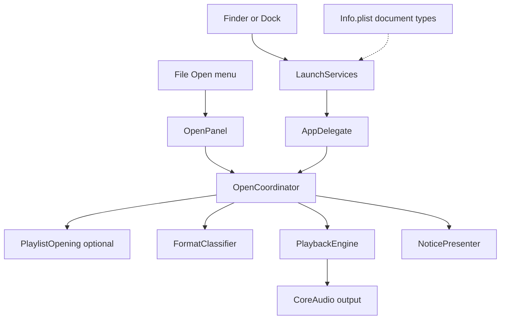
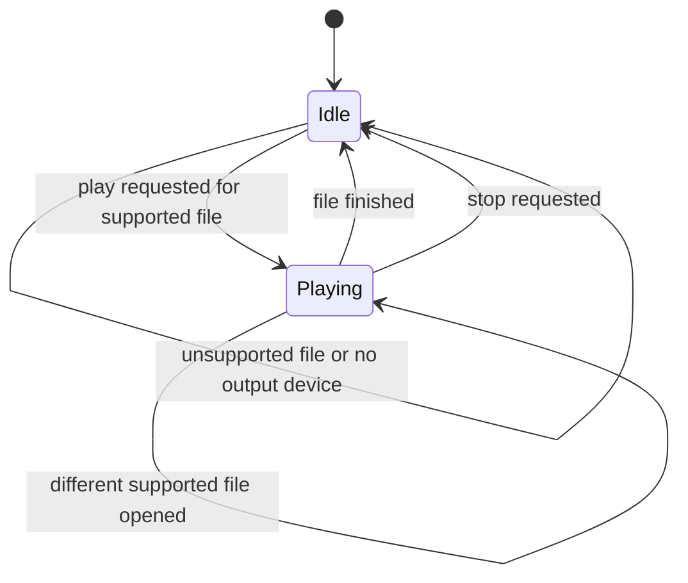
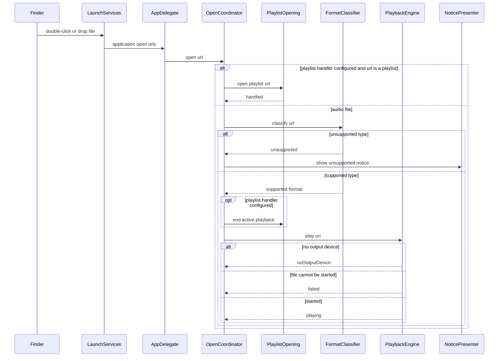
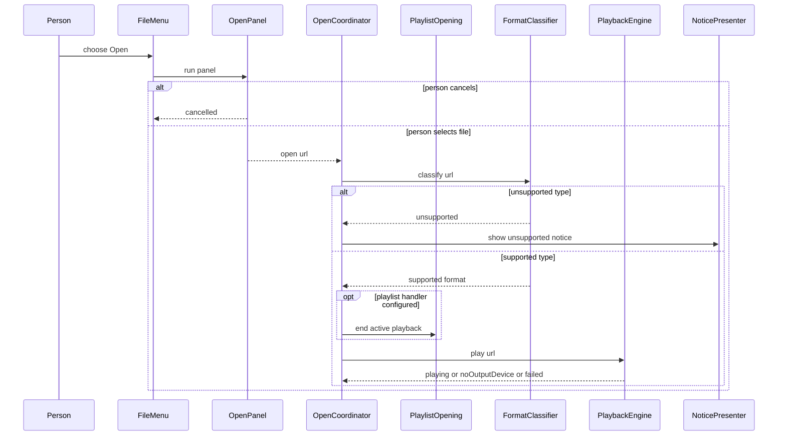

# Technical Design

Open-file handling, format classification, playback engine and unsupported notice for a native Swift macOS 26 app.

## Overview

Native Swift app, macOS 26 minimum, not sandboxed (see docs/tech-architecture.md). No source tree exists yet; every path below is a PROPOSED location in a new SwiftPM package named LocalPlayer rooted at the repo root (`Package.swift`, `Sources/LocalPlayer/...`, `Tests/LocalPlayerTests/...`). Audio decoding and output use AVFoundation behind a small protocol so the engine can be replaced later (the audio engine is not yet designed in docs/tech-architecture.md; AVAudioPlayer is the proposal for this story).

Three entry surfaces (Finder double-click, drop on the app icon, File > Open) converge on one coordinator. If a playlist handler is configured and the URL is a playlist document, the coordinator hands it over before any audio classification; otherwise it classifies the file and either starts playback or shows the unsupported notice. Before it starts playing a supported audio file it asks a configured playlist handler to end any active playlist playback, so a playlist that was playing cannot keep advancing underneath the new file.

Scope notes. The app is document based: each playlist is a document with its own window and there is no main window. This story therefore does NOT decide which window shows a single opened audio file; that is an open question (PRD open question 1) and the engine and coordinator work without knowing it. This story's `PlaybackEngine` has only `play(_:)`, `stop()` and `isPlaying`; pause, resume, seek, position, duration, volume and mute belong to the 'Control playback' story, which extends the same protocol. The playlist document type itself is declared by the playlist-management story, and this story's open-files path only routes to it through the optional `PlaylistOpening` dependency.

## Structure


## State
No persisted state is introduced: nothing is written to disk and no settings change. The only state is the in-memory playback state of the engine:


## Flow 1: open from Finder or the app icon


## Flow 2: open from the File menu


Both flows share OpenCoordinator, so the replace-current-playback and no-copy rules live in one place. The File > Open panel offers audio files only; playlist documents are opened through the standard document open path owned by the playlist-management story.

## Test Strategy

## Test Scopes
- **unit**: FormatClassifier and PlaybackEngine state logic, no audio hardware.
- **integration**: OpenCoordinator with the real FormatClassifier and a real PlaybackEngine against the real file system, with the audio output replaced by a recording sink and the playlist handler replaced by a recording stub. Entry events are delivered by calling the same handlers LaunchServices and the open panel call, so the request-handling boundary in the structure diagram is exercised.
- **e2e**: the built .app is launched and driven from outside (real Finder open via `open -a`, Apple events, UI automation for File > Open). Needed because file association and Dock-drop behaviour exist only in the real app bundle.

## Dimensions crossed
Entry surface (S1 Finder double-click, S2 drop on app icon, S3 File > Open) x file type (F1 mp3, F2 wav, F3 m4a, F4 unsupported flac) x prior state (P1 idle, P2 playing a different file). Equivalence classes for each dimension are exhaustive and non-overlapping: a file is exactly one of supported (F1-F3) or unsupported (F4); the engine is exactly idle or playing. Expected results: supported+idle = plays from 0:00; supported+playing = previous stops, new plays from 0:00; unsupported+idle = notice shown, nothing plays; unsupported+playing = notice shown, previous keeps playing, position unchanged. All rows run with no playlist handler configured, which is the default.

| Ref | Surface | Type | Prior | Expected | Level |
|---|---|---|---|---|---|
| TC-01 | S1 | F1 | P1 | plays from 0:00 | e2e |
| TC-02 | S1 | F1 | P2 | replaces, plays from 0:00 | integration |
| TC-03 | S1 | F2 | P1 | plays from 0:00 | integration |
| TC-04 | S1 | F2 | P2 | replaces, plays from 0:00 | integration |
| TC-05 | S1 | F3 | P1 | plays from 0:00 | integration |
| TC-06 | S1 | F3 | P2 | replaces, plays from 0:00 | integration |
| TC-07 | S1 | F4 | P1 | notice shown, no playback | integration |
| TC-08 | S1 | F4 | P2 | notice shown, previous unchanged | integration |
| TC-09 | S2 | F1 | P1 | plays from 0:00 | e2e |
| TC-10 | S2 | F1 | P2 | replaces, plays from 0:00 | integration |
| TC-11 | S2 | F2 | P1 | plays from 0:00 | integration |
| TC-12 | S2 | F2 | P2 | replaces, plays from 0:00 | integration |
| TC-13 | S2 | F3 | P1 | plays from 0:00 | integration |
| TC-14 | S2 | F3 | P2 | replaces, plays from 0:00 | integration |
| TC-15 | S2 | F4 | P1 | notice shown, no playback | integration |
| TC-16 | S2 | F4 | P2 | notice shown, previous unchanged | integration |
| TC-17 | S3 | F1 | P1 | plays from 0:00 | e2e |
| TC-18 | S3 | F1 | P2 | replaces, plays from 0:00 | integration |
| TC-19 | S3 | F2 | P1 | plays from 0:00 | integration |
| TC-20 | S3 | F2 | P2 | replaces, plays from 0:00 | integration |
| TC-21 | S3 | F3 | P1 | plays from 0:00 | integration |
| TC-22 | S3 | F3 | P2 | replaces, plays from 0:00 | integration |
| TC-23 | S3 | F4 | P1 | notice shown, no playback | integration |
| TC-24 | S3 | F4 | P2 | notice shown, previous unchanged | integration |

## Test Case Design (boundaries and error paths)
| Ref | Capability | Case | Expected | Level |
|---|---|---|---|---|
| TC-30 | open.format.classify | uppercase extension `SONG.MP3` | classified mp3 | unit |
| TC-31 | open.format.classify | file with no extension but mp3 content type | classified from content type, mp3 | unit |
| TC-32 | open.format.classify | double extension `a.flac.mp3` | classified by the final type, mp3 | unit |
| TC-33 | open.format.classify | empty path, directory, nonexistent file | unsupported with reason fileNotReadable | unit |
| TC-34 | playback.engine.play_file | play called twice with different files | state Playing with the second file only | unit |
| TC-35 | playback.engine.play_file | system reports no output device | result noOutputDevice, state stays Idle | unit |
| TC-36 | playback.engine.play_file | file finishes | state Idle | unit |
| TC-37 | playback.engine.play_file | file of supported type that cannot be started | result failed, state stays as before | unit |
| TC-38 | open.unsupported.notice | unsupported notice shown twice in a row | one notice at a time, dismiss closes it | integration |
| TC-39 | open.association.register | built bundle declares document types | exactly the three audio types (mp3, wav, m4a) plus the playlist document type declared by the playlist-management story, and nothing else | integration |
| TC-40 | open.file.read_only | open each of F1-F3 then compare checksum, size, modification time and location | all unchanged, no copy exists anywhere in the app support directory | integration |
| TC-41 | open.unsupported.notice | show a saveFailed notice with the text `could not be saved` | exactly one notice with that text and a dismiss action, no unsupported wording | integration |
| TC-42 | open.unsupported.notice | show an unsupported notice then a saveFailed notice without dismissing | one notice at a time, the second replaces the first | integration |
| TC-43 | open.entry.receive | OpenCoordinator built with no playlist handler, given a playlist document URL | falls through to audio classification, so the unsupported notice is shown and nothing else changes | integration |
| TC-44 | open.entry.receive | OpenCoordinator built with a playlist handler, given a playlist document URL | handler called once with the URL before classification, classifier, engine and notice are not called | integration |
| TC-45 | open.entry.receive | OpenCoordinator built with a playlist handler, given an mp3 URL | the handler's open is not called and mp3 plays as in TC-01 | integration |
| TC-46 | open.entry.receive | OpenCoordinator built with a playlist handler, given in turn a supported audio URL, an unsupported URL and a playlist document URL | `endActivePlayback()` is called exactly once for the supported URL and before the engine play call; it is not called for the unsupported URL or the playlist URL; with no handler configured it is never called | integration |

## Negative Scenarios
| Ref | Case | Must NOT happen | Level |
|---|---|---|---|
| TC-50 | unsupported file opened while playing | current playback must not stop or restart | integration |
| TC-51 | no output device | no audio output call is made and no crash occurs | integration |
| TC-52 | any open | no import dialog, library prompt or confirmation appears | e2e |
| TC-53 | any open of an audio file | no playlist is created or modified | integration |
| TC-54 | File > Open cancelled | playback state does not change | integration |

## Mock vs Integration Boundaries
| Component | Real or mocked | Reason |
|---|---|---|
| File system | real, temporary directory with real fixture files | the no-copy and unreadable-file behaviour is under test |
| FormatClassifier | real | pure logic, cheap |
| LaunchServices and Finder | real only in e2e; replaced by direct handler calls in integration | the real service cannot be driven reliably inside a test process |
| Audio output hardware | replaced by a recording sink in unit and integration; real in e2e | CI machines have no output device and the sink lets tests assert what would be played |
| OpenPanel | replaced by a stub returning a chosen URL in integration; real in e2e | a modal panel blocks the test process |
| PlaylistOpening | recording stub in integration (records open, canOpen and endActivePlayback calls and their order relative to the engine); absent in e2e of this story | the real playlist handler belongs to the playlist stories, and this story only tests the hand-over |
| NoticePresenter | recording stub in other integration tests; real alert in TC-38, TC-41, TC-42 and e2e | those cases assert the presented content itself |

## E2E Workflows
| Ref | Workflow | Asserts |
|---|---|---|
| E2E-1 | `open -a LocalPlayer song.mp3` from a cold start | app launches and audio starts for song.mp3 |
| E2E-2 | drop file on the app icon while another plays | previous stops, new plays from 0:00 |
| E2E-3 | File > Open, choose song.m4a | audio starts for song.m4a |
| E2E-4 | open a .flac | message says not supported yet and why |

## Fixtures
Real files: a 30-second mp3, wav and m4a encoded from the same source with real tags and a cover image, a 0-byte file named `empty.mp3`, a real .flac, and a real playlist document file produced once the playlist-management story provides its writer (until then a file with the proposed `.lplaylist` extension and realistic content). Files are generated by the system encoder at test setup, not hand-written byte stubs.

## Deliberately not covered
Corrupt files opened alone, output-device changes during playback, opening several files at once, files whose content type disagrees with their extension, which window shows a single opened audio file (PRD open question 1), pause, seek, position and volume (the 'Control playback' story), what the playlist handler does with a playlist and how it ends playlist playback (the playlist stories), and launch-time or play-latency thresholds (separate story). A passing run here does not claim any of these.

## open.association.register

> Anchor: `open.association.register`

## Contract
Inputs: the built app bundle.
Outputs: the bundle declares document types for mp3, wav and m4a, plus the playlist document type that the playlist-management story declares, and nothing else. The three audio declarations are what make Finder offer the app for those files, deliver a double-click to the app as an open-files event, and route a drop on the app icon to the same event. The event is received by `open.entry.receive` (AppDelegate), which hands each URL to the OpenCoordinator; for a supported file the coordinator calls `playback.engine.play_file`, so the file starts playing. Without these declarations neither the double-click nor the icon drop reaches the app at all, so they are a required link in the chain for `prd.open.finder` and `prd.open.drag`. The playlist document type is owned and declared by the playlist-management story; this story only asserts that it is the one and only addition.
Errors: none at runtime; a missing or wrong declaration is caught by tests.
Side effects: none at runtime.

## Implementation
Proposed file: `Resources/Info.plist` with `CFBundleDocumentTypes` listing UTTypes `public.mp3`, `com.microsoft.waveform-audio` and `public.mpeg-4-audio`, role Viewer. The playlist document type entry (proposed extension `.lplaylist`) is added by the playlist-management story to the same file. Setting the app as the DEFAULT handler is a user choice in Finder; the app does not change system defaults silently.

## Tests
TC-39 (declared types are exactly the three audio types plus the playlist document type), E2E-1 (double-click path starts playback), E2E-2 (icon drop starts playback).

## open.format.classify

> Anchor: `open.format.classify`

## Contract
Inputs: a file URL.
Outputs: `supported(format)` where format is mp3, wav or m4a, or `unsupported(reason)` where reason is `unknownType(typeDescription)` or `fileNotReadable`.
This capability defines the exact set of supported formats (mp3, wav, m4a) and is the single decision point: a `supported` result is the only way a file reaches `playback.engine.play_file`, which decodes and plays those three formats; an `unsupported` result is the only way the `open.unsupported.notice` message is triggered, with the reason text that explains why the file is not supported yet. Together with those two capabilities it delivers `prd.open.formats` and `prd.open.unsupported` end to end.
Errors: nonexistent path, directory or unreadable file return `unsupported(fileNotReadable)`; never throws.
Side effects: none; reads file metadata only.

## Implementation
Proposed file: `Sources/LocalPlayer/Open/FormatClassifier.swift`.
```swift
enum SupportedFormat { case mp3, wav, m4a }
enum UnsupportedReason: Equatable { case unknownType(String), fileNotReadable }
enum FormatClassification { case supported(SupportedFormat), unsupported(UnsupportedReason) }
protocol FormatClassifying { func classify(_ url: URL) -> FormatClassification }
```
Classification uses the file's system content type, falling back to the extension, case-insensitively. A content type that disagrees with the extension is not specified by this story.

## Tests
TC-30 to TC-33, and the type column of TC-01 to TC-24.

## playback.engine.play_file

> Anchor: `playback.engine.play_file`

## Contract
Inputs: a file URL already classified as supported (mp3, wav or m4a).
Outputs: `PlayResult` = `.playing`, `.noOutputDevice` or `.failed(reason)`.
Format handling: the engine decodes and plays mp3, wav and m4a through the system audio framework; no other type is ever passed to it because `open.format.classify` filters first.
Replace behaviour: when a file is already playing, `play` stops it and starts the new file from its beginning (0:00), with no queue and no confirmation.
Errors: no system output device returns `.noOutputDevice` and starts nothing; a file that cannot be started returns `.failed` and leaves the previous playback exactly as it was.
Side effects: emits state changes Idle <-> Playing; when a file ends the state returns to Idle.
Scope: this story's contract is limited to `play(_:)`, `stop()` and `isPlaying`. Pause, resume, seek, position, duration, volume and mute are added to the same protocol by the 'Control playback' story and are not specified or tested here.

## Implementation
Proposed files: `Sources/LocalPlayer/Playback/PlaybackEngine.swift` (protocol and state) and `Sources/LocalPlayer/Playback/AVPlaybackEngine.swift` (AVFoundation implementation).
```swift
enum PlayResult: Equatable { case playing, noOutputDevice, failed(String) }
protocol PlaybackEngine: AnyObject {
  var isPlaying: Bool { get }
  func play(_ url: URL) -> PlayResult
  func stop()
}
```
The protocol is shared: the 'Control playback' story extends it with the transport and volume members, so conforming types and test doubles in this story must be written so those additions are easy to adopt (no assumptions that these three members are the whole protocol). Output-device presence is read from the system default output device rather than guessed from a playback error. Audio is rendered on AVFoundation's own thread; the engine does not allocate in any render callback it owns.

## Tests
TC-34 to TC-37, TC-51, and the replace rows of TC-01 to TC-24 with all three supported formats as the new file.

## open.unsupported.notice

> Anchor: `open.unsupported.notice`

## Contract
Inputs: a `Notice`, either `unsupported(UnsupportedReason)` or `saveFailed(String)`. This story owns the notice mechanism; later stories add cases to the same enum.
Outputs: for `unsupported`, a single message that says the file type is not supported yet and why, naming the supported types (MP3, WAV, M4A), with one dismiss action (this is the behaviour `prd.open.unsupported` requires, delivered when `open.entry.receive` calls the presenter for an unsupported file). For `saveFailed`, a single message that says the change could not be saved and includes the supplied reason, with one dismiss action; it never uses the unsupported wording.
Errors: none.
Side effects: shown over the app window; does not touch playback. Only one notice is visible at a time; showing a second replaces the first.

## Implementation
Proposed file: `Sources/LocalPlayer/Open/NoticePresenter.swift`, presenting a standard macOS alert sheet so the message follows system design guidelines.
```swift
enum Notice: Equatable {
  case unsupported(UnsupportedReason)
  case saveFailed(String)
}
protocol NoticePresenting: AnyObject {
  func show(_ notice: Notice)
}
```
The unsupported text is built from the reason returned by the classifier; the saveFailed text is `could not be saved` plus the supplied reason. The presenter holds at most one notice.

## Tests
TC-07, TC-08, TC-38 (unsupported shown twice, one at a time), TC-41 (saveFailed content), TC-42 (second notice replaces the first), TC-50, E2E-4.

## open.entry.receive

> Anchor: `open.entry.receive`

## Contract
Inputs: file URLs from the application's open-files event (Finder double-click, drop on icon) or from the File > Open panel.
Outputs: if a playlist handler is configured and the URL is a playlist document, the URL is handed to that handler before any audio classification, and nothing else happens in this capability. Otherwise, for a supported audio file, the coordinator first asks a configured playlist handler to end any active playlist playback (`endActivePlayback()`), then calls the playback engine (so a Finder double-click, an icon drop and a File > Open choice all start playing that file, which is what `prd.open.finder`, `prd.open.drag` and `prd.open.menu` require, and a playlist that was playing does not keep advancing underneath the new file, which is what `prd.open.replace` requires); for an unsupported file, a call to the notice presenter and no engine call and no `endActivePlayback()` call. With no playlist handler configured (the default) a playlist URL is treated like any other file and goes through classification, and no `endActivePlayback()` call is made.
Errors: cancelling the panel does nothing; an empty URL list does nothing.
Side effects: none on disk, no playlist change. If several URLs arrive together the behaviour is not specified by this story. Which window shows a single opened audio file is not decided (PRD open question 1) and is not needed here.

## Implementation
Proposed files: `Sources/LocalPlayer/App/AppDelegate.swift` (open-files event and File > Open menu item) and `Sources/LocalPlayer/Open/OpenCoordinator.swift` (the shared path). The File menu Open item is added to the main menu in code and its panel offers audio files only.
```swift
protocol PlaylistOpening: AnyObject {
  func canOpen(_ url: URL) -> Bool
  func open(_ url: URL)
  func endActivePlayback()
}
final class OpenCoordinator {
  init(classifier: FormatClassifying, engine: PlaybackEngine, notices: NoticePresenting,
       playlists: PlaylistOpening? = nil)
  func open(_ url: URL)
}
```
The new `playlists` parameter defaults to nil so existing construction of the coordinator is unchanged. The playlist stories supply the real `PlaylistOpening` (the playlist-open story's `PlaylistOpenRouter`, which implements `endActivePlayback()` by ending the active playlist session of the playlist-playback story); its source lives under `Sources/LocalPlayer/Playlists/`. This story only defines the protocol and calls it.

## Tests
TC-01 to TC-24, TC-43 to TC-46, TC-52 to TC-54, E2E-1 to E2E-3.

## open.file.read_only

> Anchor: `open.file.read_only`

## Contract
Inputs: any file URL passed to the open path.
Outputs: none.
Errors: none.
Side effects: none. The file is opened read-only, never copied into an app library, never moved, never rewritten, and its metadata and modification time are unchanged.

## Implementation
The engine and classifier open files for reading only. No code path in this story writes to the user's file or creates a copy. Enforced by the test below rather than by a runtime guard.

## Tests
TC-40, TC-53.

