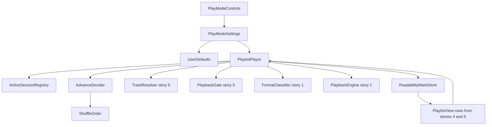
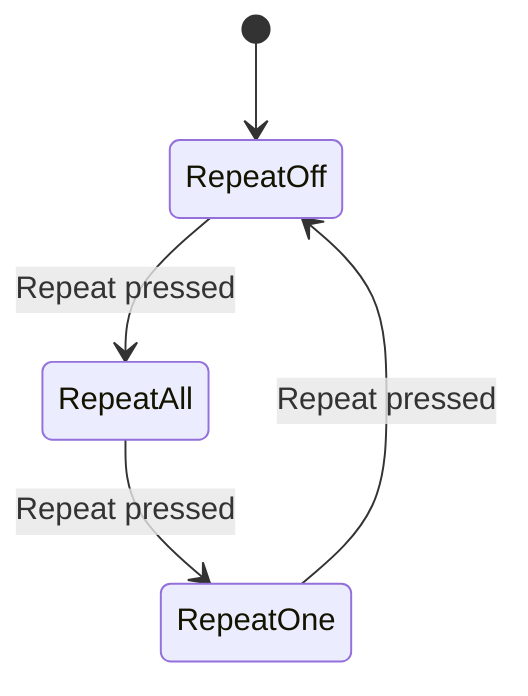
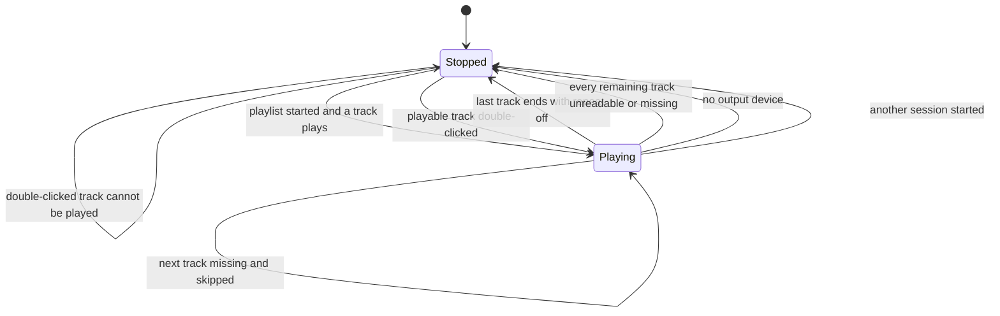
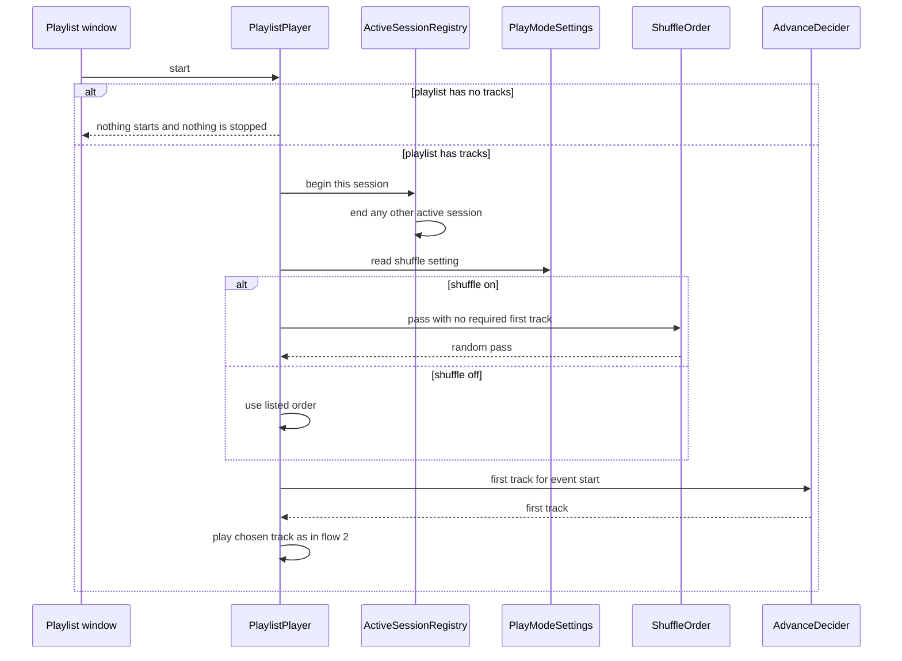
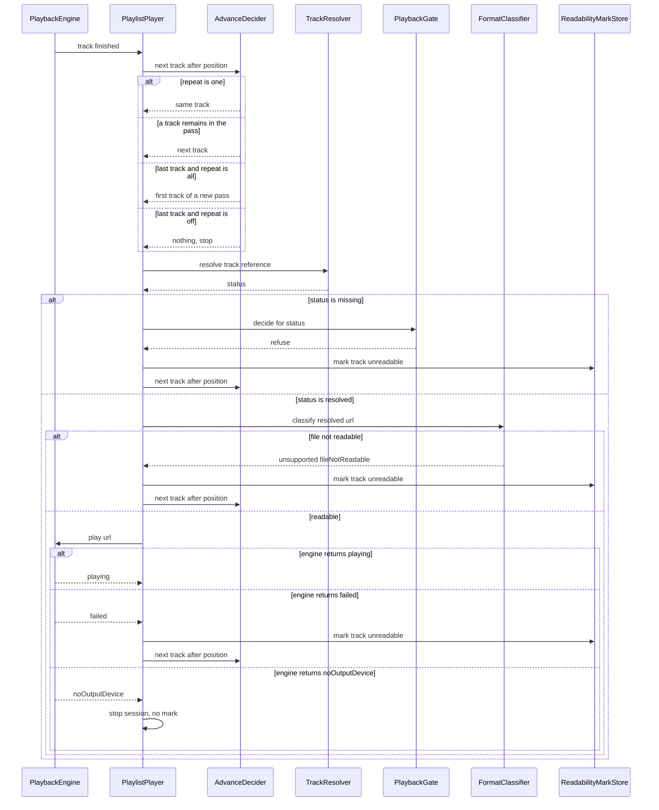
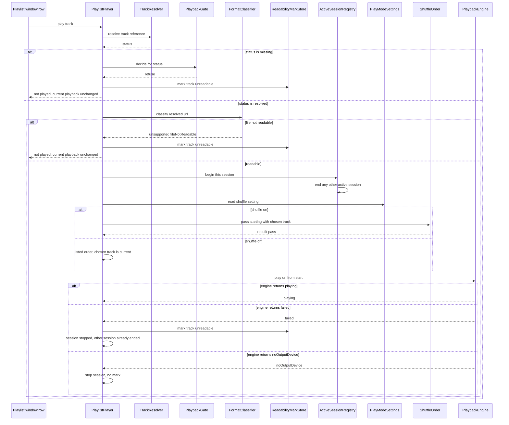
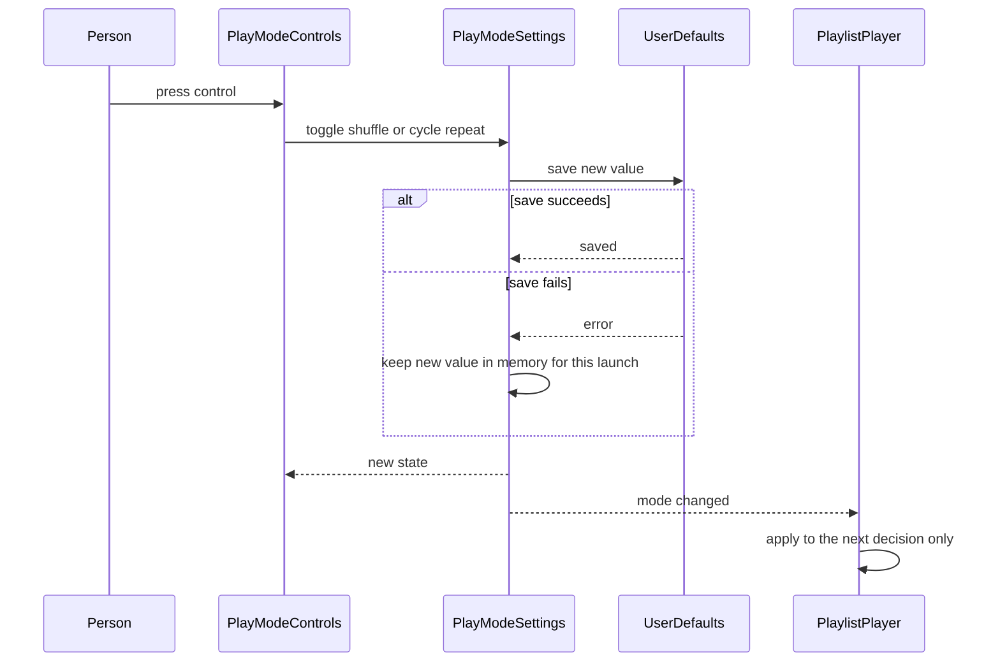
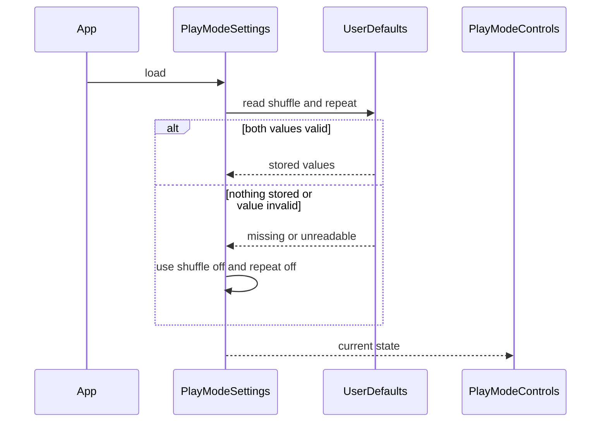

# Technical Design

Playlist session that advances, shuffles, repeats, skips unreadable tracks and persists two independent mode settings.

## Overview

Native Swift, macOS 26 minimum, not sandboxed. This story builds on story 1 (`PlaybackEngine`, `PlayResult`, `FormatClassifying`, `NoticePresenting`) and on types it does NOT redefine: the playlist model owned by the managing-playlists story (story 4), `Playlist { tracks: [Track] }` where the playlist name is its file name and `Track { id: UUID, reference: TrackReference }`; and `TrackReference`, `TrackResolving`, `TrackStatus { resolved(URL), missing }` and `PlaybackGating` owned by the missing-files story (story 5). No source tree exists yet; every path is a PROPOSED location under the package from story 1 (`Sources/LocalPlayer/Playlists/...`, `Sources/LocalPlayer/UI/...`, `Tests/LocalPlayerTests/...`). The directory name is `Playlists` (plural) throughout.

The app is document-based: each playlist is its own document with its own window, and there is no main window and no playlist list. Each open playlist document owns one `PlaylistPlayer`, the single session type for playback of a playlist. All players share one `PlaybackEngine` and one `ActiveSessionRegistry`. When a player starts or plays a chosen track, the registry ends whichever other player is active, so only one thing plays at a time (owner decision, confirmed). Ending a session detaches it from the engine's events so it no longer advances; the audio itself is replaced by the next `play` call on the shared engine. Runtime identity of a player is the open document; nothing is derived from a file path. Ending the active session when a single audio file is opened goes through story 1's `PlaylistOpening.endActivePlayback()`, which story 3's router implements by calling `ActiveSessionRegistry.endActive()` (PROVISIONAL interface); this story only provides `endActive()`.

A `PlaylistPlayer` starts and advances like this. `start()` reads `PlayModeSettings` directly, then asks `AdvanceDecider` for the first track: with shuffle off the first listed track, with shuffle on the first track of a random `ShuffleOrder` pass. `play(track:)` is the entry for a person double-clicking a row: the chosen track plays from 0:00 and becomes the current track, and with shuffle on the pass is rebuilt so that it starts at that track, which is the same rule as turning shuffle on mid-song. After each track ends the decider chooses what plays next from the current position, the repeat mode, the shuffle setting and the pass; the same decider answers Next and Previous (`skipForward`, `skipBackward`) for the control-playback story. For every chosen track the player asks `TrackResolving` for its status. A `missing` track is refused by `PlaybackGating`, recorded as unplayable with a `ReadabilityMark.unreadable` mark (the hazard icon, in addition to the grey look story 5 gives it) and skipped (owner decision, confirmed). A `resolved` track is classified and, if readable, handed to the engine. If the file cannot be read, or the engine returns `failed`, the player records the same mark for that track and asks the decider again. The mark means 'could not be played this session' and covers both missing and unreadable files. Two settings, shuffle (on/off) and repeat (off/all/one), are held by `PlayModeSettings`, shown by `PlayModeControls` in every playlist window and saved to the user defaults. Refreshed references returned by the resolver are handed back through the playlist document's normal update path owned by stories 4 and 5; this story never writes playlist files. The track rows, including the hazard icon, are drawn by story 5's `PlaylistTrackRow` inside story 4's `PlaylistView`, which also forwards a double-click on a row to `PlaylistPlayer.play(track:)`; this story only publishes the `ReadabilityMark`.

Decisions confirmed by the owner: only one session plays at a time; a missing track is skipped and marked with the hazard icon; turning shuffle on mid-song keeps the current track playing and shuffles the tracks after it; turning it off continues in listed order from the current track; next with repeat one moves to the following track; double-clicking a track plays it. A shuffle pass is a random permutation in which each track appears once, and the end of a pass is handled by the repeat mode, so with repeat all a new pass starts. Previous (`skipBackward`) steps to the preceding track of the order or pass; at the first track it goes to the last track when repeat is on (all or one) and does nothing when repeat is off; with shuffle on it steps backward through the current shuffle pass with the same first-track rule. That reading of the owner's words ('last track if it's on repeat, nothing if not, previous random if random') is an INTERPRETATION pending owner confirmation. Remaining assumptions, flagged so they are not mistaken for decisions: (1) the two settings are shared by all playlist windows (PROVISIONAL); (2) a double-click on a track that cannot be played leaves anything already playing unchanged, and that is an interpretation pending owner confirmation; (3) which window hosts playback when a single audio file is opened is an open question and not decided here. The shuffle rules are isolated behind `ShuffleOrder` so they can change without touching the rest.

## Structure


## State: repeat mode
Repeat mode is persisted (see `playlist.settings.persist`), so its transitions are shown. Shuffle is a two-state value that toggles on a press and is not drawn separately.


## State: playlist session
The session is in memory only and is not persisted. One session exists per open playlist document, and only one is active at a time.


## Flow 1: a playlist is started


## Flow 2: a track ends and the next one is played


## Flow 3: the person double-clicks a track


## Flow 4: person presses Shuffle or Repeat


## Flow 5: app launch restores the settings


## Test Strategy

## Test Scopes
- **unit**: `AdvanceDecider`, `ShuffleOrder`, `ActiveSessionRegistry` and `PlayModeSettings` state logic with an injected seeded random generator, an in-memory `Playlist` and no audio.
- **integration**: `PlaylistPlayer` with the real `AdvanceDecider`, `ShuffleOrder`, `PlayModeSettings`, `FormatClassifier` and `PlaybackGate`, a real `UserDefaults` suite created per test, real fixture files, a stubbed `TrackResolving` (so a track can be made missing without moving real files; real bookmark resolution is tested in story 5) and a recording audio sink as the engine output. This exercises the request-handling boundary in the structure diagram (engine events in, play calls out, defaults read and written, a row double-click in). Two `PlaylistPlayer` values share one registry to model two open playlist windows.
- **e2e**: the built app is launched and driven from outside (open, UI automation). Needed because the hazard icon, the control states, the double-click on a row, two playlist windows and relaunch persistence exist only in the real windows and process.

## Dimensions crossed
Advance matrix: repeat mode (R-off, R-all, R-one) x shuffle (S-off, S-on) x event (E1 a track ends with a track remaining, E2 the last track ends, E3 the playlist is started). The classes are exhaustive and non-overlapping: repeat is exactly one of three values, shuffle exactly one of two, and a given moment is exactly one of the three events. Playlist under test: 5 tracks. Shuffle rows use a seeded generator, so the permutation is known and asserted exactly.

| Ref | Repeat | Shuffle | Event | Expected | Level |
|---|---|---|---|---|---|
| TC-01 | R-off | S-off | E1 | next track in listed order | unit |
| TC-02 | R-off | S-off | E2 | stop, state Stopped | unit |
| TC-03 | R-off | S-off | E3 | first listed track plays | unit |
| TC-04 | R-off | S-on | E1 | next track of the seeded permutation | unit |
| TC-05 | R-off | S-on | E2 | end of the pass, stop | unit |
| TC-06 | R-off | S-on | E3 | first track of the seeded permutation plays, not necessarily track 1 | unit |
| TC-07 | R-all | S-off | E1 | next track in listed order | unit |
| TC-08 | R-all | S-off | E2 | first listed track plays again | unit |
| TC-09 | R-all | S-off | E3 | first listed track plays | unit |
| TC-10 | R-all | S-on | E1 | next track of the seeded permutation | unit |
| TC-11 | R-all | S-on | E2 | a new permutation pass starts and its first track plays | unit |
| TC-12 | R-all | S-on | E3 | first track of the seeded permutation plays | unit |
| TC-13 | R-one | S-off | E1 | the same track plays again | unit |
| TC-14 | R-one | S-off | E2 | the same track plays again | unit |
| TC-15 | R-one | S-off | E3 | first listed track plays | unit |
| TC-16 | R-one | S-on | E1 | the same track plays again | unit |
| TC-17 | R-one | S-on | E2 | the same track plays again | unit |
| TC-18 | R-one | S-on | E3 | first track of the seeded permutation plays | unit |
| TC-19 | R-off | S-off | E1 then E2 | full 5-track run through real engine sink: tracks 1 to 5 in order, then Stopped | integration |
| TC-20 | R-all | S-off | E2 | full run: after track 5 the sink shows track 1 again | integration |
| TC-21 | R-one | S-off | E1 | sink shows track 1 played three times in a row | integration |
| TC-22 | R-off | S-on | E1 then E2 | sink shows every track exactly once in a seeded order, then Stopped | integration |

## Start cases
Dimensions crossed: shuffle (S-off, S-on) x other playback (idle, another session playing) x playlist size (0, 1 or 5 tracks). The classes are exhaustive and non-overlapping: shuffle is exactly on or off; at the moment of start another session is exactly active or not; a playlist has exactly 0, 1 or more tracks. Two players share one registry in the rows with another session playing.

| Ref | Shuffle | Other playback | Tracks | Expected | Level |
|---|---|---|---|---|---|
| TC-80 | S-off | idle | 0 | nothing starts, state Stopped | unit |
| TC-81 | S-off | idle | 1 | the only track plays | unit |
| TC-82 | S-off | idle | 5 | first listed track plays | unit |
| TC-83 | S-off | another playing | 0 | nothing starts, the other session keeps playing untouched | integration |
| TC-84 | S-off | another playing | 1 | other session ended, the only track plays | integration |
| TC-85 | S-off | another playing | 5 | other session ended, first listed track plays | integration |
| TC-86 | S-on | idle | 0 | nothing starts, state Stopped | unit |
| TC-87 | S-on | idle | 1 | the only track plays | unit |
| TC-88 | S-on | idle | 5 | first track of the seeded pass plays, not necessarily track 1 | unit |
| TC-89 | S-on | another playing | 0 | nothing starts, the other session keeps playing untouched | integration |
| TC-90 | S-on | another playing | 1 | other session ended, the only track plays | integration |
| TC-91 | S-on | another playing | 5 | other session ended, first track of the seeded pass plays | integration |
| TC-103 | any | player A active, player B begins | registry ends A exactly once and B is the only active session | unit |

## Play-track cases (double-click on a row)
Dimensions crossed: shuffle (S-off, S-on) x other playback (O-idle nothing playing, O-same another track of this playlist playing, O-other a track of a different playlist playing) x chosen track (T-ok playable, T-miss file missing, T-bad file unreadable). The classes are exhaustive and non-overlapping: shuffle is exactly on or off; at the moment of the double-click exactly one of the three playback situations holds; a chosen track is exactly playable, missing or unreadable. Playlist under test: 5 tracks, the chosen track is track 3, a seeded generator makes the shuffle pass known. A playable chosen track always plays from 0:00 and becomes the current track. A missing or unreadable chosen track is not played, is marked with the hazard icon (`ReadabilityMark.unreadable`) and leaves anything already playing unchanged and the registry untouched (interpretation pending owner confirmation).

| Ref | Shuffle | Other playback | Chosen track | Expected | Level |
|---|---|---|---|---|---|
| TC-110 | S-off | O-idle | T-ok | track 3 plays from 0:00, then track 4 follows when it ends | integration |
| TC-111 | S-off | O-idle | T-miss | gate refuses, track 3 marked, nothing plays, engine never called | integration |
| TC-112 | S-off | O-idle | T-bad | classifier says not readable, track 3 marked, nothing plays | integration |
| TC-113 | S-off | O-same | T-ok | previous track stops advancing, track 3 plays from 0:00, track 4 follows | integration |
| TC-114 | S-off | O-same | T-miss | track 3 marked, the track already playing carries on unchanged | integration |
| TC-115 | S-off | O-same | T-bad | track 3 marked, the track already playing carries on unchanged | integration |
| TC-116 | S-off | O-other | T-ok | other session ended exactly once, track 3 plays from 0:00 | integration |
| TC-117 | S-off | O-other | T-miss | track 3 marked, the other session keeps playing and stays active | integration |
| TC-118 | S-off | O-other | T-bad | track 3 marked, the other session keeps playing and stays active | integration |
| TC-119 | S-on | O-idle | T-ok | track 3 plays from 0:00, then the remaining four follow in the seeded order, each once | integration |
| TC-120 | S-on | O-idle | T-miss | track 3 marked, nothing plays, no pass built | integration |
| TC-121 | S-on | O-idle | T-bad | track 3 marked, nothing plays, no pass built | integration |
| TC-122 | S-on | O-same | T-ok | pass rebuilt starting at track 3, previous track stops advancing, track 3 plays from 0:00 | integration |
| TC-123 | S-on | O-same | T-miss | track 3 marked, current track and its pass unchanged | integration |
| TC-124 | S-on | O-same | T-bad | track 3 marked, current track and its pass unchanged | integration |
| TC-125 | S-on | O-other | T-ok | other session ended exactly once, pass rebuilt starting at track 3, track 3 plays from 0:00 | integration |
| TC-126 | S-on | O-other | T-miss | track 3 marked, the other session keeps playing and stays active | integration |
| TC-127 | S-on | O-other | T-bad | track 3 marked, the other session keeps playing and stays active | integration |
| TC-128 | S-off | O-idle | T-ok | double-click on a real row plays that track in the real app | e2e |
| TC-129 | S-off | O-same | T-miss | double-click on a missing row shows the hazard icon and the music carries on | e2e |
| TC-132 | any | engine returns failed after the other session was ended | track marked, this session Stopped, no crash (edge: the other playback is already gone) | integration |
| TC-133 | any | engine returns noOutputDevice | no mark, session Stopped | integration |
| TC-134 | S-off | O-idle | chosen track is the last of the playlist, repeat off | plays, then Stopped when it ends | integration |
| TC-135 | S-on | O-idle | one-track playlist | the only track plays, pass holds one track | unit |

## Skip forward and skip backward cases (decider level)
Dimensions crossed: event (skipForward, skipBackward) x position of the current track (first, middle, last of a 5-track order) x repeat (R-off, R-all, R-one) x shuffle (S-off, S-on). The classes are exhaustive and non-overlapping: each event, position, repeat value and shuffle value is exactly one of its set. With shuffle on the order is the seeded pass P1 to P5 and the positions are positions in that pass; with shuffle off the order is the listed order T1 to T5. The control-level tests for Next and Previous live in the control-playback story; these rows pin the decider's answers. Owner decisions: next with repeat one moves to the following track; previous at the first track goes to the last track when repeat is on and does nothing when repeat is off. Interpretation pending owner confirmation: repeat on means all or one; random means stepping back through the shuffle pass; next at the last track with repeat one wraps like repeat all.

| Ref | Event | Position | Repeat | Shuffle | Expected | Level |
|---|---|---|---|---|---|---|
| TC-140 | skipForward | first | R-off | S-off | T2 plays | unit |
| TC-141 | skipForward | first | R-off | S-on | P2 plays | unit |
| TC-142 | skipForward | first | R-all | S-off | T2 plays | unit |
| TC-143 | skipForward | first | R-all | S-on | P2 plays | unit |
| TC-144 | skipForward | first | R-one | S-off | T2 plays, not a replay of T1 | unit |
| TC-145 | skipForward | first | R-one | S-on | P2 plays, not a replay of P1 | unit |
| TC-146 | skipForward | middle | R-off | S-off | T4 plays | unit |
| TC-147 | skipForward | middle | R-off | S-on | P4 plays | unit |
| TC-148 | skipForward | middle | R-all | S-off | T4 plays | unit |
| TC-149 | skipForward | middle | R-all | S-on | P4 plays | unit |
| TC-150 | skipForward | middle | R-one | S-off | T4 plays, not a replay of T3 | unit |
| TC-151 | skipForward | middle | R-one | S-on | P4 plays, not a replay of P3 | unit |
| TC-152 | skipForward | last | R-off | S-off | stop | unit |
| TC-153 | skipForward | last | R-off | S-on | stop | unit |
| TC-154 | skipForward | last | R-all | S-off | T1 plays | unit |
| TC-155 | skipForward | last | R-all | S-on | first track of a newly built pass plays | unit |
| TC-156 | skipForward | last | R-one | S-off | T1 plays (interpretation: wraps like repeat all) | unit |
| TC-157 | skipForward | last | R-one | S-on | first track of a newly built pass plays (interpretation) | unit |
| TC-158 | skipBackward | first | R-off | S-off | stay, playback exactly as it is | unit |
| TC-159 | skipBackward | first | R-off | S-on | stay, playback exactly as it is | unit |
| TC-160 | skipBackward | first | R-all | S-off | T5 plays, the last listed track | unit |
| TC-161 | skipBackward | first | R-all | S-on | P5 plays, the last track of the current pass | unit |
| TC-162 | skipBackward | first | R-one | S-off | T5 plays, the last listed track | unit |
| TC-163 | skipBackward | first | R-one | S-on | P5 plays, the last track of the current pass | unit |
| TC-164 | skipBackward | middle | R-off | S-off | T2 plays | unit |
| TC-165 | skipBackward | middle | R-off | S-on | P2 plays | unit |
| TC-166 | skipBackward | middle | R-all | S-off | T2 plays | unit |
| TC-167 | skipBackward | middle | R-all | S-on | P2 plays | unit |
| TC-168 | skipBackward | middle | R-one | S-off | T2 plays, not a replay of T3 | unit |
| TC-169 | skipBackward | middle | R-one | S-on | P2 plays, not a replay of P3 | unit |
| TC-170 | skipBackward | last | R-off | S-off | T4 plays | unit |
| TC-171 | skipBackward | last | R-off | S-on | P4 plays | unit |
| TC-172 | skipBackward | last | R-all | S-off | T4 plays | unit |
| TC-173 | skipBackward | last | R-all | S-on | P4 plays | unit |
| TC-174 | skipBackward | last | R-one | S-off | T4 plays | unit |
| TC-175 | skipBackward | last | R-one | S-on | P4 plays | unit |
| TC-176 | skipBackward | only track of a 1-track playlist | R-off | any | stay | unit |
| TC-177 | skipBackward | only track of a 1-track playlist | R-all | any | the same track plays again (it is the last track of the order) | unit |
| TC-178 | skipForward | only track of a 1-track playlist | R-off | any | stop | unit |
| TC-179 | skipForward | only track of a 1-track playlist | R-all | any | the same track plays again | unit |
| TC-180 | skipForward | empty playlist | any | any | stop | unit |
| TC-181 | skipBackward | empty playlist | any | any | stay | unit |

## Controls and settings cases
Dimension crossed: control (Shuffle, Repeat) x prior state x press count.

| Ref | Case | Expected | Level |
|---|---|---|---|
| TC-30 | Repeat pressed from off | state all, control shows all | unit |
| TC-31 | Repeat pressed from all | state one, control shows one | unit |
| TC-32 | Repeat pressed from one | state off, control shows off | unit |
| TC-33 | Repeat pressed three times from off | back to off (boundary of the cycle) | unit |
| TC-34 | Shuffle pressed from off | on | unit |
| TC-35 | Shuffle pressed from on | off | unit |
| TC-36 | Repeat pressed while shuffle is on | shuffle still on, only repeat changed | unit |
| TC-37 | Shuffle pressed while repeat is all | repeat still all, only shuffle changed | unit |
| TC-38 | Either control pressed while a track plays | the track keeps playing without restarting, position unchanged | integration |
| TC-39 | Shuffle turned on mid-playback of track 3 | track 3 keeps playing, remaining tracks follow the seeded permutation that starts at track 3 (owner decision) | integration |
| TC-40 | Shuffle turned off mid-playback of track 3 | track 3 keeps playing, then track 4 plays (owner decision) | integration |
| TC-104 | Shuffle pressed in playlist window A while window B is open | window B control shows the same state (settings shared, provisional) | integration |

## Persistence cases
Dimension crossed: stored shuffle x stored repeat, then missing and invalid values. An isolated defaults suite is used per test.

| Ref | Stored shuffle | Stored repeat | Expected on launch | Level |
|---|---|---|---|---|
| TC-50 | off | off | off and off | integration |
| TC-51 | off | all | off and all | integration |
| TC-52 | off | one | off and one | integration |
| TC-53 | on | off | on and off | integration |
| TC-54 | on | all | on and all | integration |
| TC-55 | on | one | on and one | integration |
| TC-56 | nothing stored | nothing stored | off and off (first launch) | integration |
| TC-57 | on | unrecognised text value | shuffle on, repeat off (invalid value falls back individually) | integration |
| TC-58 | wrong type of value | one | shuffle off, repeat one | integration |
| TC-59 | save to defaults fails during a press | new value kept for this launch, UI shows it | unit |

## Unreadable track cases
Dimension crossed: position of the unreadable track x number of unreadable tracks, repeat off, shuffle off. A track is unreadable when the engine returns `failed` or the classifier returns `fileNotReadable` for its resolved file. The stubbed resolver returns `resolved` for these tracks.

| Ref | Case | Expected | Level |
|---|---|---|---|
| TC-60 | track 3 of 5 unreadable | track 3 marked, track 4 plays, no dialog | integration |
| TC-61 | last track unreadable, reached by advance | marked, session stops (repeat off) | integration |
| TC-62 | first track unreadable at playlist start | marked, track 2 plays | integration |
| TC-63 | only track unreadable | marked, session stops, no loop because repeat is off | integration |
| TC-64 | tracks 2 and 3 unreadable in a row | both marked, track 4 plays | integration |
| TC-65 | unreadable track classified as fileNotReadable | marked exactly as a failed track | unit |
| TC-66 | engine returns noOutputDevice | no track marked, session stops, no advance | integration |
| TC-67 | hazard icon visible on the marked row and absent on the others | icon on track 3 only | e2e |

## Missing track cases
Dimension crossed: position of the missing track (first, middle, last, all) x repeat mode (off, all) x shuffle (off, on), plus mixes with unreadable tracks. A track is missing when the stubbed resolver returns `missing` for it; `PlaybackGate` then refuses it, the track is marked with the hazard icon (`ReadabilityMark.unreadable`, meaning 'could not be played this session') and skipped. This is the owner's confirmed rule, which supersedes the earlier silent skip.

| Ref | Case | Expected | Level |
|---|---|---|---|
| TC-92 | track 3 of 5 missing, repeat off, shuffle off | track 3 skipped and marked, track 4 plays | integration |
| TC-93 | last track missing, repeat off | session stops after track 4, track 5 marked | integration |
| TC-94 | first track missing at playlist start | track 1 marked, track 2 plays | integration |
| TC-95 | all 5 tracks missing, repeat off | each marked in turn, session Stopped, engine never called | integration |
| TC-96 | track 2 missing and track 3 unreadable | both marked, track 4 plays | integration |
| TC-97 | last track missing, repeat all | marked, session wraps to track 1 | integration |
| TC-98 | shuffle on, one of 5 tracks missing | the seeded pass plays the other four once each, the missing one is marked and skipped | integration |
| TC-99 | missing track reached | the gate refuses before the engine is called, engine receives no play for it | integration |
| TC-100 | repeat all, track 3 missing on pass one and resolved on pass two | skipped and marked on pass one, plays on pass two (status re-read each time); whether the mark clears is not specified | integration |
| TC-105 | missing track reached in a real playlist | hazard icon on that row, no dialog, next track plays | e2e |

## Negative Scenarios
| Ref | Case | Must NOT happen | Level |
|---|---|---|---|
| TC-70 | shuffle on for a whole pass | stored order of the playlist is unchanged | integration |
| TC-71 | track skipped as unreadable or missing | no alert, sheet or notification appears | e2e |
| TC-72 | repeat cycled | shuffle value is not modified | unit |
| TC-73 | shuffle toggled | repeat value is not modified | unit |
| TC-74 | empty playlist started | nothing plays, no crash, session stays Stopped, nothing already playing is stopped | unit |
| TC-75 | no output device | no track is marked unreadable | integration |
| TC-101 | missing track skipped | the mark is recorded and no dialog appears; the mark is not written to the playlist file | integration |
| TC-102 | any start, play-track, skip or mode press | no playlist file is written by this story | integration |
| TC-130 | double-click on a missing or unreadable track | the registry is not touched and the other session is not ended | integration |
| TC-131 | double-click on a playable track | the saved shuffle and repeat values are not changed | integration |

## Boundary values
Empty playlist (TC-74, TC-80), single-track playlist with repeat off, all and one (TC-76, TC-77, TC-78 below), the five-track playlist for the first and last positions (TC-02, TC-03, TC-08, TC-134), and the skip boundaries (TC-176 to TC-181).

| Ref | Case | Expected | Level |
|---|---|---|---|
| TC-76 | 1-track playlist, repeat off | plays once, stops | unit |
| TC-77 | 1-track playlist, repeat all | plays again | unit |
| TC-78 | 1-track playlist, repeat one | plays again | unit |

## Mock vs Integration Boundaries
| Component | Real or mocked | Reason |
|---|---|---|
| UserDefaults | real, a unique suite per test | the persisted settings are the behaviour under test (`playlist.settings.persist`) |
| Playlist storage and the playlist file | mocked with an in-memory `Playlist` value | the file format and saving belong to the playlist-management story and are not under test here |
| TrackResolving | stub keyed by `Track.id` returning `resolved(URL)` or `missing` | lets a test make a track missing without moving real files; bookmark resolution is covered in story 5 |
| PlaybackGate | real in integration, stub in unit | pure logic owned by story 5, cheap to run for real |
| FormatClassifier | real | pure logic and cheap |
| PlaybackEngine | recording sink in unit and integration, real audio in e2e | CI has no output device; the sink lets tests assert what was played and its order |
| ActiveSessionRegistry | real | ending the other session is the behaviour under test |
| Random generator | seeded and injected | makes shuffle assertions exact |
| File system | real fixture files | unreadable detection depends on real files |
| Playlist windows, controls and track list UI | real, in e2e only | the visible state, hazard icon, row double-click and two windows need the real app |

## E2E Workflows
| Ref | Workflow | Asserts |
|---|---|---|
| E2E-1 | open a 3-track playlist, repeat off, shuffle off, let it run | tracks play in order and playback stops after the third |
| E2E-2 | same playlist with a corrupt middle track | hazard icon on track 2 only, track 3 plays, no dialog |
| E2E-3 | set shuffle on and repeat all, quit, relaunch | both controls show on and all |
| E2E-4 | press Repeat three times | control shows all, one, off in that order |
| E2E-5 | open two playlists in two windows, start the first, then start the second | the first stops, only the second plays |
| E2E-6 | open a playlist whose middle track file was deleted and let it run | the missing track is skipped and shows the hazard icon, no dialog, the next track plays |
| E2E-7 | double-click the third row of an open playlist while another track plays | the other track stops, the third track plays from its beginning |
| E2E-8 | double-click a row whose file is missing while another track plays | the row shows the hazard icon and the music carries on |

## Fixtures
A 5-track `Playlist` of `Track` values built from real encoded mp3, wav and m4a files generated by the system encoder (the same generator as story 1), each 3 to 5 seconds long so the whole advance runs in a test, with real titles. Each `TrackReference` holds real bookmark data created from its fixture file, even though the resolver is stubbed, so the data has its real shape. The unreadable fixture is a real mp3 whose header bytes are overwritten with zeros so standard audio tools cannot open it; the file name and extension are unchanged. The corrupt file is not a zero-byte stub. For missing tracks the stub resolver reports `missing`, and for the e2e cases the real file is deleted from a copy of the fixture folder.

## Deliberately not covered
A playlist where every track is unreadable or missing with repeat on (accepted risk, tight loop); a track that fails part-way through playing; changes of output device while playing; the meaning of a mode called once; whether every track plays once before any repeat in shuffle combined with repeat all (design assumption only); how missing tracks are displayed as greyed out and repaired, and real bookmark resolution (story 5); the Next, Previous, pause, seek and volume controls themselves (story 11); which window hosts playback of a single opened audio file and ending the active session when one is opened (open-a-file stories); saving playlists and renaming them (story 4); layout, glass surfaces and AppleScript control (separate stories); launch and next-track latency (separate story). A passing run does not claim any of these.

## playlist.playback.advance

> Anchor: `playlist.playback.advance`

## Contract
Inputs: the playlist (story 4 model: ordered `Track` values), the current track, the repeat mode (off, all, one), the shuffle setting, the shuffle pass, and an event: `start`, `trackFinished`, or, for the person pressing Next or Previous (owned by the control-playback story), `skipForward` or `skipBackward`.
Outputs: `Next` = `.play(track)`, `.stop`, or `.stay` (leave playback exactly as it is).
How it delivers each requirement:
- Listed order (`prd.playlist.order`): with shuffle off, `start` returns the first listed track and each `trackFinished` returns the following listed track.
- Automatic advance (`prd.playlist.advance`): `trackFinished` with another track remaining returns `.play(next)` and the session starts it with no person action.
- Repeat off (`prd.playlist.repeat_off`): `trackFinished` on the last track of the pass returns `.stop`.
- Repeat all (`prd.playlist.repeat_all`): `trackFinished` on the last track of the pass returns `.play(first track of a new pass)`.
- Repeat one (`prd.playlist.repeat_one`): `trackFinished` returns `.play(the same track)` whatever the position or shuffle setting.
Skip events, for the control-playback story. Owner decisions: `skipForward` returns the following track of the order or pass whatever the repeat mode, so with repeat one it still moves on and does not replay the current track; `skipBackward` at the first track goes to the last track of the order when repeat is on and returns `.stay` when repeat is off. Interpretation pending owner confirmation: repeat on means all or one; with shuffle on both events step through the current shuffle pass (previous steps backward through it) rather than rebuilding it; `skipForward` on the last track returns `.stop` with repeat off and the first track of a new pass with repeat all, and repeat one at the last track wraps like repeat all. `skipBackward` mid-list returns the preceding track and never restarts the current track. A one-track playlist is both first and last track: with repeat on both events return that same track, with repeat off `skipForward` returns `.stop` and `skipBackward` returns `.stay`.
Errors: an empty playlist returns `.stop` for `start`, `trackFinished` and `skipForward`, and `.stay` for `skipBackward`; the decider never throws.
Side effects: none, it is pure.

## Implementation
Proposed file: `Sources/LocalPlayer/Playlists/AdvanceDecider.swift`. `Playlist` and `Track` are the story 4 types and are not redefined here.
```swift
enum RepeatMode: String { case off, all, one }
enum Next: Equatable { case play(Track), stop, stay }
enum PlaybackEvent { case start, trackFinished, skipForward, skipBackward }
protocol AdvanceDeciding {
  func next(in playlist: Playlist, after current: Track?, event: PlaybackEvent,
            repeatMode: RepeatMode, order: ShuffleOrdering) -> Next
}
```
Shuffle on supplies the pass order from `ShuffleOrdering`; shuffle off uses the listed order. Skipping unreadable or missing tracks is handled by `PlaylistPlayer` calling the decider again, not by the decider. A `.stay` answer is never passed to the engine.

## Tests
TC-01 to TC-22, TC-74, TC-76 to TC-78, TC-80, TC-86, TC-140 to TC-181. The control-level rows for Next and Previous are in the control-playback story.

## playlist.playback.shuffle_order

> Anchor: `playlist.playback.shuffle_order`

## Contract
Inputs: the playlist, an optional track that must come first, and a random generator.
Outputs: an ordered pass, which is a random permutation of the playlist's tracks in which each track appears once and the requested track, if any, is first. When no first track is requested (a playlist start) the pass begins with whatever track the generator puts first.
How it delivers each requirement:
- Random order while shuffle is on (`prd.playlist.shuffle`): `AdvanceDecider` takes every `start` and next-track choice from this permutation whenever shuffle is on, so a started playlist begins with the first track of a random pass.
- Shuffle after a double-click (`prd.playlist.play_track_shuffle`): `PlaylistPlayer.play(track:)` asks for a pass whose required first track is the double-clicked track, so that track plays first and the remaining tracks follow in a random order, each once.
- Playlist order untouched (`prd.playlist.order_untouched`): the permutation is a separate array of track ids built for the session. The `Playlist` value is passed in read-only and is never mutated or written back, so the stored order is the same before and after a shuffled pass.
Rules (owner decisions): a pass is a random permutation with each track once and the end of a pass is handled by the repeat mode. Turning shuffle on mid-song keeps the current track playing and builds a new pass that starts at it; turning shuffle off continues with the track after the current one in listed order. Both are the same operation as a double-click rebuild: a pass whose first track is the current track.
Errors: an empty playlist returns an empty pass.
Side effects: none; the generator is injected so tests are deterministic.

## Implementation
Proposed file: `Sources/LocalPlayer/Playlists/ShuffleOrder.swift`.
```swift
protocol ShuffleOrdering {
  func pass(for playlist: Playlist, startingWith first: Track?) -> [Track]
}
```
The shuffle rules live only here. Pass membership uses `Track.id`, never a file path.

## Tests
TC-04 to TC-06, TC-10 to TC-12, TC-22, TC-39, TC-40, TC-70, TC-88, TC-98, TC-119, TC-122, TC-125, TC-135.

## playlist.playback.start

> Anchor: `playlist.playback.start`

## Contract
Inputs: a start request from a playlist document's window, the playlist (story 4 model), the shuffle setting from `PlayModeSettings`, and the shared `ActiveSessionRegistry`.
Outputs: the playlist begins playing, or nothing happens when it has no tracks.
How it delivers `prd.playlist.start`: when the playlist has at least one track, `PlaylistPlayer.start()` first registers itself with `ActiveSessionRegistry`, which ends whichever other `PlaylistPlayer` is active (so it no longer advances; the shared engine's next play call replaces the audio), and only then asks the decider for the first track and plays it. Exactly one session is active afterwards, so only one thing plays at a time (owner decision, confirmed).
Where it begins: with shuffle off the first listed track; with shuffle on the first track of a random `ShuffleOrder` pass (a pass with no required first track). The player reads `PlayModeSettings` directly and never writes it, so starting a playlist never changes the saved shuffle or repeat setting.
Is it playing: each player reports `isPlaying`, true from the moment its session is active until it stops, so the playlist-open story can tell whether a playlist that is opened again is already playing and must be left alone. A player belongs to its open playlist document, so the answer is per playlist.
Errors: a playlist with no tracks starts nothing and does NOT end the active session, so anything already playing keeps playing.
Side effects: the previously active session moves to Stopped. When a single audio file is opened, the open-a-file path ends the active session through `PlaylistOpening.endActivePlayback()` (story 1), which the playlist-open story implements by calling `ActiveSessionRegistry.endActive()`; this story provides that call (PROVISIONAL interface) and does not own the audio-file path. Which window hosts playback of a single opened audio file is an open question and not decided here.

## Implementation
Proposed files: `Sources/LocalPlayer/Playlists/PlaylistPlayer.swift` (one per open playlist document, runtime identity is the document, never a file path) and `Sources/LocalPlayer/Playlists/ActiveSessionRegistry.swift`.
```swift
protocol SessionEnding: AnyObject { func end() }
final class ActiveSessionRegistry {
  func begin(_ session: SessionEnding)
  func endActive()
}
final class PlaylistPlayer: SessionEnding {
  init(playlist: Playlist, settings: PlayModeSettings, decider: AdvanceDeciding, order: ShuffleOrdering,
       resolver: TrackResolving, gate: PlaybackGating, classifier: FormatClassifying,
       engine: PlaybackEngine, marks: ReadabilityMarkStoring, registry: ActiveSessionRegistry)
  var isPlaying: Bool { get }
  func start()
  func play(track: Track)
  func end()
}
```
`end()` detaches the session from engine events and marks it Stopped; it does not itself stop audio, because the caller is about to replace it or stop it. `play(track:)` is specified in `playlist.playback.play_track`.

## Tests
TC-80 to TC-91, TC-103, E2E-5, and TC-82, TC-88 for where it begins. `isPlaying` is asserted through the playlist-open story's rows for an already-playing playlist (TC-05, TC-06, TC-40 there).

## playlist.playback.play_track

> Anchor: `playlist.playback.play_track`

## Contract
Inputs: the `Track` the person double-clicked in a playlist window, delivered by story 4's `PlaylistView` / story 5's `PlaylistTrackRow` to `PlaylistPlayer.play(track:)`; the shuffle setting from `PlayModeSettings`; the shared `ActiveSessionRegistry`.
Outputs: the chosen track plays from 0:00 and becomes the current track, or it is marked and nothing changes.
How it delivers each requirement:
- Play the track (`prd.playlist.play_track`): the player resolves the track through `TrackResolving`, asks `PlaybackGate` and the classifier whether it can be played, then registers with `ActiveSessionRegistry`, which ends any other active session (another track of this playlist or a track of another playlist), and plays the track from 0:00. The track becomes the current track, so with shuffle off the playlist carries on with the following listed track when it ends.
- Shuffle carries on (`prd.playlist.play_track_shuffle`): with shuffle on the player asks `ShuffleOrdering.pass(for:startingWith:)` for a pass starting with the chosen track and uses it from then on, so the remaining tracks follow in a random order, each once. Turning shuffle on mid-song uses the same call.
- Blocked track (`prd.playlist.play_track_blocked`): if the status is `missing` (gate refuses) or the resolved file is not readable, the player records `ReadabilityMark.unreadable` for the track (the hazard icon), does NOT touch `ActiveSessionRegistry`, calls no engine play, and anything already playing carries on unchanged. That playback is left unchanged is an interpretation pending owner confirmation.
Errors: `noOutputDevice` from the engine marks nothing and leaves the session Stopped; an engine `failed` after the checks passed marks the track and leaves this session Stopped (the other session was already ended, an accepted edge); a track that is not in this playlist is ignored.
Side effects: does not write the playlist file and does not change the saved shuffle or repeat settings. The mark lives for the session only, keyed by `Track.id`.

## Implementation
Proposed file: `Sources/LocalPlayer/Playlists/PlaylistPlayer.swift` (the same player as `playlist.playback.start`). Story 5's `PlaylistTrackRow` forwards the double-click as `player.play(track:)`.
```swift
extension PlaylistPlayer {
  func play(track: Track)
}
```
The checks run in the order resolve, gate, classify, registry, engine, so a blocked track never ends other playback.

## Tests
TC-110 to TC-135 (the play-track table), TC-130, TC-131, E2E-7, E2E-8.

## playlist.playback.skip_unreadable

> Anchor: `playlist.playback.skip_unreadable`

## Contract
Inputs: a chosen track from `AdvanceDecider` (or a double-clicked track); its resolved URL from story 5's `TrackResolving` (status `resolved`); the story 1 classifier result and engine `PlayResult`.
Outputs: either the track plays, or the track is marked and, during play-through, the decider is asked for the next track.
How it delivers the requirement (`prd.playlist.skip_unreadable`): when the resolved file classifies as `unsupported(fileNotReadable)`, or the engine returns `failed` for it, `PlaylistPlayer` records `ReadabilityMark.unreadable` for that track in `ReadabilityMarkStore`, the track row in the playlist window shows a hazard icon, and the loop asks the decider for the following track and plays it. The row is story 5's `PlaylistTrackRow` inside story 4's `PlaylistView`; it reads the mark and draws the icon. No alert, sheet or notification is shown.
Errors: `noOutputDevice` is not an unreadable track. It marks nothing and stops the session so no track is wrongly marked. A pass in which every remaining track is unreadable or missing ends in `.stop` when repeat is off. With repeat on, the behaviour is the accepted risk and is not specified. A track whose status is `missing` is handled by `playlist.playback.skip_missing`, which records the same mark.
Side effects: the mark lives for the session only, is keyed by `Track.id` and is not saved to disk. It means 'could not be played this session' and is used for unreadable and missing tracks alike. The mark is cleared by `clearMark(of:)`, which story 5's Locate calls when it makes a missing track playable again (`prd.missing.locate`: the hazard icon is removed); no other path clears it in this story.

## Implementation
Proposed files: `Sources/LocalPlayer/Playlists/PlaylistPlayer.swift` and `Sources/LocalPlayer/Playlists/ReadabilityMarkStore.swift`. This story adds no row or list view of its own: the hazard icon (system warning-triangle symbol) is drawn by `PlaylistTrackRow` (`Sources/LocalPlayer/UI/PlaylistTrackRow.swift`, owned by story 5) from the `ReadabilityMark` this story publishes. This story's mark type is named `ReadabilityMark` so it cannot collide with story 5's `TrackStatus`.
```swift
enum ReadabilityMark { case readable, unreadable }
protocol ReadabilityMarkStoring: AnyObject {
  func mark(of track: Track) -> ReadabilityMark
  func markUnreadable(_ track: Track)
  func clearMark(of track: Track)
}
```
The skip is an iterative loop, not recursion.

## Tests
TC-60 to TC-67, TC-71, TC-75, TC-96. Clearing a mark: a marked track returns to `readable` after `clearMark(of:)`, and clearing an unmarked track changes nothing.

## playlist.playback.skip_missing

> Anchor: `playlist.playback.skip_missing`

## Contract
Inputs: a chosen track from `AdvanceDecider`, its `TrackResolving` status (`resolved(URL)` or `missing`, from story 5), and `PlaybackGating.decide(for:)`.
Outputs: for a `missing` track, no play call, a hazard mark recorded, and the next track is tried; for a `resolved` track, normal playback proceeds.
How it delivers `prd.playlist.skip_missing` (owner decision, confirmed): before any play call, `PlaylistPlayer` asks the resolver for the track's status and asks `PlaybackGate` for a decision. When the decision is `refuse` the engine is not called, the player records `ReadabilityMark.unreadable` for the track so its row shows the hazard icon (on top of the greyed-out look story 5 gives a missing track), and the loop asks the decider for the following track, so playback carries on with the next track. Because the status is re-read every time a track is chosen, a file that reappears plays on the next pass (repeat all); whether its mark then clears is not specified.
Errors: when every remaining track is missing and repeat is off the session stops, every track is marked and the engine is never called. With repeat on, an all-missing playlist is the same tight-loop accepted risk as an all-unreadable one and is not specified.
Side effects: none on disk and no dialog. The mark is session-only, keyed by `Track.id`, and not written to the playlist file. How a missing track is shown as greyed out and repaired belongs to story 5.

## Implementation
Proposed file: `Sources/LocalPlayer/Playlists/PlaylistPlayer.swift` (the same player as `playlist.playback.start`; the skip is the iterative loop in `playNext`). Uses story 5's types, not redefined here:
```swift
// from story 5
enum TrackStatus: Equatable { case resolved(URL), missing }
enum PlayDecision: Equatable { case play(URL), refuse }
protocol TrackResolving { func resolve(_ ref: TrackReference) -> (TrackStatus, TrackReference) }
protocol PlaybackGating { func decide(for status: TrackStatus) -> PlayDecision }
```
The refreshed reference returned by the resolver is passed on to the playlist document's own update path (stories 4 and 5); this story does not write it. The mark is recorded through `ReadabilityMarkStoring.markUnreadable(_:)`.

## Tests
TC-92 to TC-100, TC-101, TC-105, E2E-6.

## playlist.controls.modes

> Anchor: `playlist.controls.modes`

## Contract
Inputs: a press on the Shuffle control or the Repeat control in any playlist window.
Outputs: the new state, shown on the pressed control and on the same control in every other open playlist window.
How it delivers each requirement:
- Shuffle toggle (`prd.playlist.shuffle_toggle`): a press on Shuffle flips shuffle on to off or off to on and the control displays the new state.
- Repeat cycle (`prd.playlist.repeat_cycle`): a press on Repeat moves off to all, all to one, one to off, and the control displays the new state.
- Independent controls (`prd.playlist.independent`): Shuffle and Repeat are two separate controls bound to two separate values in `PlayModeSettings`; a press on one writes only its own value.
Errors: none visible to the person; a failure to save is handled by `playlist.settings.persist`.
Side effects: the new value applies to the next advance decision. The track that is playing is never restarted or interrupted. The settings object is shared by all playlist windows (provisional), so the other windows update too.

## Implementation
Proposed files: `Sources/LocalPlayer/Playlists/PlayModeSettings.swift` and `Sources/LocalPlayer/UI/PlayModeControls.swift`. Placement and glass styling of the controls are decided in the design stories and are not specified here.
```swift
@MainActor final class PlayModeSettings: ObservableObject {
  @Published private(set) var shuffleOn: Bool
  @Published private(set) var repeatMode: RepeatMode
  func toggleShuffle()
  func cycleRepeat()
}
```

## Tests
TC-30 to TC-40, TC-72, TC-73, TC-104, E2E-4.

## playlist.settings.persist

> Anchor: `playlist.settings.persist`

## Contract
Inputs: a change to shuffle or repeat; app launch.
Outputs: on launch, the stored shuffle and repeat values, or shuffle off and repeat off.
How it delivers the requirement (`prd.playlist.persist`): every press saves the new value to the user defaults immediately; on the next launch `PlayModeSettings` reads both values before any playlist window is shown and the controls display them. When nothing was ever stored, or a stored value is not one of the allowed values, that setting falls back to off, individually, so a good value is not lost because the other is bad.
Errors: if saving fails, the new value is kept in memory for this launch and shown; no message is shown.
Side effects: two keys are written to the app's own defaults domain. No other app's settings are read or written. No playlist file is written.

## Implementation
Proposed file: `Sources/LocalPlayer/Playlists/PlayModeStore.swift`, backed by `UserDefaults` with keys `shuffleEnabled` (Bool) and `repeatMode` (String: off, all, one). Injected so tests use a private suite.
```swift
protocol PlayModeStoring {
  func load() -> (shuffle: Bool, repeatMode: RepeatMode)
  func saveShuffle(_ on: Bool)
  func saveRepeat(_ mode: RepeatMode)
}
```

## Tests
TC-50 to TC-59, E2E-3.

