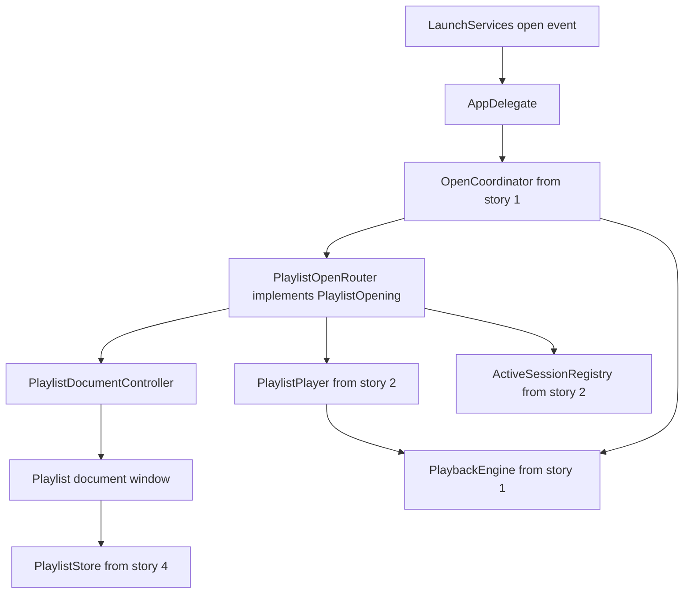
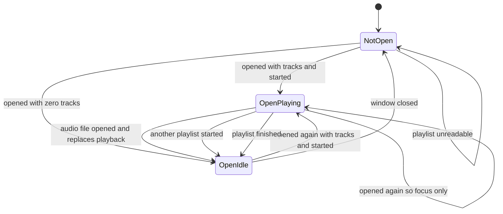
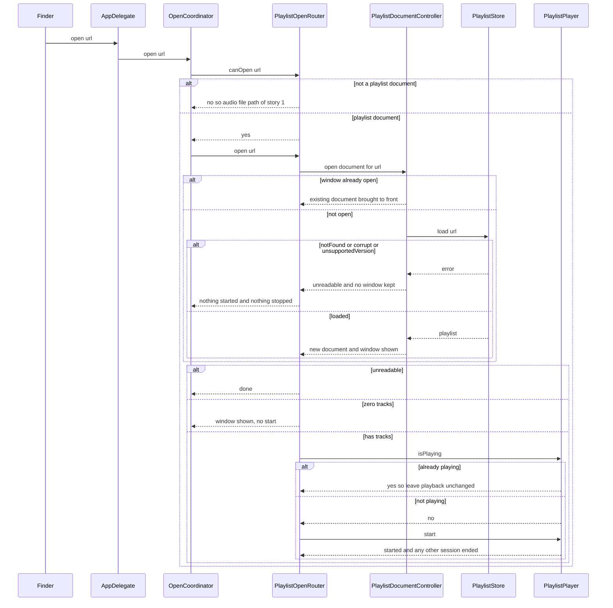
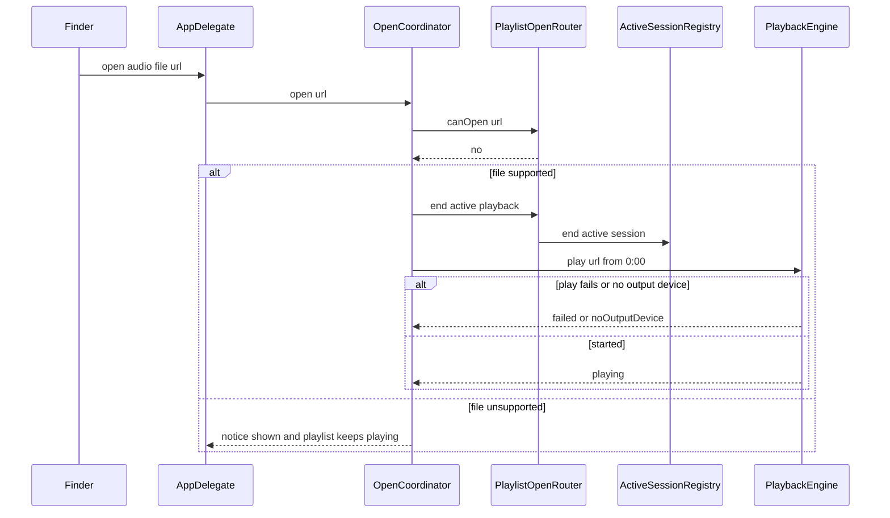

# Technical Design

Routing of a Finder-opened playlist document to its own window and playback through story 2's PlaylistPlayer: start per last-used shuffle, focus without disturbing, replacement by audio-file opens.

## Overview

Native Swift app, macOS 26 minimum, not sandboxed (docs/tech-architecture.md). Builds on story 1 (open-files event, OpenCoordinator, PlaybackEngine, NoticePresenting, the `PlaylistOpening` protocol), story 2 (PlaylistPlayer, which owns playback of one playlist, shuffle and repeat settings and the single-active-session rule, and `ActiveSessionRegistry`) and story 4 (the playlist document, PlaylistStore and its LoadResult, and the playlist document type declaration). All paths are PROPOSED locations in the SwiftPM package introduced by story 1, under `Sources/LocalPlayer/Playlists/` (plural).

The app is document-based: each playlist is a document with its own window. There is no main window and no playlist list. Window identity is the open document itself; nothing here derives an identifier from a file path.

**Dependencies (owned elsewhere, consumed here):**
- Story 4 declares the playlist document type (proposed extension `.lplaylist`), reads a playlist file into a `Playlist` and reports `LoadResult` = `loaded(Playlist)`, `notFound`, `corrupt` or `unsupportedVersion(Int)`.
- Story 2 owns what happens when a playlist starts: `PlaylistPlayer.start()` plays the first track when the last-used shuffle setting is off and the first track of a random pass when it is on, and it ends any other active session first. Only one thing plays at a time; this is an owner decision. Each open playlist document has its own `PlaylistPlayer`, which reports `isPlaying`; the router asks the document's player whether the playlist is already playing. This story never reads or writes the shuffle or repeat settings.
- Story 1 owns the audio-file path. When a supported audio file is opened, `OpenCoordinator` calls `PlaylistOpening.endActivePlayback()` before it plays the file. This story's `PlaylistOpenRouter` is the real `PlaylistOpening` and implements `endActivePlayback()` by calling story 2's `ActiveSessionRegistry.endActive()`. (The interface name is PROVISIONAL, shared with stories 1 and 2.)
- Story 5 keeps track references up to date; the document may rewrite the playlist file for that reason. This story only promises that the playlist's name, tracks and order are not changed by opening it.

**Open, not decided here:** which window hosts playback of a single audio file opened from Finder; what the person sees for an empty or unreadable playlist. For an unreadable playlist the design only guarantees no playback, nothing stopped, the app stays open and no window for it is kept.

When the app receives a file URL that is a playlist document, `PlaylistOpenRouter` opens it through `PlaylistDocumentController`, which shows the playlist's existing window if it is already open or creates one if not, and then starts playback unless that playlist is already playing.

## Structure


## State
No persisted state is introduced by this story. Opening writes no setting, and the playlist's name, tracks and order are never changed; any rewrite of the playlist file to refresh track references belongs to story 5. The only state is in-memory, per open playlist document:

What happens to playback when the window of a playing playlist is closed is not specified, so there is no transition for it.

## Flow 1: double-click a playlist in Finder


## Flow 2: audio file opened while a playlist plays


## Test Strategy

## Test Scopes
- **unit**: the pure open decision (`PlaylistOpenDecision`) and the mapping from story 4's `LoadResult` to an outcome. No window, no audio, no disk.
- **integration**: `PlaylistOpenRouter`, `PlaylistDocumentController` and story 2's real `PlaylistPlayer` wired to the real `PlaylistStore` reading real playlist files from a temporary directory, with a recording `PlaybackEngine` sink and a seeded random generator. Entry is the same open-files handler LaunchServices calls, so the request-handling boundary in the structure diagram is exercised.
- **e2e**: the built app opened with a real playlist file via `open -a`. The real playlist file comes from story 4's store using its proposed format; the e2e rows depend on that story being implemented.

## Dimensions crossed
Document and playback state (W1 not open, W2 open and idle, W3 open and this playlist playing, W4 a different playlist playing) x last-used shuffle (S0 off, S1 on), on a playlist of 5 tracks. Each dimension is exhaustive and non-overlapping: a playlist is in exactly one of W1-W4; shuffle is exactly on or off. Expected: W1/W2 the playlist starts (S0 first track, S1 first track of the seeded random pass); W3 focus only, track, position, shuffle and repeat unchanged; W4 the other playlist stops, this window to front, this playlist starts per shuffle (only one thing plays at a time, an owner decision).

| Ref | State | Shuffle | Expected | Level |
|---|---|---|---|---|
| TC-01 | W1 not open | S0 off | one window created, first track plays | integration |
| TC-02 | W1 not open | S1 on | one window created, first track of the seeded random pass plays | integration |
| TC-03 | W2 open and idle | S0 off | existing window to front, first track plays, still one window | integration |
| TC-04 | W2 open and idle | S1 on | existing window to front, first track of the seeded random pass plays, still one window | integration |
| TC-05 | W3 open and playing | S0 off | window to front, track, position, shuffle, repeat unchanged, no start call | integration |
| TC-06 | W3 open and playing | S1 on | window to front, track, position, shuffle, repeat unchanged, no start call | integration |
| TC-07 | W4 other playlist playing | S0 off | other session ended, this window to front, first track plays | integration |
| TC-08 | W4 other playlist playing | S1 on | other session ended, this window to front, first track of the seeded random pass plays | integration |
| TC-09 | W1 not open, real Finder | S0 off | app launches, the playlist opens in its own window and plays from its first track | e2e |
| TC-10 | W3 open and playing, real Finder | S1 on | window to front, audio uninterrupted | e2e |

## Test Case Design (boundaries and error paths)
Equivalence classes for the open decision: outcome is exactly one of unreadable, empty, withTracks; the playlist is exactly playing or not playing. LoadResult maps: `loaded` with zero tracks to empty, `loaded` with one or more to withTracks, `notFound`, `corrupt` and `unsupportedVersion` to unreadable. These classes are exhaustive and non-overlapping.

| Ref | Capability | Case | Expected | Level |
|---|---|---|---|---|
| TC-20 | playlist.open.route | withTracks and not playing | action showAndStart | unit |
| TC-21 | playlist.open.route | empty and not playing | action showOnly | unit |
| TC-22 | playlist.open.route | empty and playing (another playlist is playing) | action showOnly, nothing stopped | unit |
| TC-23 | playlist.open.route | withTracks and playing | action focusOnly | unit |
| TC-24 | playlist.open.route | unreadable and not playing | action doNothing | unit |
| TC-25 | playlist.open.route | unreadable and playing | action doNothing, nothing stopped | unit |
| TC-26 | playlist.open.route | LoadResult mapping for loaded 5 tracks, loaded 1 track, loaded 0 tracks, notFound, corrupt, unsupportedVersion | withTracks, withTracks, empty, unreadable, unreadable, unreadable | unit |
| TC-27 | playlist.open.route | real playlist file with 1 track, shuffle on | the single track plays, no error | integration |
| TC-28 | playlist.open.route | real 0-track playlist file | window shown with empty playlist, no start, current playback untouched | integration |
| TC-29 | playlist.open.route | real file of random bytes (corrupt) | no window kept, no start, current playback untouched, app still running | integration |
| TC-30 | playlist.open.route | real file whose version is newer than supported | no window kept, no start, current playback untouched | integration |
| TC-31 | playlist.open.route | url that does not exist | no window kept, no start, current playback untouched | integration |
| TC-32 | playlist.document.focus | same playlist opened twice in a row while W2 | exactly one window, brought to front both times | integration |
| TC-33 | playlist.document.focus | window closed then playlist opened again | a new window is created and the playlist starts per shuffle | integration |
| TC-34 | playlist.document.focus | two different playlists opened one after the other | two windows, one per playlist, neither closed nor moved by the other | integration |
| TC-35 | playlist.playback.replace | playlist playing, supported audio file opened | session ended, engine plays the file from 0:00, state OpenIdle | integration |
| TC-36 | playlist.playback.replace | playlist playing, unsupported file opened | notice path, playlist keeps playing | integration |
| TC-37 | playlist.playback.replace | playlist playing, supported file opened but no output device | engine returns noOutputDevice, state after is as story 1 defines for that result | integration |
| TC-38 | playlist.playback.replace | OpenCoordinator constructed without a playlist-opening dependency (story 1 style) | audio file opens exactly as in story 1 | integration |

## Negative Scenarios
| Ref | Case | Must NOT happen | Level |
|---|---|---|---|
| TC-40 | playlist already playing, opened again | no restart, no second window, no start call | integration |
| TC-41 | any Finder playlist open | saved shuffle and repeat values are never written (values equal before and after) | integration |
| TC-42 | any Finder playlist open | playlist name, tracks and order are never changed (compared before and after; refreshed track references may be written by the document and are ignored by the comparison) | integration |
| TC-43 | unreadable or empty playlist | nothing already playing is stopped | integration |
| TC-44 | any Finder playlist open | no confirmation dialog or prompt appears | e2e |
| TC-45 | any Finder playlist open | no main window or playlist list is created | e2e |

## Mock vs Integration Boundaries
| Component | Real or mocked | Reason |
|---|---|---|
| PlaylistStore and the playlist document | real, reading real playlist files in a temporary directory | the mapping from file to loaded, empty or unreadable is what decides the routing, so mocking it would hide the contract with story 4 |
| PlaylistPlayer (story 2) | real, with a seeded random generator and a real UserDefaults suite per test | start position and the single-active-session rule are story 2 behaviour that this story depends on; only the call is asserted here, the algorithm is tested in story 2 |
| PlaylistDocumentController | real | window uniqueness is the behaviour under test |
| PlaybackEngine | recording sink from story 1 | CI has no output device and the sink lets tests assert calls |
| LaunchServices and Finder | real only in e2e, direct handler call in integration | the real service cannot be driven inside a test process |
| PlaylistOpenDecision | real in unit and integration | pure logic |

## E2E Workflows
| Ref | Workflow | Asserts |
|---|---|---|
| E2E-1 | `open -a LocalPlayer <playlist>` from a cold start with shuffle off | the playlist opens in its own window and the first track plays |
| E2E-2 | double-click the same playlist again while it plays | window comes forward and audio is not interrupted |
| E2E-3 | open a .mp3 while the playlist plays | the playlist stops and the file plays |

## Fixtures
Real playlist files written by story 4's `PlaylistStore` (proposed `.lplaylist` format): a 5-track playlist referencing real mp3, wav and m4a files generated by the system encoder, a 1-track playlist, a 0-track playlist, a hand-damaged copy of random bytes, and a copy with a higher version number. A second 5-track playlist is used for the two-playlist cases. The audio files are real encoded files with real tag data, not byte stubs.

## Deliberately not covered
The playlist file format and its parsing (story 4), creating, saving and editing playlists, the Finder registration of the playlist type (story 4), what shuffle does after the first track starts and the uniformity of the random choice (story 2), missing audio files inside a playlist (story 5), opening several playlist files at once, the wording of any message for an empty or unreadable playlist, which window hosts a single opened audio file, and what happens when the window of a playing playlist is closed. A passing run does not claim any of these.

## playlist.open.route

> Anchor: `playlist.open.route`

## Contract
Inputs: a file URL delivered by the application's open-files event that is a playlist document (the type declared by story 4).
Outputs: the playlist opens as a document in its own window and, when it has tracks and is not already playing, playback of that playlist starts. This is how a Finder double-click on a playlist file starts that playlist and brings the app forward (`prd.plopen.start`).
How each requirement is delivered:
- Start position (`prd.plopen.first`, `prd.plopen.random`): the router calls story 2's `PlaylistPlayer.start()`. Story 2 plays the first track when the last-used shuffle setting is off and the first track of a random pass when it is on, so the router contains no start-position logic of its own.
- Already playing: the router reads `isPlaying` from the open document's own `PlaylistPlayer` (story 2 holds one per open playlist document) and starts nothing when it is true.
- Settings untouched (`prd.plopen.settings`): the router and the document never read or write the shuffle or repeat settings; only the player reads them.
- Unreadable or empty (`prd.plopen.unreadable`): story 4's `LoadResult` of `notFound`, `corrupt` or `unsupportedVersion` maps to outcome `unreadable`, and a `loaded` playlist with zero tracks maps to `empty`. Both start no playback and stop nothing that is already playing. An empty playlist still shows its window; an unreadable one keeps no window. The app stays open in every case. Wording of any message is not specified.
- Content untouched (`prd.plopen.content`): opening never edits the playlist's name, tracks or order. The document may rewrite the playlist file to refresh its links to audio files (story 5); that does not change name, tracks or order.
Errors: none thrown; every failure is one of the outcomes above.
Side effects: a document window is shown; playback may start; no setting is written.
Only one thing plays at a time (owner decision): when a different playlist is playing, starting this one ends that session through story 2's single-active-session rule.

## Implementation
Proposed file: `Sources/LocalPlayer/Playlists/PlaylistOpenRouter.swift`, called from `OpenCoordinator` before audio-file classification. `PlaylistOpening` is defined by story 1 (`canOpen`, `open`, `endActivePlayback`); `OpenCoordinator`'s initializer takes it as an optional dependency, default none, so story 1's tests still construct it.
```swift
// PlaylistOpening is owned by story 1:
// protocol PlaylistOpening: AnyObject { func canOpen(_ url: URL) -> Bool; func open(_ url: URL); func endActivePlayback() }
enum OpenOutcome: Equatable { case unreadable, empty, withTracks
  init(_ load: LoadResult) }
enum OpenAction: Equatable { case showAndStart, showOnly, focusOnly, doNothing }
enum PlaylistOpenDecision { static func decide(_ outcome: OpenOutcome, isPlaying: Bool) -> OpenAction }
final class PlaylistOpenRouter: PlaylistOpening {}
```
Decision table: unreadable gives doNothing; empty gives showOnly; withTracks and playing gives focusOnly; withTracks and not playing gives showAndStart. The document read is story 4's; there is no abstract loader in this story. `isPlaying` comes from the document's `PlaylistPlayer` (story 2), reached through `PlaylistDocumentController.player(for:)` (see `playlist.document.focus`).

## Tests
TC-01 to TC-10 (start rows), TC-20 to TC-31, TC-41 to TC-43, E2E-1.

## playlist.document.focus

> Anchor: `playlist.document.focus`

## Contract
Inputs: a playlist document URL that is already open, or not.
Outputs: exactly one window per open playlist document, using standard document behaviour.
- Open and not playing (`prd.plopen.front`): the document controller returns the existing document and brings its window to the front; no second window is created; the router then starts the playlist through `playlist.open.route`.
- Already playing (`prd.plopen.nodisturb`): the window comes to the front, no start is requested, and the current track, position, shuffle and repeat are left exactly as they were, because the router asks the document's `PlaylistPlayer` (story 2) whether the playlist is playing and does nothing further when it is.
Errors: a window that was closed is treated as not open and a new document window is created on the next open.
Side effects: window ordering only. Windows of other playlists are not closed or moved. There is no main window and no playlist list, and no path-derived identifier: identity is the open document.

## Implementation
Proposed file: `Sources/LocalPlayer/Playlists/PlaylistDocumentController.swift`, the app's document controller subclass; opening a URL that matches an open document returns that document and shows it.
```swift
final class PlaylistDocumentController: NSDocumentController {
  func isOpen(_ url: URL) -> Bool
  func player(for url: URL) -> PlaylistPlayer?
}
```
Playback state is read from story 2's `PlaylistPlayer.isPlaying`, not stored here. `player(for:)` returns the player owned by the open document for that URL (story 2 holds one per open playlist document) and nil when the playlist is not open.

## Tests
TC-03 to TC-08, TC-10, TC-32 to TC-34, TC-40, TC-45, E2E-2.

## playlist.playback.replace

> Anchor: `playlist.playback.replace`

## Contract
Inputs: a supported audio file URL opened while a playlist session is playing.
Outputs: the playlist session ends, the playlist playback stops, and the opened file plays from 0:00 through the story 1 engine (`prd.plopen.replace`). The ending is what keeps the playlist from advancing to its next track underneath the new file.
How it is delivered: story 1's `OpenCoordinator` calls `PlaylistOpening.endActivePlayback()` before it plays a supported audio file. This story's `PlaylistOpenRouter` implements that call by calling story 2's `ActiveSessionRegistry.endActive()`, which stops the active `PlaylistPlayer`. With no active session the call does nothing.
Errors: an unsupported file leaves the playlist playing and shows the story 1 notice (`endActivePlayback()` is not called for it); a play failure or no output device is reported by the engine as in story 1.
Side effects: the playlist's state moves from playing to idle; no playlist content or setting is changed.

## Implementation
The change to `Sources/LocalPlayer/Open/OpenCoordinator.swift` (the `PlaylistOpening.endActivePlayback()` call and the optional `playlists` dependency) is owned by story 1; this story supplies the implementation in `Sources/LocalPlayer/Playlists/PlaylistOpenRouter.swift`.
```swift
extension PlaylistOpenRouter {
  func endActivePlayback()  // calls ActiveSessionRegistry.endActive()
}
```
With no `PlaylistOpening` supplied, the coordinator behaves exactly as story 1. The interface name `endActivePlayback()` is PROVISIONAL, shared with stories 1 and 2.

## Tests
TC-35 to TC-38, E2E-3.

