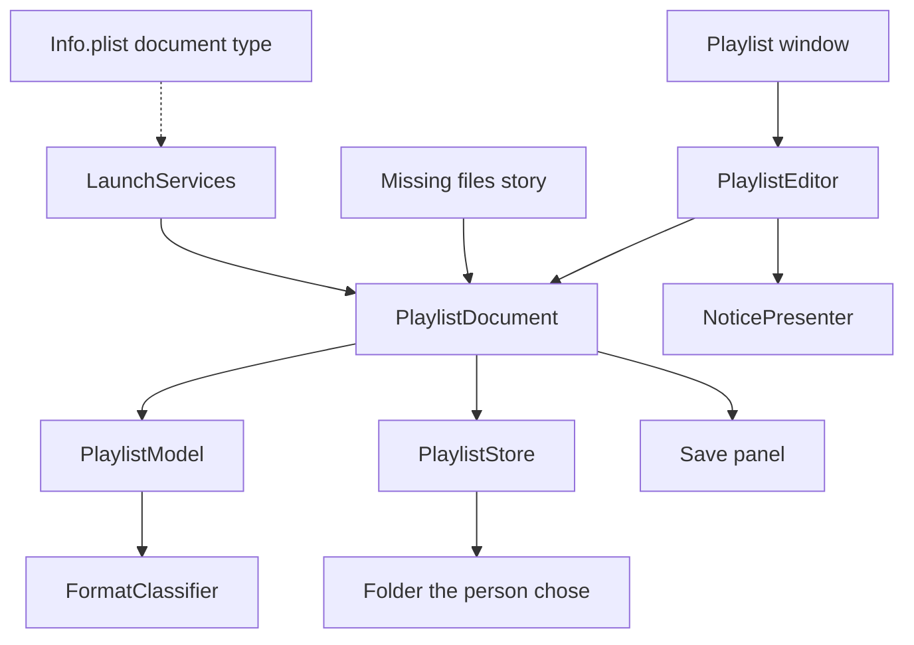
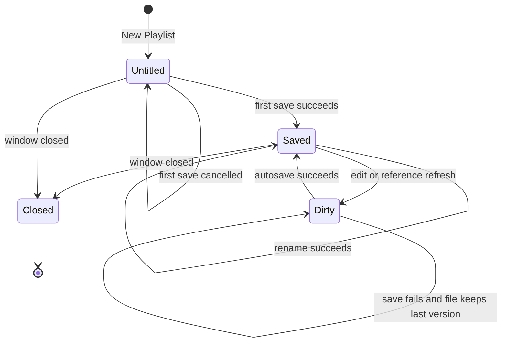
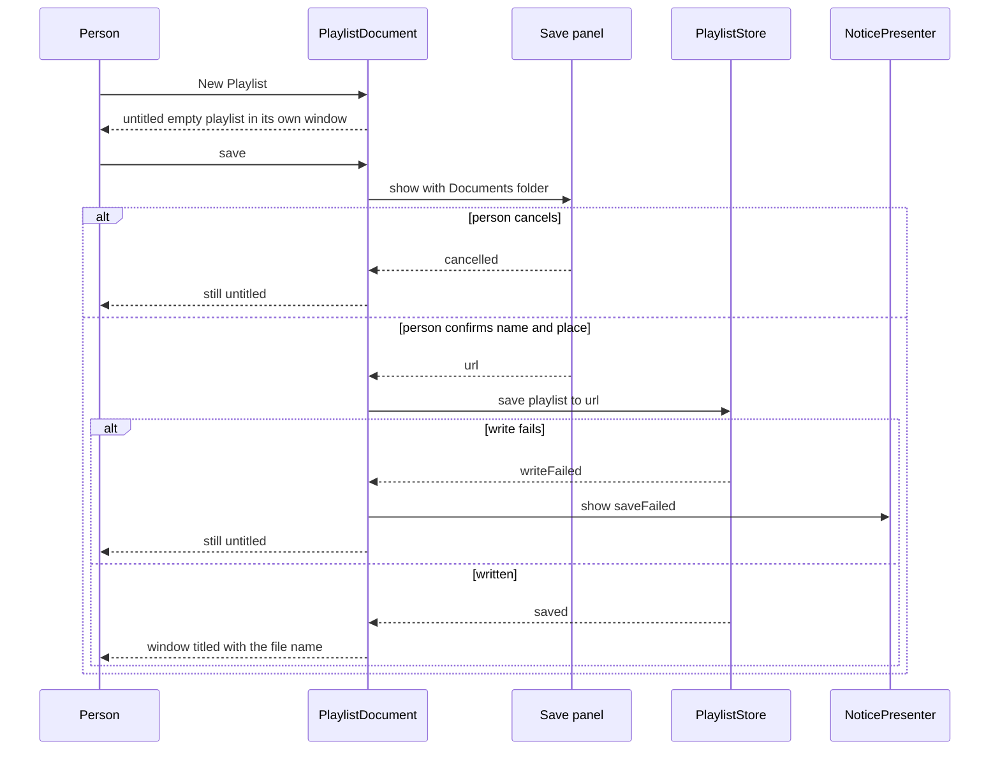
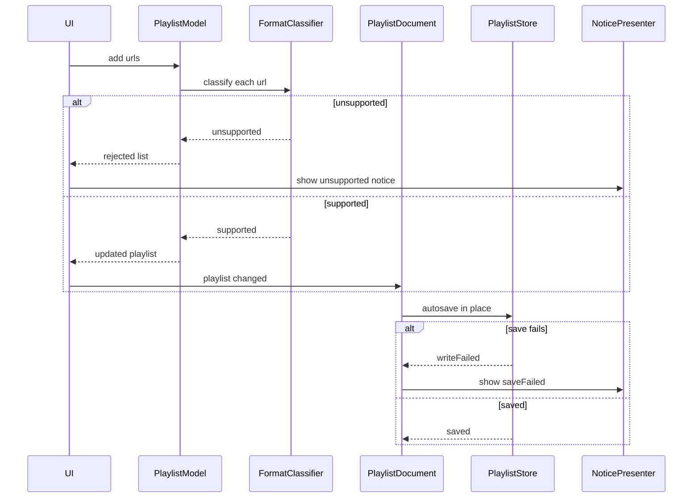
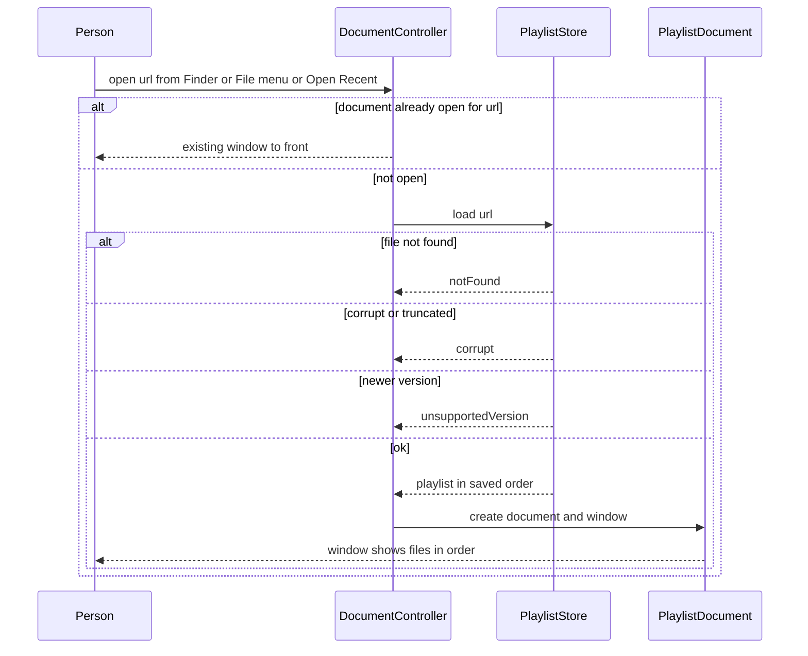
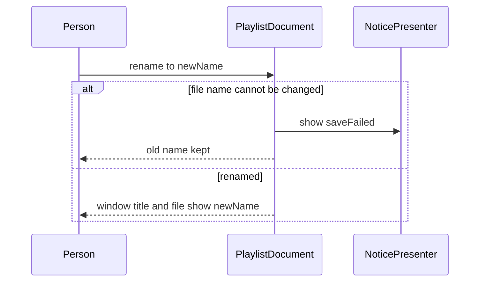
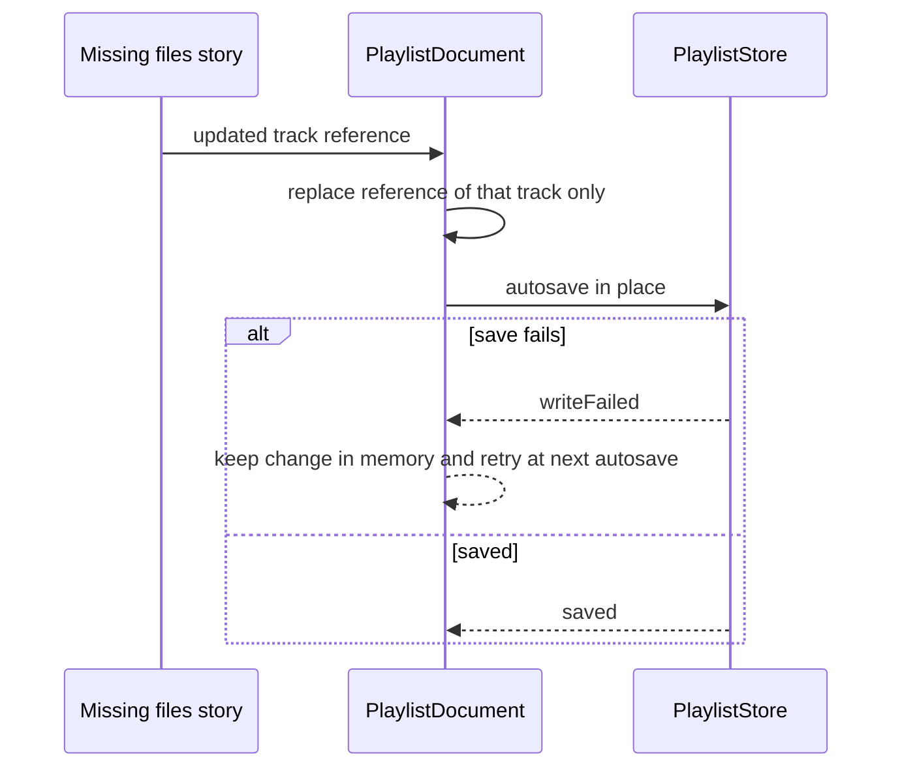

# Technical Design

Playlist document (one window each, saved where the person chooses, Documents default), Playlist/Track model, atomic autosaving store, self-updating references, editor and document type declaration for a native Swift macOS 26 app.

## Overview

Native Swift app, macOS 26 minimum, not sandboxed (docs/tech-architecture.md). The source tree is created by the open-a-file story; all paths below are PROPOSED locations inside that SwiftPM package (`Sources/LocalPlayer/Playlists/...`, `Tests/LocalPlayerTests/Playlists/...`).

The app is document-based. Each playlist is a document with its own window; there is no main window and no playlist list. Runtime identity of a playlist is the open document (its file URL while saved), not a stored or path-derived ID. The document is an AppKit `NSDocument` subclass (PROPOSED) with autosaving in place, so the standard Save panel, Open Recent, Rename and bringing an already-open document to the front come from the document framework. Whether a closed or quit untitled playlist with files is silently kept or prompts is the framework's standard behaviour and an OPEN question (PRD open question 1).

A playlist is one file on disk, in the place the person chose (the Save panel offers the Documents folder first). Deleting it is done in Finder; the app offers no delete. The on-disk format and extension are NOT decided by the PRD; this design PROPOSES a versioned JSON document with the extension `.lplaylist` and the type identifier `com.localplayer.playlist`. Writes are atomic: new content goes to a temporary file in the same folder and replaces the original in one step, so an interrupted save leaves the previous file untouched.

**Data model owned by this story.** `Playlist { tracks: [Track] }`; the playlist's name is its file name and is not stored inside the file. `Track { id: UUID, reference: TrackReference }`. `TrackReference { bookmark: Data, lastKnownPath: String, fileName: String }` is defined and resolved by the missing-files story; this story stores and returns it. Resolving moved or missing files belongs to that story; this story only persists whatever reference it is given, including refreshed ones, through the document (self-update). File-type filtering uses `open.format.classify` from the open-a-file story. User messages go through the shared `NoticePresenting.show(Notice)` owned by the open-a-file story, using `Notice.unsupported(UnsupportedReason)` and `Notice.saveFailed(String)`.

Open or provisional: duplicate tracks in one playlist are not decided (not stated either way); a background self-update save that fails shows no message and is retried on the next autosave (provisional); a failed rename is reported with `Notice.saveFailed` (provisional wording).

## Structure


## State: playlist document lifecycle
The design introduces persisted state: a playlist file on disk and an in-memory edited copy. The copy is Dirty between an edit and a successful save.


## Flow 1: new playlist and first save


## Flow 2: edit tracks and autosave


## Flow 3: open a playlist


## Flow 4: rename a playlist


## Flow 5: self-update from a reference refresh or Locate


## Test Strategy

## Test Scopes
- **unit**: PlaylistModel edits and the store's encode and decode logic. No disk, no UI.
- **integration**: PlaylistStore against the real file system in a temporary directory with injectable faults (disk full, read-only folder, interruption between write and replace); PlaylistDocument and the real document controller in-process with the Save panel and Open panel replaced by stubs that return a chosen URL; UI editor controller driven through the same entry points menus and drop targets call.
- **e2e**: the built app driven from outside with real files, the real Save panel, quit and relaunch, because the Save panel's default folder, persistence across launches, one-window-per-document, Open Recent, drag and drop, and menus exist only in the real bundle.

## Dimensions crossed
Edit operation (add valid, add unsupported, remove, reorder) x playlist size (S0 empty, S1 one track, SN five tracks) x position (first, middle, last, out of range). Equivalence classes are exhaustive and non-overlapping: a playlist has exactly 0, 1 or more tracks; an index is exactly valid (0 to count-1) or out of range; a file is exactly supported or unsupported. Design decisions made where the PRD is silent: added files are appended in the order given; in a mix of supported and unsupported files the supported ones are added and the unsupported ones are rejected and reported; a destination index must be in 0 to count-1.

| Ref | Operation | Size | Position | Expected | Level |
|---|---|---|---|---|---|
| TC-01 | add 1 supported | S0 | end | playlist has 1 track | unit |
| TC-02 | add 2 supported | S1 | end | 3 tracks, new ones last in given order | unit |
| TC-03 | add 3 supported | SN | end | 8 tracks, new ones last in given order | unit |
| TC-04 | add 1 unsupported | S0 | end | rejected unsupportedType, still 0 tracks | unit |
| TC-05 | add 2 supported plus 1 unsupported | SN | end | 7 tracks, 1 rejected and reported | unit |
| TC-06 | remove index 0 | S0 | out of range | error indexOutOfRange, still 0 tracks | unit |
| TC-07 | remove index 0 | S1 | first and last | 0 tracks | unit |
| TC-08 | remove index 0 | SN | first | 4 tracks, order of rest kept | unit |
| TC-09 | remove index 4 | SN | last | 4 tracks, order of rest kept | unit |
| TC-10 | remove index 2 | SN | middle | 4 tracks, order of rest kept | unit |
| TC-11 | move 0 to 0 | S0 | out of range | error indexOutOfRange | unit |
| TC-12 | move 0 to 0 | S1 | first and last | unchanged, no error | unit |
| TC-13 | move 0 to 4 | SN | first to last | old first is now last, rest shift up | unit |
| TC-14 | move 4 to 0 | SN | last to first | old last is now first, rest shift down | unit |
| TC-15 | move 2 to 2 | SN | middle to same | unchanged, no error | unit |
| TC-16 | move 0 to 5 | SN | destination equals count | error indexOutOfRange, unchanged | unit |
| TC-17 | move -1 to 2 | SN | negative source | error indexOutOfRange, unchanged | unit |
| TC-18 | any successful edit | SN | any | every Track keeps its id and reference; only order or membership changes | unit |

## Test Case Design: persistence (store)
| Ref | Capability | Case | Expected | Level |
|---|---|---|---|---|
| TC-20 | playlist.store.save | save then load, 0 tracks | empty track list round-trips | unit |
| TC-21 | playlist.store.save | save then load, 1 track | identical id, reference and order | unit |
| TC-22 | playlist.store.save | save then load, 5000 tracks | identical order, all present | integration |
| TC-23 | playlist.store.save | track with unicode and emoji in its file name and last known path | values round-trip unchanged | unit |
| TC-24 | playlist.store.save | interruption after temp file written, before replace | original file byte-identical to before | integration |
| TC-25 | playlist.store.save | disk full injected on write | writeFailed, original byte-identical, no stray temp file | integration |
| TC-26 | playlist.store.save | folder is read-only | writeFailed, original byte-identical | integration |
| TC-27 | playlist.store.save | two saves in quick succession | file valid and equals the second save | integration |
| TC-28 | playlist.store.save | process killed during a save, then relaunch | playlist loads as last good version, stray temp ignored | e2e |
| TC-29 | playlist.store.save | file is placed in a folder named like iCloud Drive and copied elsewhere | copy loads identically | integration |
| TC-30 | playlist.store.load | path does not exist | notFound | unit |
| TC-31 | playlist.store.load | random bytes | corrupt | unit |
| TC-32 | playlist.store.load | 0-byte file | corrupt | unit |
| TC-33 | playlist.store.load | version number higher than supported | unsupportedVersion with that number | unit |
| TC-34 | playlist.store.load | valid file whose track refers to a missing audio file | loads; track present; resolution is not attempted here | integration |
| TC-35 | playlist.store.save | playlist name | not stored inside the file; the name is the file name | unit |

## Test Case Design: document lifecycle
| Ref | Capability | Case | Expected | Level |
|---|---|---|---|---|
| TC-40 | playlist.document.lifecycle | New Playlist | one untitled document with an empty playlist and one window; no file exists on disk yet | integration |
| TC-41 | playlist.document.lifecycle | first save, Save panel prepared | panel directory is the user's Documents folder | integration |
| TC-42 | playlist.document.lifecycle | first save, stub returns a different folder and name | file is written at that URL and the document title is its file name | integration |
| TC-43 | playlist.document.lifecycle | first save, panel cancelled | document still untitled, nothing written | integration |
| TC-44 | playlist.document.lifecycle | first save fails to write | saveFailed notice, document still untitled | integration |
| TC-45 | playlist.document.lifecycle | open a saved playlist url | one document and one window, files in saved order | integration |
| TC-46 | playlist.document.lifecycle | open the same url twice | still one document and one window, window brought to front | integration |
| TC-47 | playlist.document.lifecycle | open two different playlist urls | two documents and two windows | integration |
| TC-48 | playlist.document.lifecycle | open a corrupt, unreadable or newer-version file | no document and no window; error returned; no change on disk | integration |
| TC-49 | playlist.document.lifecycle | rename a saved playlist | file renamed on disk, tracks and order unchanged, document stays open | integration |
| TC-50 | playlist.document.lifecycle | rename fails | old name and file kept, saveFailed notice | integration |
| TC-51 | playlist.document.lifecycle | edit a saved playlist | file on disk equals the edit after autosave, with no explicit save | integration |
| TC-52 | playlist.document.lifecycle | edit an untitled playlist | no file is written until the first save (provisional, open question 1) | integration |
| TC-53 | playlist.document.lifecycle | Open Recent after a first save | saved playlist is listed and opens | e2e |
| TC-54 | playlist.document.lifecycle | Save panel in the real app | Documents folder is offered by default | e2e |

## Test Case Design: self-update, editor and document type
| Ref | Capability | Case | Expected | Level |
|---|---|---|---|---|
| TC-60 | playlist.store.save | a refreshed reference for one track is applied to a saved document | file on disk contains the new reference for that track; every other track, the order and the file name are unchanged | integration |
| TC-61 | playlist.store.save | a Locate result is applied | file contains the new reference; nothing else changed | integration |
| TC-62 | playlist.store.save | self-update save fails | change kept in memory, no message shown, retried at next autosave (provisional) | integration |
| TC-63 | playlist.store.save | self-update on a playlist file that is read-only | no crash, no message, in-memory change kept | integration |
| TC-70 | playlist.doctype.declare | built Info.plist | declares one playlist document type: identifier com.localplayer.playlist, extension lplaylist, role Editor | integration |
| TC-71 | playlist.doctype.declare | built Info.plist, all document types together | exactly the three audio types of the open-a-file story plus this one, nothing else | integration |
| TC-72 | playlist.doctype.declare | real Finder opens a .lplaylist file | the app opens it in a playlist window | e2e |
| TC-80 | playlist.ui.editor | New Playlist menu item | untitled empty playlist window, ready for files | integration |
| TC-81 | playlist.ui.editor | drop 3 files from Finder | 3 rows in dropped order, change autosaved | integration |
| TC-82 | playlist.ui.editor | drag row to a new position | rows reordered and saved | integration |
| TC-83 | playlist.ui.editor | drop an unsupported file | unsupported notice shown, rows unchanged | integration |
| TC-84 | playlist.ui.editor | save fails after an edit | could-not-be-saved notice, rows show the edit, disk has old version | integration |
| TC-85 | playlist.ui.editor | Remove a selected row | row gone, audio file untouched, change saved | integration |

## Negative Scenarios
| Ref | Case | Must NOT happen | Level |
|---|---|---|---|
| TC-90 | remove a track | audio file deleted, moved or changed (checksum, size, mtime, location) | integration |
| TC-91 | add unsupported file | playlist file rewritten or changed on disk | integration |
| TC-92 | failed save | original playlist file altered or left with a partial write | integration |
| TC-93 | rename | track order or track set changes | integration |
| TC-94 | any playlist action | a hidden library folder or database is created | integration |
| TC-95 | any menu of the built app | no Delete Playlist item exists | e2e |
| TC-96 | any window of the app | no playlist list view and no main window exists | integration |
| TC-97 | opening the same playlist again | no second window and no second document is created | integration |
| TC-98 | self-update | playlist name, track set, order or any other track's reference changes | integration |

## Boundary justification
PlaylistModel is pure logic, so unit tests exercise it directly. PlaylistStore is a request-handling boundary over the file system, so its tests run against a real temporary directory; a mocked file system would hide exactly the atomic-replace behaviour under test. PlaylistDocument is exercised with the real document controller in-process (integration) because one-window-per-document and rename come from it, and in the real app (e2e) for the real Save panel, Open Recent and Finder.

## Mock vs Integration Boundaries
| Component | Real or mocked | Reason |
|---|---|---|
| File system | real temporary directory, with an injectable fault layer for disk full, read-only and interruption | atomic save behaviour is the thing under test |
| Document controller | real | one-window-per-document and rename are framework behaviours this design relies on |
| Save panel and Open panel | stub returning a chosen URL in integration, real in e2e | a modal panel blocks the test process |
| iCloud Drive | not used; a folder with the same file-copy semantics stands in | CI machines have no iCloud account; no sync behaviour is claimed |
| FormatClassifier | real | pure logic and cheap |
| NoticePresenter | recording stub in integration, real in e2e | assert what would be shown without a modal blocking the test |
| Missing-files story | stub that emits a reference update | resolution logic is tested in that story; this story tests only that the update is saved |
| Finder drag and drop and LaunchServices | synthesised events in integration, real in e2e | cannot drive real Finder inside a test process |

## E2E Workflows
| Ref | Workflow | Asserts |
|---|---|---|
| E2E-1 | New Playlist, drop mp3 wav m4a, drag third to top, save as Dinner in the default folder, quit, relaunch, open from Finder | same order shown and the file is in Documents |
| E2E-2 | open Dinner, rename to Supper, quit, relaunch | name is Supper in the title and in Finder |
| E2E-3 | remove the middle file | audio file still in Finder, playlist updated |
| E2E-4 | drop a .flac | not supported yet message, nothing added |
| E2E-5 | edit while the folder is read-only | could-not-be-saved message, old version after relaunch |
| E2E-6 | kill the app during a save, relaunch | playlist loads as the last good version |
| E2E-7 | open the same playlist twice from Finder | exactly one window for it, brought to front |
| E2E-8 | move an audio file in Finder, open the playlist, quit, reopen | playlist file now holds the refreshed reference and the playlist still plays the file without any person action |

## Fixtures
Real mp3, wav and m4a files encoded at setup, a real .flac, real playlist files produced by the store itself plus hand-damaged copies (truncated, random bytes, higher version number), real Track references created from real files, and a 5000-track playlist generated from real file URLs.

## Deliberately not covered
The proposed on-disk format and extension themselves (they may change), real iCloud Drive sync and conflict behaviour, duplicate tracks in one playlist, the Save panel's own replace or keep-both behaviour when a name already exists (system behaviour, the app adds no rules), what happens to an untitled playlist with files when its window is closed or the app quits (open question 1), wording shown for a damaged playlist, how moved or deleted audio files are found (missing-files story), playback of playlists, which window plays a single opened audio file, and AppleScript control (separate story). A deleted-playlist case is absent on purpose: the app does not offer delete. A passing run here does not claim any of these.

## playlist.model.edit

> Anchor: `playlist.model.edit`

## Contract
Inputs: an in-memory `Playlist` (ordered `[Track]`) and one edit: add URLs, remove index, or move index to index.
Outputs: the updated playlist, and for add a list of rejected URLs with their reasons.
- Add (`prd.playlist.add`): supported files are appended, each as a new `Track` with a fresh UUID and a `TrackReference`, in the order given.
- Reject (`prd.playlist.reject_unsupported`): each URL is classified with `open.format.classify`; an unsupported URL is NOT added, is returned in the rejected list with the reason so the caller shows the not-supported-yet message, and the playlist is unchanged by it.
- Remove (`prd.playlist.remove`): the track at the index leaves the playlist and the order of the rest is kept.
- Reorder (`prd.playlist.reorder`): the track at the source index moves to the destination index (0 to count-1); the others keep their relative order; moving to the same index changes nothing; every track keeps its id and reference.
- Audio untouched (`prd.playlist.audio_untouched`): remove only drops the in-memory `Track`; the model never opens, writes, moves or deletes an audio file, so removing a track cannot change the audio file.
Errors: `indexOutOfRange` for a remove or move with an index outside 0 to count-1 (an empty playlist has no valid index); the playlist is unchanged. Whether the same file may be added twice is not decided and not tested.
Side effects: none. The model never writes to disk; the document saves the result.

## Implementation
Proposed file: `Sources/LocalPlayer/Playlists/PlaylistModel.swift`. `TrackReference` is owned by the missing-files story (`Sources/LocalPlayer/Playlists/TrackReference.swift`).
```swift
struct Track: Equatable, Codable { let id: UUID; var reference: TrackReference }
struct Playlist: Equatable { var tracks: [Track] }
enum EditError: Error, Equatable { case indexOutOfRange }
struct AddResult { let playlist: Playlist; let rejected: [(URL, UnsupportedReason)] }
func adding(_ urls: [URL], to p: Playlist, classifier: FormatClassifying, makeReference: (URL) -> TrackReference?) -> AddResult
func removing(at i: Int, from p: Playlist) throws -> Playlist
func moving(from s: Int, to d: Int, in p: Playlist) throws -> Playlist
```
Value types, so every edit returns a new playlist and a failed edit cannot leave a half-changed one. A URL for which no reference can be made is rejected with `fileNotReadable`.

## Tests
TC-01 to TC-18, TC-90.

## playlist.store.save

> Anchor: `playlist.store.save`

## Contract
Inputs: a `Playlist` and a destination file URL (the location the person chose, or the file the document already has).
Outputs: `saved`, or `writeFailed(reason)`.
- Own file (`prd.playlist.own_file`): the playlist is written as one ordinary file at the destination chosen by the person, visible in Finder, which can be copied, deleted in Finder or placed in iCloud Drive and loads identically from the copy. The store never creates a hidden library.
- Persist (`prd.playlist.persist`): what is written contains the format version, every track's id and reference, and their order, so a later load returns exactly the saved playlist. The name is the file name and is not stored inside the file.
- Safe save (`prd.playlist.save_safe`): the new content is written to a temporary file in the same folder and then swapped in as one step. If anything fails or is interrupted before the swap, the destination file is byte-for-byte the previous version and no partial file is left under the playlist's name; a stray temporary file is removed on the next successful save or on launch. On failure the caller is told so it can show the could-not-be-saved message.
- Self-update (`prd.playlist.self_update`): when the document hands the store a playlist in which one track's reference was refreshed or located, the same save writes the new reference into the playlist file. Only that track's reference differs from the previous file; the order, other tracks and file name are unchanged, and no person action is needed because the document autosaves.
Errors: `writeFailed(reason)` for disk full, read-only folder, permission denied or an I/O error; the original is unchanged in every case.
Side effects: one file replaced in the destination folder; nothing else on disk.

## Implementation
Proposed file: `Sources/LocalPlayer/Playlists/PlaylistStore.swift`. PROPOSED format: UTF-8 JSON, extension `.lplaylist`, containing an integer `version` (starting at 1) and the tracks, each with `id` and `reference`.
```swift
enum SaveResult: Equatable { case saved, writeFailed(String) }
protocol PlaylistStoring { func save(_ p: Playlist, to url: URL) -> SaveResult; func load(from url: URL) -> LoadResult }
```
The swap uses the file manager's replace-item operation on a temp file created in the destination folder, coordinated through file coordination so it is safe in iCloud Drive folders. The document's write delegates to this store, so the atomic guarantee tested here holds whatever the document framework does around it. A fault-injection seam wraps file operations so tests can fail or interrupt at each step.

## Tests
TC-20 to TC-29, TC-35, TC-60 to TC-63, TC-92, TC-98, E2E-6, E2E-8.

## playlist.store.load

> Anchor: `playlist.store.load`

## Contract
Inputs: a playlist file URL.
Outputs: `loaded(Playlist)` or an error.
- Open (`prd.playlist.open`): the returned playlist has the files in exactly the order they were last saved, ready for a playlist window to show; the document uses this whether the person opened the file from Finder, the File menu or Open Recent.
- Persist (`prd.playlist.persist`): after quit and relaunch, opening a saved playlist returns the tracks, ids and order from its last successful save; the name shown is the file name.
Errors: `notFound`; `corrupt` for unparseable, truncated or 0-byte content; `unsupportedVersion(n)` when the file's version is newer than this app understands. In all cases nothing on disk changes. A track whose audio file is missing is NOT an error here; it is returned as a reference for the missing-files story to handle.
Side effects: none; read-only.

## Implementation
Proposed file: `Sources/LocalPlayer/Playlists/PlaylistStore.swift` (same file as save).
```swift
enum LoadResult: Equatable { case loaded(Playlist), notFound, corrupt, unsupportedVersion(Int) }
```
Unknown future fields in a same-version file are ignored so older apps can still read it.

## Tests
TC-20 to TC-22, TC-30 to TC-34, TC-48, E2E-1.

## playlist.document.lifecycle

> Anchor: `playlist.document.lifecycle`

## Contract
Inputs: New Playlist; open of a file URL (Finder, File menu, Open Recent); first save; rename; any change to the playlist.
Outputs: one playlist document per playlist, each with its own window; no main window and no list of playlists exist.
- Create (`prd.playlist.create`): New Playlist creates one untitled document holding an empty playlist and opens its own window, ready to receive files. No file exists on disk until the first save.
- Save location (`prd.playlist.save_location`): the first save presents the standard Save panel with the user's Documents folder as its starting directory; the person chooses name and place, and the playlist is written there through `playlist.store.save`. The window title becomes the file name. Cancelling leaves the document untitled and writes nothing. Saving over an existing name uses the Save panel's own replace or keep-both choices; the app adds no naming rules.
- Autosave (`prd.playlist.autosave`): once the document has a file, every change is written into that same file by the document's autosave in place, with no Save button.
- Open once (`prd.playlist.open_once`): the document is identified by its file URL. Opening a URL that already has a document returns that document and brings its window to the front; no second document or window is created. Opening a different URL creates a second document and window.
- Rename (`prd.playlist.rename`): the standard document rename changes the file name on disk and the window title; tracks and order are unchanged, and the document stays open.
- Reference updates from the missing-files story: the document accepts an updated `TrackReference` for one of its tracks through `apply(_:toTrack:)`, replaces only that track's reference, marks itself changed and lets autosave write it (see `playlist.store.save`). Passing a track id that no track in the playlist has changes nothing. Several calls made in a row are written by one autosave.
Errors: a file that cannot be loaded creates no document or window and returns the store's error; a failed first save or rename shows `Notice.saveFailed` and leaves the previous state (untitled, or the old name and file).
Side effects: files in the folder the person chose only. Untitled-document behaviour on close or quit is the framework's standard behaviour and an open question.

## Implementation
Proposed files: `Sources/LocalPlayer/Playlists/PlaylistDocument.swift` (an `NSDocument` subclass with autosaving in place, reading and writing through `PlaylistStoring`, and a `prepareSavePanel` that sets the starting directory to the Documents folder) and `Sources/LocalPlayer/Playlists/PlaylistWindowController.swift`. The shared document controller supplies Open Recent, one document per URL and bringing an open document forward.
```swift
final class PlaylistDocument: NSDocument, PlaylistDocumentEditing {
  var playlist: Playlist
  func apply(_ updatedReference: TrackReference, toTrack id: UUID)
}
```
`PlaylistDocumentEditing` is declared by the missing-files story (it exposes `playlist` and `apply(_:toTrack:)`); `PlaylistDocument` conforms to it and is the only conforming document type. `apply` is the entry point for refreshed and located references; it marks the document changed so autosave writes it.

## Tests
TC-40 to TC-54, TC-93, TC-94, TC-96, TC-97, E2E-1, E2E-2, E2E-7.

## playlist.ui.editor

> Anchor: `playlist.ui.editor`

## Contract
Inputs: person actions inside one playlist window: Add Files (menu or drop from Finder), Remove a selected row, drag a row to reorder.
Outputs: the window shows the playlist's files in order.
- Add (`prd.playlist.add`): drops and the Add Files menu item call the model with the chosen URLs; the supported files appear as rows in the order given and the document is marked changed so autosave writes them.
- Remove (`prd.playlist.remove`): the Remove action takes the selected row out of the list immediately; the audio file is untouched; the change is saved.
- Reorder (`prd.playlist.reorder`): dragging a row changes the shown order immediately and the new order is saved.
- Reject (`prd.playlist.reject_unsupported`): for each rejected URL the unchanged list stays on screen and `Notice.unsupported` is shown. The text states that the file type is not supported yet AND why, using the reason returned by the format classifier and naming the supported types (MP3, WAV, M4A), exactly as when opening a file.
- Save safe (`prd.playlist.save_safe`): when a save returns `writeFailed` the person sees a could-not-be-saved message via `Notice.saveFailed`; the rows keep showing the edit and the file on disk keeps its previous contents.
Errors: model and store errors are surfaced to the person as a short message; the PRD does not specify wording for damaged-file errors, so the exact text is not decided here.
Side effects: none beyond the calls above. There is no Delete Playlist action and no playlist list in any window.

## Implementation
Proposed files: `Sources/LocalPlayer/Playlists/PlaylistView.swift` and `Sources/LocalPlayer/Playlists/PlaylistEditorController.swift`, using native list drag and drop and the shared `NoticePresenting`. `PlaylistView` owns the list and the editing; each row is drawn by the missing-files story's `PlaylistTrackRow` (greyed look, Locate, and the playback story's hazard icon), so this story does not draw row appearance. Every action is also exposed as a controller method so the AppleScript story can call the same code path.

## Tests
TC-80 to TC-85, TC-83, TC-84, TC-91, TC-95, E2E-3, E2E-4, E2E-5.

## playlist.doctype.declare

> Anchor: `playlist.doctype.declare`

## Contract
Inputs: the built app bundle.
Outputs: the bundle declares and exports the playlist document type so macOS identifies playlist files as playlists belonging to the app, Finder shows them with the app's association and opens them in the app (`prd.playlist.doctype`). PROPOSED values: type identifier `com.localplayer.playlist`, extension `lplaylist`, role Editor. Being the default handler remains the person's choice in Finder; the app does not change system defaults.
Errors: none at runtime; a missing or wrong declaration is caught by the tests. The open-a-file story's document-type test is coordinated with this one: the built bundle declares exactly the three audio types of that story plus this playlist type, and nothing else.
Side effects: none at runtime.

## Implementation
Proposed file: `Resources/Info.plist` with a `CFBundleDocumentTypes` entry (role Editor, content type `com.localplayer.playlist`) and a `UTExportedTypeDeclarations` entry (identifier, description, extension `lplaylist`, conforming to a data type). Identifier and extension are proposals, not decisions.

## Tests
TC-70, TC-71, TC-72.

