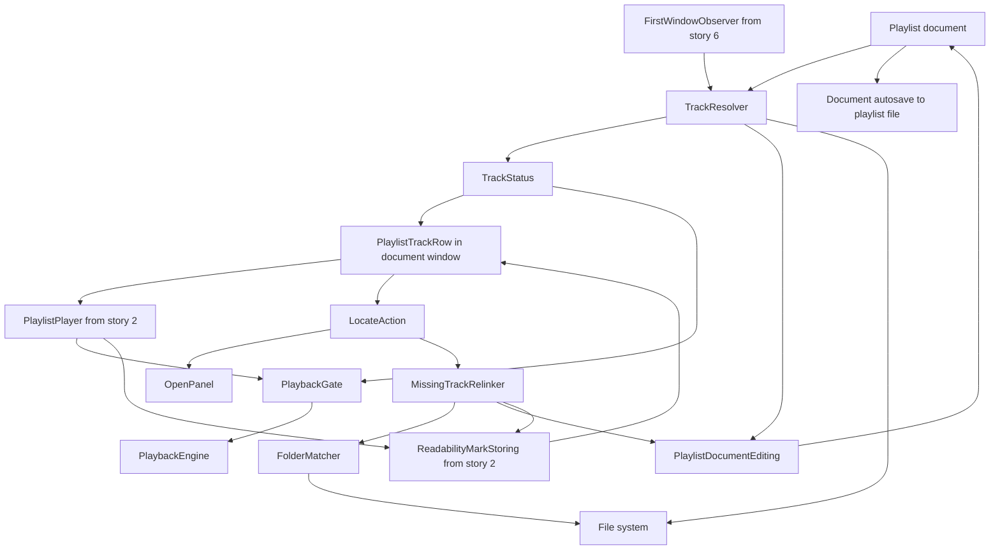
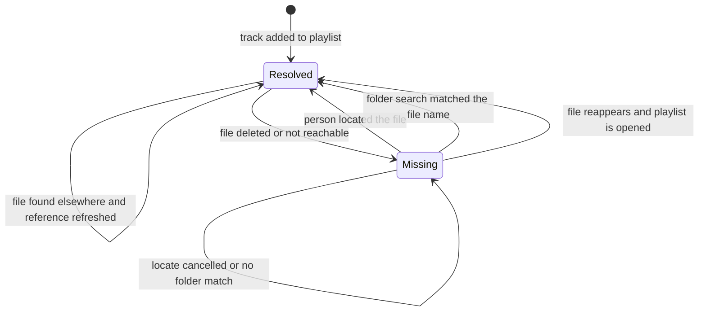
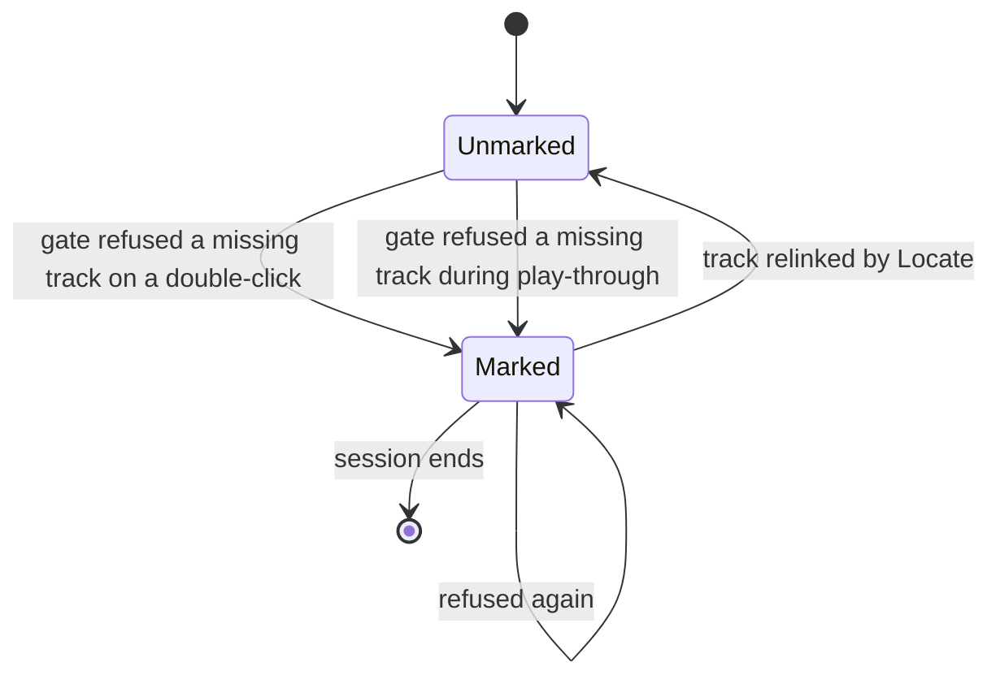
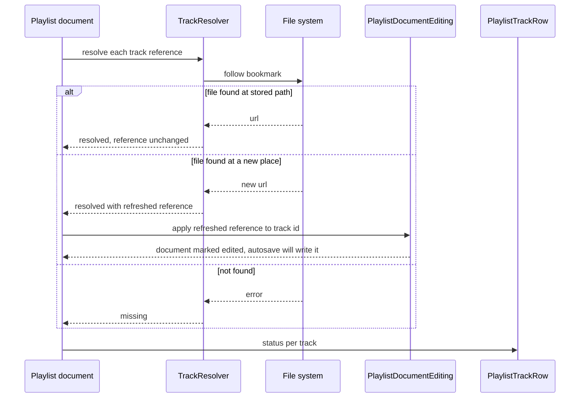
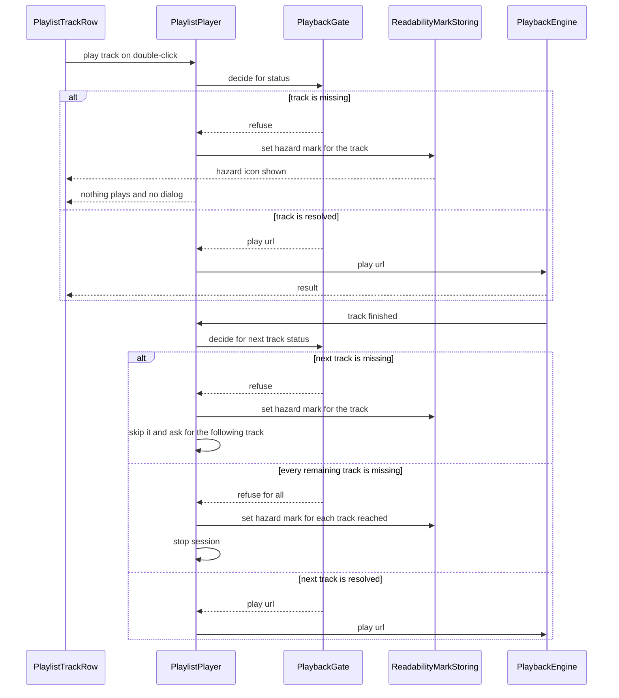
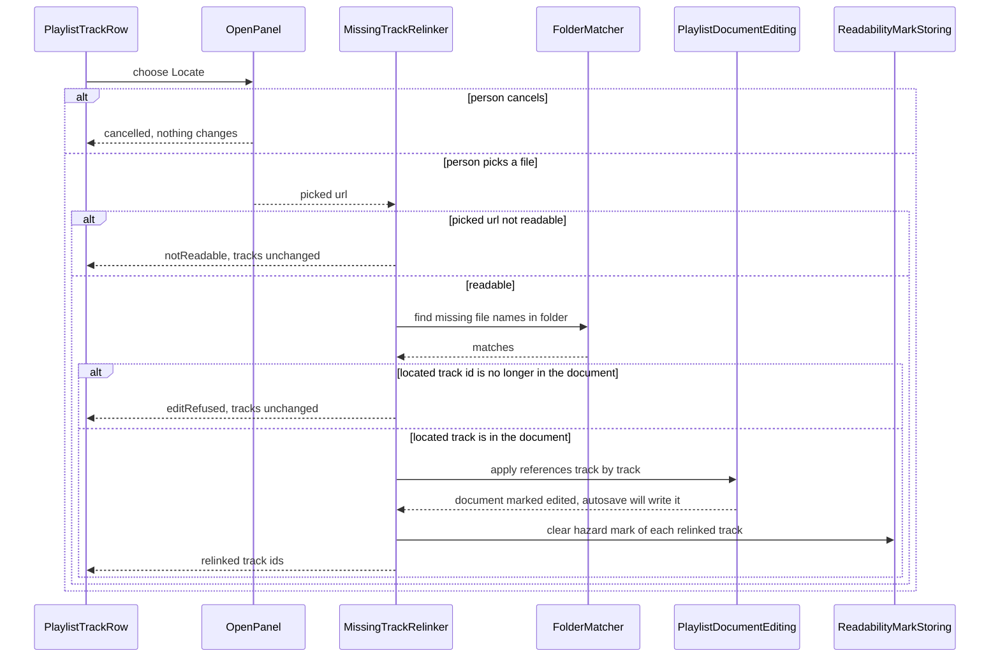

# Technical Design

Track references that follow moved files, missing-track status, Locate, and same-folder reconnection for a native Swift macOS 26 app.

## Overview

Native Swift app, macOS 26 minimum, not sandboxed (docs/tech-architecture.md). No source tree exists yet; every path is a PROPOSED location in the SwiftPM package LocalPlayer (`Sources/LocalPlayer/Playlists/...` for playlist logic, `Sources/LocalPlayer/UI/...` for views, `Tests/LocalPlayerTests/...`).

**Document model (owner decisions D1 to D4).** The app is document based: each playlist is an ordinary document with its own window, saved where the person chose. There is no main window and no playlist list. The playlist data model is owned by the playlist-management story: `Playlist { tracks: [Track] }` with `Track { id: UUID, reference: TrackReference }`. THIS story owns `TrackReference` and `TrackStatus`, and nothing else in the model. A playlist document updates itself: when a reference is refreshed or a track is relinked, the change is applied to the open document's tracks through the document's own editing path, the document becomes edited, and the document's normal autosave writes it into the playlist file. This story has no save call of its own; the playlist-management story's document save is the only writer. The interface this story needs from that story is `PlaylistDocumentEditing` (below): it is declared here and mirrors that story's `PlaylistDocument` exactly (the `playlist` property and `apply(_:toTrack:)`), and `PlaylistDocument` conforms to it.

A `TrackReference` holds bookmark data (Apple alias, the working choice from the PRD), the last known path and the original file name. Resolving it yields either a live URL (together with a refreshed reference when the file moved) or `missing`. Resolution runs off the main thread. For the playlist documents restored when the app launches, it starts when the launch-speed story's `FirstWindowObserver.firstWindowPresented()` fires, so it never delays the first window; for a playlist opened later it starts when the document opens. Missing tracks are greyed out in the document's window and refuse to play.

**Skip and mark (owner decision).** Both a person's double-click on a row and automatic play-through reach `PlaylistPlayer` (story 2), which consults a `PlaybackGate` before every play. When the gate refuses a missing track, `PlaylistPlayer` sets that track's hazard mark (`ReadabilityMark.unreadable`, the value story 2 draws as the hazard icon, session-only, through `ReadabilityMarkStoring`); a person's double-click then plays nothing, and automatic advance skips the track and carries on (PRD `prd.missing.playmarked` and `prd.missing.autoskip`). The marking call is owned by story 2's `playlist.playback.skip_missing`; this story supplies the refusal. A successful Locate clears the mark of every relinked track. Locate re-points one missing track at a chosen file, then scans only that file's folder for other missing tracks of the same document and re-points those whose file name matches.

One open item, owned elsewhere: which window hosts playback of a single opened audio file.

## Structure


## State
The track reference lifecycle is persisted inside the playlist file (written by the document's autosave), so it is long-lived state:

Resolved versus Missing is recomputed every time a playlist document is opened. Only a refreshed reference or a relinked reference changes the document; when it does, the document is marked edited and its autosave writes the playlist file.

The hazard mark is separate, in-memory and session-only, and is never written to the playlist file:


## Flow 1: open a playlist document and resolve its tracks


## Flow 2: double-click a track, and automatic advance


## Flow 3: Locate a missing track

If the later autosave of the document fails, the playlist-management story shows its standard could-not-be-saved message; the relinked references stay in memory for the session.

## playlist.track.reference

> Anchor: `playlist.track.reference`

## Contract
Inputs: a stored `TrackReference` (bookmark data, last known path, original file name) for each `Track` of an opened playlist document.
Outputs: `TrackStatus.resolved(URL)` or `TrackStatus.missing` per track. When the file has moved to another place on the Mac, the result is `resolved` with the new URL, so the track still plays without any action from the person (`prd.missing.track`), and the refreshed reference is applied to the open document through `PlaylistDocumentEditing`, one track at a time. That makes the document edited, and the document's own autosave writes the playlist file (one write for the whole batch), so the playlist keeps pointing at the file's new place for the next opening (also `prd.missing.track`).
When it runs: for the playlist documents restored at launch, resolution starts when story 6's `FirstWindowObserver.firstWindowPresented()` fires (the resolver is registered as one of the first-window observers), so it never runs before the first window is on screen; for a playlist opened later it starts when the document opens. Both run off the main thread.
Errors: bookmark data that cannot be decoded falls back to the last known path; if that also fails the result is `missing`. Resolution never throws. If the document does not take a refreshed reference (the track id is no longer in the document), the track is still shown resolved for this session and nothing is shown to the person.
Side effects: none of its own on disk. The only write is the document's normal autosave of the playlist file after the document was edited; this capability has no save call. Opening a playlist whose files have not moved does not edit the document.

## Implementation
Proposed files: `Sources/LocalPlayer/Playlists/TrackReference.swift` and `Sources/LocalPlayer/Playlists/TrackResolver.swift`. This story owns `TrackReference` and `TrackStatus`; the playlist-management story's `Track { id: UUID, reference: TrackReference }` embeds the reference. There is only one `TrackStatus` type in the module.
```swift
struct TrackReference: Codable, Equatable {
  var bookmark: Data
  var lastKnownPath: String
  var fileName: String
}
enum TrackStatus: Equatable { case resolved(URL), missing }
protocol TrackResolving { func resolve(_ ref: TrackReference) -> (TrackStatus, TrackReference) }
// Declared here; the playlist-management story's PlaylistDocument conforms to it.
protocol PlaylistDocumentEditing: AnyObject {
  var playlist: Playlist { get }
  func apply(_ updatedReference: TrackReference, toTrack id: UUID)
}
// Declared by the launch-speed story and adopted here:
// protocol FirstWindowObserver: AnyObject { func firstWindowPresented() }
```
Apple aliases (bookmark data) are the working choice because the app is not sandboxed; any mechanism that follows moves equally reliably is acceptable. A refresh whose track id is not in `playlist.tracks` is skipped by the resolver and not passed to `apply`.

## Tests
TC-01, TC-03, TC-04, TC-09, TC-30 to TC-35, E2E-1, E2E-4.

## playlist.track.status

> Anchor: `playlist.track.status`

## Contract
Inputs: a `TrackStatus` per track of an opened playlist document, and a person's double-click on a track row, delivered to `PlaylistPlayer.play(track:)` (story 2).
Outputs: the row look (normal or greyed) in the playlist document's own window, and a play decision. A `missing` track is shown greyed out (`prd.missing.grey`) and the `PlaybackGate` refuses to play it, so nothing starts and the engine is never called (`prd.missing.unplayable`). When the person double-clicks a missing track, `PlaylistPlayer` receives `refuse`, marks the track with the hazard mark (story 2's `ReadabilityMark.unreadable`, drawn by the row as the hazard icon), and shows no dialog (`prd.missing.playmarked`). A `resolved` track is shown normally and handed to the engine.
Errors: none; a refused play is a no-op for audio and shows only the hazard icon, never a dialog.
Side effects: the in-memory, session-only hazard mark is set through story 2's `ReadabilityMarkStoring`. The track keeps its `missing` status, stays greyed out, and nothing is written to the document. The gate and the look never write to the document.

## Implementation
Proposed files: `Sources/LocalPlayer/UI/PlaylistTrackRow.swift` (greyed look, hazard icon drawn from the published mark, double-click calls `PlaylistPlayer.play(track:)`) and `Sources/LocalPlayer/Playlists/PlaybackGate.swift`.
```swift
enum PlayDecision: Equatable { case play(URL), refuse }
protocol PlaybackGating { func decide(for status: TrackStatus) -> PlayDecision }
```
The greyed look uses the system disabled-content colour so it follows system appearance and accessibility settings. `PlaylistTrackRow` lives in the playlist document's window; there is no shared list of playlists. Setting the mark after a refusal is done by `PlaylistPlayer`, whose marking call is owned by the playlist-playback story.

## Tests
TC-02, TC-05 to TC-08, TC-10, TC-36, TC-37, TC-61 to TC-63, TC-70 to TC-72, TC-74, E2E-2, E2E-6.

## playlist.track.autoskip

> Anchor: `playlist.track.autoskip`

## Contract
Inputs: the next track chosen by the playlist-playback story's `AdvanceDecider` during automatic play-through, and that track's `TrackStatus`.
Outputs: when the status is `missing`, `PlaybackGate` returns `refuse`; `PlaylistPlayer` then marks the track with the hazard mark (story 2's `ReadabilityMark.unreadable`, which the row draws as the hazard icon), skips it, and asks the decider for the following track, so play-through continues with the next playable track (`prd.missing.autoskip`). No dialog or notification is produced. The mark is session-only, the same one story 2 sets for an unreadable file; the track keeps its `missing` status and stays greyed out.
Errors: if every remaining track in the pass is missing, each reached track is marked once and the session stops once a full pass found no playable track, so there is no tight loop even with repeat on. An empty playlist stops at once.
Side effects: the in-memory hazard mark is set on each skipped missing track, through story 2's `ReadabilityMarkStoring`. Nothing is written to the document or the playlist file, and the track's `TrackStatus` is unchanged. The call that sets the mark is owned by story 2's `playlist.playback.skip_missing`; this capability supplies the refusal that triggers it.

## Implementation
Proposed files: `Sources/LocalPlayer/Playlists/PlaybackGate.swift` (shared with `playlist.track.status`) and a call to `PlaybackGating.decide(for:)` from `PlaylistPlayer` in `Sources/LocalPlayer/Playlists/PlaylistPlayer.swift` (owned by the playlist-playback story) before every play, both for a person's press and for automatic advance. On `refuse` the player sets the hazard mark and, for automatic advance, moves on. The player keeps a count of consecutive refusals in the current pass and stops when it reaches the number of tracks, so the loop is bounded.
```swift
// consulted by PlaylistPlayer before every play; refuse leads to a hazard mark
protocol PlaybackGating { func decide(for status: TrackStatus) -> PlayDecision }
```
The mark type, `ReadabilityMark`, and how it is stored belong to the playlist-playback story. A missing track and an unreadable file are different conditions that share the same hazard icon.

## Tests
TC-18 to TC-26, TC-38 to TC-41, TC-67, E2E-5.

## playlist.missing.locate

> Anchor: `playlist.missing.locate`

## Contract
Inputs: the missing track's `Track.id` in the open playlist document and the file URL the person picks in the file chooser opened from the Locate item on the track's row.
Outputs: `RelinkResult` = `.relinked([UUID])` (the located track first), `.cancelled`, `.notReadable`, or `.editRefused`. On success the located track's reference is rebuilt from the picked file, the track becomes resolved and playable, its hazard mark (set earlier by a skipped or refused play) is cleared through story 2's `ReadabilityMarkStoring`, and the new references are applied to the open document through `PlaylistDocumentEditing`, so the document becomes edited and its normal autosave writes the playlist file (`prd.missing.locate`, including keeping the playlist pointing at the picked file and removing the hazard icon).
Errors: `.cancelled` (person dismissed the chooser, nothing changes); `.notReadable` (picked URL is a directory or cannot be read, nothing changes); `.editRefused` (the located track's id is no longer in the document's `playlist.tracks`, so nothing is applied, no mark is cleared, and all tracks stay exactly as before). A folder-search match whose track id is no longer in the document is skipped without error. Locate is not offered, and is rejected if invoked, on a track that is already resolved.
Side effects: only the one open playlist document is changed, plus clearing the in-memory hazard mark of each relinked track. Other playlist documents that contain the same file are not touched. The picked file is never modified. This capability has no save call; the playlist-management story's autosave is the only writer, and a failed autosave is reported by that story.

## Implementation
Proposed files: `Sources/LocalPlayer/Playlists/MissingTrackRelinker.swift` and the Locate context-menu item in `Sources/LocalPlayer/UI/PlaylistTrackRow.swift`.
```swift
enum RelinkResult: Equatable { case relinked([UUID]), cancelled, notReadable, editRefused }
protocol MissingTrackRelinking {
  func relink(trackID: UUID, to url: URL, in document: PlaylistDocumentEditing) -> RelinkResult
}
```
The relinker checks the located track's id against `document.playlist.tracks`, then calls `apply(_:toTrack:)` for the located track and then for each folder-search match, then clears the hazard mark of each track it relinked; the document's autosave coalesces the apply calls into one write. The picked file is accepted even if its name differs from the original track name; name matching applies only to the other tracks (see `playlist.missing.folder_search`).

## Tests
TC-11 to TC-17, TC-42 to TC-45, TC-64, TC-66, TC-72, E2E-3.

## playlist.missing.folder_search

> Anchor: `playlist.missing.folder_search`

## Contract
Inputs: the folder containing the located file and the list of tracks (id and original file name) in the same open playlist document that are currently missing.
Outputs: the subset of those tracks whose original file name equals a file name directly in that folder (case-insensitive). Those tracks are reconnected to the matching files in the same document edit as the located track (`prd.missing.folder`). A missing track whose name is not in the folder is returned as unmatched: its reference is not changed and it stays greyed out (`prd.missing.nonmatch`).
Errors: unreadable or empty folder yields no matches, never an error. Duplicate file names in the folder are not specified.
Side effects: none on disk. The folder is only listed; no file in it is moved, renamed, copied or modified (`prd.missing.untouched`). Only direct children are considered, not sub-folders. Only tracks that are currently missing are candidates; present tracks keep their references. The matcher itself never touches the document; `playlist.missing.locate` applies its result.

## Implementation
Proposed file: `Sources/LocalPlayer/Playlists/FolderMatcher.swift`.
```swift
protocol FolderMatching { func match(missing: [(id: UUID, fileName: String)], in folder: URL) -> [(id: UUID, url: URL)] }
```
The matcher reads directory entries only (a directory listing), so by construction it cannot modify files; this is verified by TC-60 rather than a runtime guard.

## Tests
TC-11 to TC-16, TC-46 to TC-50, TC-60, TC-65, TC-68.

## Test Strategy

## Test Scopes
- **unit**: FolderMatcher name matching, status rules, PlaybackGate decisions, autoskip decisions over an in-memory list. No file system beyond temp directories.
- **integration**: TrackResolver, MissingTrackRelinker and the playlist document edit path against the real file system, real bookmarks, real temporary folders and a real second volume (a mounted disk image). The playlist document is the real document type from the playlist-management story with real autosave to a temporary folder; until that exists, a recording `PlaylistDocumentEditing` stand-in is used and the tests that need real autosave are blocked and declared so. The hazard mark is observed through story 2's `ReadabilityMarkStoring`. This exercises the persistence boundary and the file-system boundary shown in the structure diagram.
- **e2e**: the built app is driven from outside (UI automation and Apple events) to confirm the greyed look and the hazard icon in the document window, the Locate action, that nothing plays for a missing track, and that a repair survives quit and reopen. Needed because greying, the icon, menu availability and autosave across relaunch exist only in the real app.

## Dimensions crossed
Table A crosses file condition (C1 unchanged, C2 moved within the same volume, C3 moved to another volume, C4 deleted, C5 volume not connected) with action (A1 open the playlist document, A2 press play on that track). The classes are exhaustive and non-overlapping: a file is in exactly one of C1 to C5, and the action is exactly one of A1 or A2. C3 is a copy-then-delete from the file system's point of view, so the original is gone and the track is missing. A2 means a double-click on the row; for a missing track it is refused and the track gets a hazard mark.

| Ref | Condition | Action | Expected | Level |
|---|---|---|---|---|
| TC-01 | C1 | A1 | track resolved, normal look, document not marked edited | integration |
| TC-02 | C1 | A2 | track plays | integration |
| TC-03 | C2 | A1 | track resolved at new place, normal look, document marked edited with the refreshed reference, autosave writes it | integration |
| TC-04 | C2 | A2 | track plays from the new place | integration |
| TC-05 | C3 | A1 | track missing, greyed, document not marked edited, no hazard mark yet | integration |
| TC-06 | C3 | A2 | nothing plays, track gets a hazard mark | integration |
| TC-07 | C4 | A1 | track missing, greyed, document not marked edited, no hazard mark yet | integration |
| TC-08 | C4 | A2 | nothing plays, hazard icon appears and no dialog appears | e2e |
| TC-09 | C5 | A1 | track missing, greyed; when the volume is mounted again and the document reopened the track is resolved | integration |
| TC-10 | C5 | A2 | nothing plays, track gets a hazard mark | integration |

Table B crosses the picked file (P1 same file name as the missing track, P2 different file name) with folder content (D1 has files matching other missing tracks, D2 has no matching files, D3 has matches only for tracks that are NOT missing). The classes are exhaustive and non-overlapping for the cases the PRD specifies; duplicate file names are deliberately not covered. In every row the hazard mark of each relinked track is cleared.

| Ref | Picked | Folder | Expected | Level |
|---|---|---|---|---|
| TC-11 | P1 | D1 | located track and every matching missing track become resolved in one document edit, their hazard marks cleared, others unchanged | integration |
| TC-12 | P1 | D2 | only the located track becomes resolved, others stay missing | integration |
| TC-13 | P1 | D3 | only the located track becomes resolved, present tracks keep their original references | integration |
| TC-14 | P2 | D1 | located track uses the picked file even though the name differs, matching missing tracks resolved | integration |
| TC-15 | P2 | D2 | only the located track resolved | integration |
| TC-16 | P2 | D3 | only the located track resolved, present tracks unchanged | integration |
| TC-17 | P1 | D1 | the full flow driven through the real Locate menu item and file chooser, then quit and reopen shows the repairs kept | e2e |

Table C crosses automatic play-through position of the missing track (M1 mid-list, M2 last track, M3 first track, M4 every track missing) with repeat mode (R-off, R-all) in a 5-track playlist, shuffle off. These rows follow requirement `prd.missing.autoskip`: each skipped missing track gets a hazard mark. The classes are exhaustive and non-overlapping: the missing set is exactly one of M1 to M4; repeat is exactly off or all.

| Ref | Missing position | Repeat | Expected | Level |
|---|---|---|---|---|
| TC-18 | M1 track 3 missing | R-off | track 2 ends, track 3 is marked with a hazard icon and skipped, track 4 plays, no dialog | integration |
| TC-19 | M1 track 3 missing | R-all | same, and after track 5 the list continues from track 1 | integration |
| TC-20 | M2 track 5 missing | R-off | after track 4 track 5 is marked and the session stops | integration |
| TC-21 | M2 track 5 missing | R-all | after track 4 track 5 is marked and the list continues from track 1, track 5 never plays | integration |
| TC-22 | M3 track 1 missing | R-off | track 1 is marked and skipped, playlist starts at track 2 | integration |
| TC-23 | M3 track 1 missing | R-all | starts at track 2, track 1 is skipped and marked on every pass | integration |
| TC-24 | M4 all five missing | R-off | nothing plays, every track reached is marked, session stops, engine never called | integration |
| TC-25 | M4 all five missing | R-all | nothing plays, every track marked, and no tight loop: the session stops once a full pass found no playable track | integration |
| TC-26 | M1 track 3 missing, real app | R-off | the real window plays on past the greyed row, a hazard icon appears on it, no dialog | e2e |

## Test Case Design (boundaries and error paths)
Equivalence classes per capability, each exhaustive and non-overlapping: a track reference is exactly one of (bookmark valid, bookmark corrupt with path valid, bookmark corrupt with path gone); a playlist has exactly 0, 1 or many tracks (boundaries 0, 1, 50); a located track id is exactly present in the document or absent; a picked URL is exactly a readable file or a directory or unreadable; a folder is exactly empty, holding matches, holding no matches, or holding a matching name only in a sub-folder; a gate decision is exactly play or refuse.

| Ref | Capability | Case | Expected | Level |
|---|---|---|---|---|
| TC-30 | playlist.track.reference | playlist with zero tracks | resolve returns nothing, document not marked edited | unit |
| TC-31 | playlist.track.reference | playlist with one track | one status returned | unit |
| TC-32 | playlist.track.reference | 50 tracks, 25 moved | 25 refreshed in one document edit, all resolved, one autosave file write | integration |
| TC-33 | playlist.track.reference | stored bookmark data is corrupt but the last known path exists | resolved via the path, reference rebuilt and applied to the document | integration |
| TC-34 | playlist.track.reference | stored bookmark corrupt and the path is gone | missing, no crash | unit |
| TC-35 | playlist.track.reference | document refuses the refresh edit | track still shown resolved this session, no dialog, no crash | integration |
| TC-36 | playlist.track.status | missing track before and after relink | status goes from missing to resolved, row look changes from grey to normal | unit |
| TC-37 | playlist.track.status | play requested on a missing track | PlaybackGate refuses and the engine is never called | unit |
| TC-38 | playlist.track.autoskip | gate consulted for each of resolved, missing | decisions play(url) and refuse | unit |
| TC-39 | playlist.track.autoskip | next playable track search over an empty list | no track, session stops | unit |
| TC-40 | playlist.track.autoskip | next playable track search over a one-track list that is missing | no track, track marked, session stops | unit |
| TC-41 | playlist.track.autoskip | skipped missing track | its status stays missing and its hazard mark is set through `ReadabilityMarkStoring`, once per skip | unit |
| TC-42 | playlist.missing.locate | Locate invoked on a track that is already resolved | rejected, no panel opens, no change | unit |
| TC-43 | playlist.missing.locate | picked URL is a directory or unreadable | result notReadable, all tracks unchanged, marks unchanged | integration |
| TC-44 | playlist.missing.locate | document refuses the edit | result editRefused, all tracks exactly as before, marks unchanged | integration |
| TC-45 | playlist.missing.locate | relinked then document autosaves, then reopened | repaired tracks are resolved without Locate | e2e |
| TC-46 | playlist.missing.folder_search | file name matching is case-insensitive | matches `Track 01.MP3` for `track 01.mp3` | unit |
| TC-47 | playlist.missing.folder_search | empty folder | no matches | unit |
| TC-48 | playlist.missing.folder_search | folder with a sub-folder that holds a matching name | not matched, sub-folders are not searched | integration |
| TC-49 | playlist.missing.folder_search | one missing track only (the located one) | no further tracks changed | unit |
| TC-50 | playlist.missing.folder_search | 50 missing tracks, 50 files present | all 50 reconnected in one document edit | integration |
| TC-70 | playlist.track.status | double-click on a missing row, through `PlaylistPlayer.play(track:)` | gate refuses, engine never called, hazard mark set, no dialog | integration |
| TC-71 | playlist.track.status | double-click on a resolved row | gate allows, engine called with the resolved URL, no hazard mark | integration |
| TC-72 | playlist.missing.locate | relink a track that carries a hazard mark | after the relink the mark is cleared and the row is normal | integration |
| TC-73 | playlist.track.status | double-click the same missing row twice | one hazard mark, still no dialog, engine never called | integration |

## Negative Scenarios
| Ref | Case | Must NOT happen | Level |
|---|---|---|---|
| TC-60 | folder search runs | no file in the folder is moved, renamed, copied or modified; checksums, sizes, names and modification times all identical before and after | integration |
| TC-61 | missing track is shown | track is not deleted from the playlist automatically | integration |
| TC-62 | playlist document opened with missing tracks | no warning dialog or notification appears, and no hazard icon appears until a play is attempted or play-through reaches the track | e2e |
| TC-63 | Locate chosen on a track that is present | the Locate item is not offered | e2e |
| TC-64 | Locate cancelled | no track changes and the document is not marked edited | integration |
| TC-65 | missing track name is not in the folder | track is not changed and stays greyed | integration |
| TC-66 | Locate on one playlist document | other playlist documents that contain the same file are not changed | integration |
| TC-67 | automatic skip or a double-click on a missing track | no alert, no notification and no dialog of any kind | e2e |
| TC-68 | any resolution or Locate | audio files are not moved, renamed, copied or modified | integration |
| TC-69 | any resolution or Locate | no playlist deletion is offered or performed | integration |
| TC-74 | setting the hazard mark on a missing track | the track's status is not changed, the document is not marked edited and nothing is written to the playlist file | integration |

## Mock vs Integration Boundaries
| Component | Real or mocked | Reason |
|---|---|---|
| File system and bookmarks | real, in temporary directories and a mounted disk image | the move-following behaviour is exactly what is under test, so mocking it would prove nothing |
| Second volume | real disk image created with `hdiutil` at test setup | the only reliable way to produce a volume that can be unmounted |
| Playlist document and autosave | real document type from the playlist-management story once it exists; until then a recording `PlaylistDocumentEditing` stand-in and the autosave rows are blocked | the edit path is under test; real autosave is owned by the other story |
| ReadabilityMarkStoring | real in-memory store from the playlist-playback story in integration; recording stub in unit tests | the mark is the observable outcome of a refusal |
| OpenPanel | stubbed in integration, real in e2e | a modal panel blocks the test process |
| PlaybackEngine | recording sink | audio hardware is not under test here, only whether it is called |
| PlaylistPlayer | real from the playlist-playback story in integration TC-18 to TC-25 and TC-70 to TC-73; a minimal stand-in for the gate unit tests | autoskip and the double-click path are exercised through the real player |

## E2E Workflows
| Ref | Workflow | Asserts |
|---|---|---|
| E2E-1 | move an album folder in Finder, open the playlist document, quit and reopen | tracks look normal and play, and the second opening finds them without work |
| E2E-2 | delete a file, open the playlist, press play on that track | track is greyed, nothing plays and a hazard icon appears |
| E2E-3 | choose Locate on a greyed track, pick the file, check the others from the same folder, quit and reopen | all matching tracks become normal with no hazard icon, unmatched stay grey, repairs kept after reopen |
| E2E-4 | unmount the disk image holding the files, open the playlist, mount it again, reopen | tracks grey, then normal |
| E2E-5 | let a playlist play with a missing track in the middle | the missing track is skipped with a hazard icon, no dialog, and the next plays |
| E2E-6 | double-click a greyed track, quit and reopen the document | nothing plays, a hazard icon appears, no dialog; after reopening the track is greyed without the icon because the mark is session-only |

## Fixtures
Real mp3 files produced by the system encoder with real tags (a 10-track album of 10 seconds each), real playlist documents written by the playlist-management story's document code, and a real mounted disk image. No hand-written byte stubs.

## Deliberately not covered
Two files with the same name in the searched folder, renamed files, playlists on iCloud Drive that are not downloaded yet, how a failed autosave is worded (owned by the playlist-management story), which window hosts single-file playback, unreadable-but-present tracks and how the hazard icon itself is drawn (playback story), and bulk removal of missing tracks. A passing run does not claim any of these.

