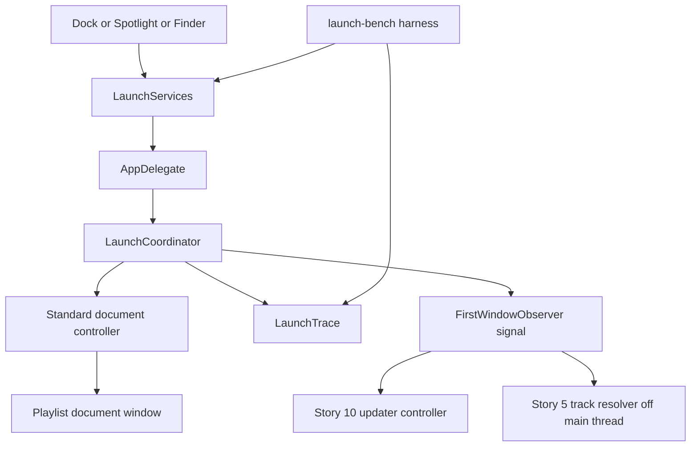
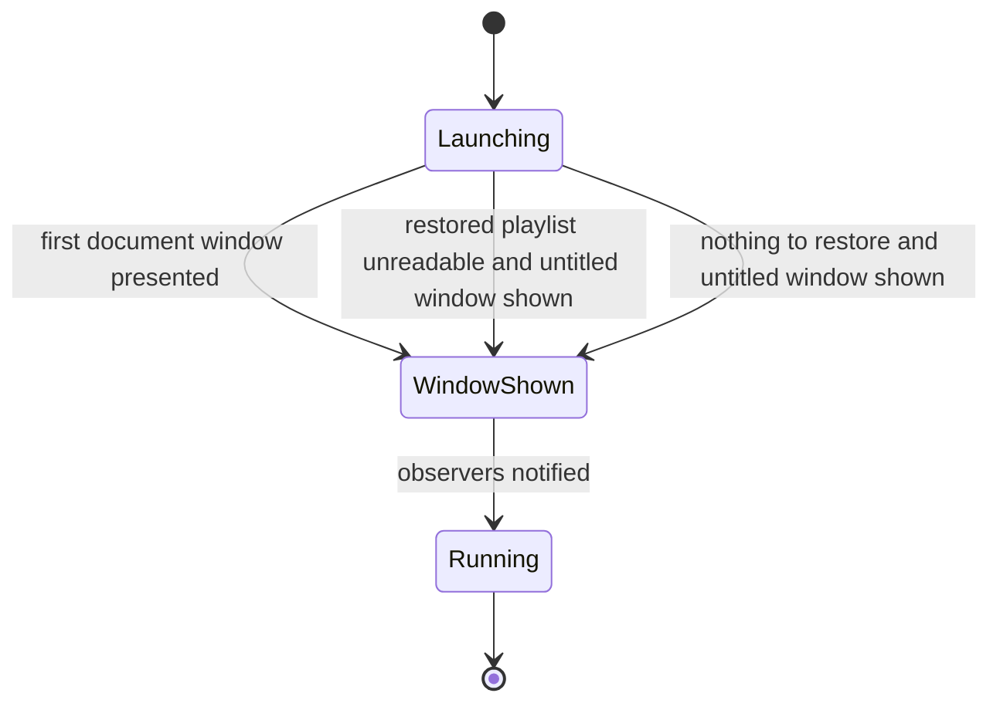
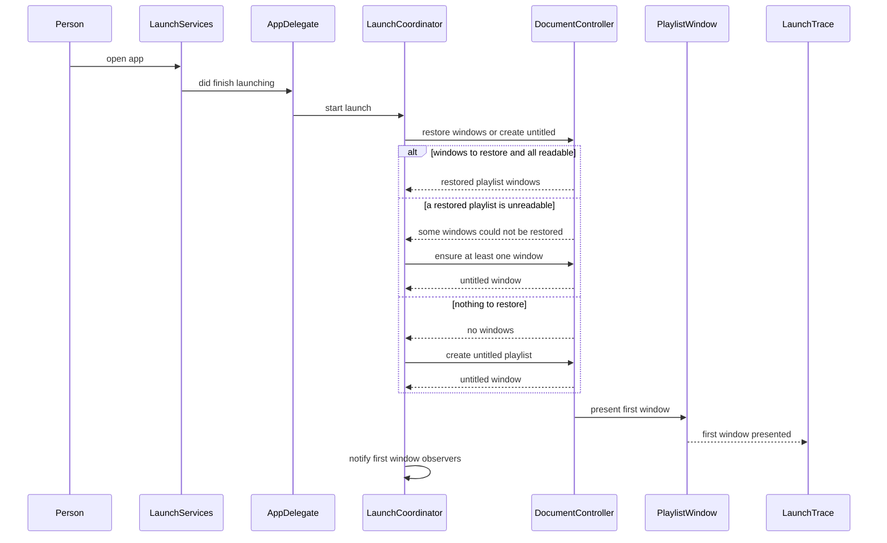
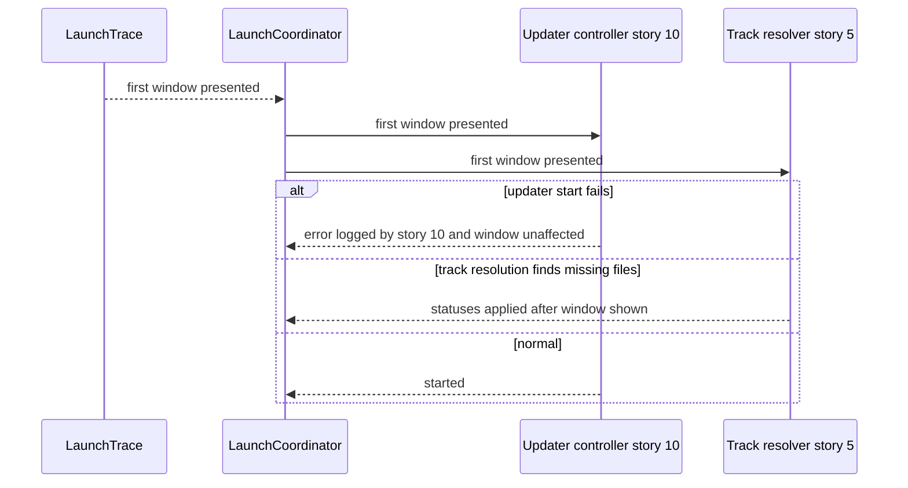
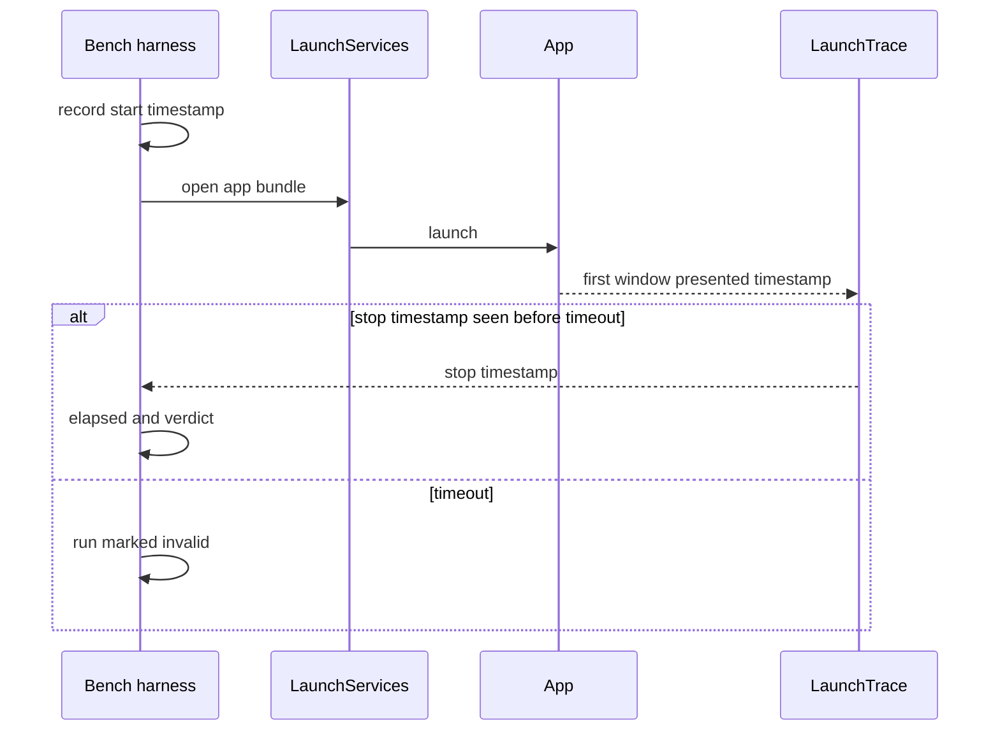

# Technical Design

Launch critical path that presents a playlist document window within 1 second, plus a repeatable launch-time measurement harness. Updater start is owned by story 10; this story asserts ordering only.

## Overview

Native Swift app, macOS 26 minimum, not sandboxed (docs/tech-architecture.md). No source tree exists yet; paths are PROPOSED locations in the new SwiftPM package, with playlist code under `Sources/LocalPlayer/Playlists/` and launch code under `Sources/LocalPlayer/App/`.

The app is document based: each playlist is a document with its own window, and there is no main window and no playlist list. The first window shown at launch is therefore a playlist document window: the windows restored from the previous session, or, when nothing is restored, an untitled new-playlist window. The untitled window is a PROPOSAL pending PRD open question 5, not a decision.

Two parts: (1) a launch critical path that does only what is needed to put the first document window on screen, with track-reference resolution (story 5, `TrackResolver`) and every other background task deferred until after that window is presented, and (2) a harness that measures the launch repeatably so the 1 second target can be checked per release.

UPDATER OWNERSHIP: starting the Sparkle updater belongs to story 10, capability `updates.controller.lifecycle`, which starts it from the first-window-presented signal. This story does not create, start or configure the updater. It publishes the signal (`FirstWindowObserver`) and asserts in tests, against a recording observer and against story 10's real controller, that the updater is started only after the first window is presented.

OPEN, deliberately not decided here (PRD open questions 1, 3 and 5): whether the target applies to cold or warm launch, how many restored windows and tracks must be supported, and what appears when there is nothing to restore. The harness reports cold and warm separately; which class gates a release is a configuration value. Fixture sizes in the tests are PROPOSED. Time from pressing play to first sound has no target and is out of scope.

The launch budget is one named constant, `launchBudgetMilliseconds = 1000`, used by the app, the harness and the tests so the number lives in one place.

## Structure


## State
No persisted state is introduced: the launch trace and any benchmark results are written only to a temporary results file chosen by the harness, never to the person's data. Windows to restore are read from the system's own restoration data, which this story only reads. The only state is the in-memory launch phase:


## Flow 1: launch to first window


## Flow 2: work deferred until after the first window


## Flow 3: measurement run


The fourth flow, bringing an already-running app to the front, shows the existing windows and does no launch work; it needs no separate sequence and is covered by TC-20 to TC-22.

## Test Strategy

## Test Scopes
- **unit**: the verdict calculation (elapsed time versus budget), launch-phase ordering, and trace parsing, using an injected clock.
- **integration**: LaunchCoordinator with the real document controller, real playlist files and real windows, but an injected clock and a recording observer in place of the updater, to assert the ORDER of work (first window presented before any observer is notified, and before reference resolution starts) and error handling. A second group runs the same ordering assertion against story 10's real `UpdaterController` once it exists. This exercises the request-handling boundary in the structure diagram (the AppDelegate entry).
- **e2e**: the built, signed app is launched by the harness on a real M2 MacBook Air and real elapsed time is measured. Timing claims can only be made at this level, because injected-clock results say nothing about real latency.

## Dimensions crossed
Launch temperature (T-cold, T-warm) x documents to restore (D0 none so an untitled window is shown, D1 one restored window, D3 three restored windows) x playlist size (P1 5 tracks, P2 500 tracks, applied to every restored playlist). The sizes are PROPOSED fixtures because the real numbers are an open question. Each dimension's classes are exhaustive and non-overlapping: a launch is exactly cold or warm; a launch restores exactly 0, 1 or 3 windows; a playlist is exactly one of the two sizes (D0 has no playlist, so its P rows use an empty untitled playlist and differ only in the temperature). Cold is approximated by running right after a Mac restart, or, for automated runs, after purging the file cache; the cache purge is a proxy and is flagged as one in the results. Expected result for every row: the harness reports elapsed milliseconds and a verdict against `launchBudgetMilliseconds`, the first window is a playlist window, and no observer is notified before the first window is presented. Whether a cold or a warm verdict gates a release is configuration pending PRD open question 1.

| Ref | Temp | Documents | Size | Expected | Level |
|---|---|---|---|---|---|
| TC-01 | cold | D0 | P1 | untitled window; elapsed and verdict reported on real M2 | e2e |
| TC-02 | cold | D0 | P2 | untitled window (size has no effect with no restored playlist); elapsed and verdict reported | e2e |
| TC-03 | cold | D1 | P1 | one restored window; elapsed and verdict reported on real M2 | e2e |
| TC-04 | cold | D1 | P2 | one restored window with 500 tracks; elapsed and verdict reported | e2e |
| TC-05 | cold | D3 | P1 | three restored windows; elapsed and verdict reported | e2e |
| TC-06 | cold | D3 | P2 | three restored 500-track windows; elapsed and verdict reported | e2e |
| TC-07 | warm | D0 | P1 | untitled window; elapsed and verdict reported on real M2 | e2e |
| TC-08 | warm | D0 | P2 | untitled window (size has no effect with no restored playlist); elapsed and verdict reported | e2e |
| TC-09 | warm | D1 | P1 | one restored window; elapsed and verdict reported on real M2 | e2e |
| TC-10 | warm | D1 | P2 | one restored window with 500 tracks; elapsed and verdict reported | e2e |
| TC-11 | warm | D3 | P1 | three restored windows; elapsed and verdict reported | e2e |
| TC-12 | warm | D3 | P2 | three restored 500-track windows; elapsed and verdict reported | e2e |

Ordering crossed with documents and updater state (U1 update available, U2 offline), using the recording observer in place of story 10's updater, and the real controller once it exists:

| Ref | Temp | Documents | Updater | Expected | Level |
|---|---|---|---|---|---|
| TC-13 | warm | D0 | U1 | first window presented before observers notified, ordering asserted | integration |
| TC-14 | warm | D1 | U1 | first window presented before observers notified, ordering asserted | integration |
| TC-15 | warm | D3 | U1 | first window presented before observers notified, ordering asserted | integration |
| TC-16 | warm | D0 | U2 | window shown, offline updater does not delay or block it | integration |
| TC-17 | warm | D1 | U2 | window shown, offline updater does not delay or block it | integration |
| TC-18 | warm | D3 | U2 | window shown, offline updater does not delay or block it | integration |
| TC-19 | warm | D1 | U1 | with a real update available and story 10's real controller, window within budget and prompt appears after | e2e |
| TC-20 | already running | D0 | U1 | existing window shown at once, no launch work repeated | integration |
| TC-21 | already running | D1 | U1 | existing windows shown at once, updater not restarted | integration |
| TC-22 | already running | D3 | U2 | existing windows shown at once, updater not restarted | integration |

## Test Case Design (boundaries and error paths)
| Ref | Capability | Case | Expected | Level |
|---|---|---|---|---|
| TC-30 | launch.measure.harness | elapsed exactly 1000 ms | verdict within budget | unit |
| TC-31 | launch.measure.harness | elapsed 1001 ms | verdict over budget | unit |
| TC-32 | launch.measure.harness | elapsed 999 ms | verdict within budget | unit |
| TC-33 | launch.measure.harness | elapsed 0 ms or negative | run marked invalid, not a pass | unit |
| TC-34 | launch.measure.harness | stop timestamp never observed before the timeout | run marked invalid, not a pass | unit |
| TC-35 | launch.measure.harness | 10 runs, one over budget | batch verdict is over budget | unit |
| TC-36 | launch.window.first_paint | no restoration data at all | untitled playlist window shown, no crash | integration |
| TC-37 | launch.window.first_paint | one restored playlist file is unreadable (permission denied) | a window is still presented and no blocking dialog delays it; the wording of any message is unspecified so it is not asserted | integration |
| TC-38 | launch.window.first_paint | restored playlist refers to an audio file that is missing | first window presented before any reference is resolved; statuses are applied after it is shown | integration |
| TC-39 | launch.window.first_paint | first window presented | trace records phase Launching then WindowShown, in order | unit |
| TC-40 | launch.window.first_paint | reference resolution starts | it runs off the main thread and only after phase WindowShown | integration |
| TC-41 | launch.measure.harness | trace path variable not set | LaunchTrace writes nothing | unit |
| TC-42 | launch.measure.harness | a real trace file written by the app | parsed to the same stop timestamp the app recorded | integration |
| TC-43 | launch.window.first_paint | observer notified | notification happens exactly once and only after WindowShown | unit |

## Negative Scenarios
| Ref | Case | Must NOT happen | Level |
|---|---|---|---|
| TC-50 | any launch | no splash screen, loading indicator or placeholder window appears before the real window | e2e |
| TC-51 | any launch | the updater (recording observer, then story 10's real controller) is not created or started before the first window is presented | integration |
| TC-52 | any launch | no network request is made before the first window is presented | integration |
| TC-53 | any launch | the audio engine is not initialised before the first window is presented | integration |
| TC-54 | harness run | the person's playlists and files are not modified and the harness writes only to its own results file | integration |
| TC-55 | over-budget run | no fake or early window is shown to hide a miss; the miss is reported | integration |
| TC-56 | any launch | no audio file is opened or resolved on the main thread before the first window is presented | integration |

## Boundary justification
The ordering and error-path claims concern what the launch coordinator does with real documents and real windows, so they are tested at the integration boundary (the AppDelegate entry shown in the structure diagram). The timing claim exists only on real hardware, so it is tested only at e2e. Pure verdict and parse logic is unit tested.

## Mock vs Integration Boundaries
| Component | Real or mocked | Reason |
|---|---|---|
| Playlist documents on disk | real files in a temporary directory | read speed and unreadable-file behaviour are under test |
| Window restoration data | real, written by a previous test launch | restoring is the behaviour under test |
| Clock | injected in unit and integration, real in e2e | ordering and boundary cases need exact times; real latency only exists at e2e |
| Updater | recording observer in unit and integration, story 10's real controller in the integration ordering group once it exists and in e2e TC-19 | this story tests the ordering around the updater, not the updater itself, which story 10 owns |
| Network | stubbed offline in U2 rows, real in TC-19 | the offline case must be reproducible |
| Window server and display | real in integration and e2e | the first presented frame is what is measured |
| LaunchServices | real in e2e only | the harness cannot drive it in a test process |

## E2E Workflows
| Ref | Workflow | Asserts |
|---|---|---|
| E2E-1 | harness runs 10 warm launches on an M2 MacBook Air and reports each elapsed time | all 10 timings and verdicts are reported, valid and over or within budget |
| E2E-2 | harness runs 10 cold launches after a restart (or cache purge, flagged as proxy) and reports separately | cold results reported separately from warm |
| E2E-3 | launch with a real update available | window within budget, update prompt appears afterwards |

## Fixtures
Six real document sets generated at setup: nothing to restore, one restored window and three restored windows, each with playlists of 5 tracks and of 500 tracks made from real encoded audio files, with real file names including non-ASCII characters and long names. Fixture sizes are proposals, not requirements. The signed release build is used for e2e, not a debug build, because debug builds are slower and would invalidate the timing.

## Deliberately not covered
Press-play-to-first-sound time, any number of windows or tracks beyond the proposed fixtures, Mac models other than the M2 MacBook Air, the choice between cold and warm as the gating class, Intel Macs, which window a file-open launch uses (story 1), and the updater itself (story 10, `updates.controller.lifecycle`). A passing run does not claim any of these.

## launch.window.first_paint

> Anchor: `launch.window.first_paint`

## Contract
Inputs: the app is opened by the person (Dock, Spotlight, Finder, Launchpad) on an M2 MacBook Air.
Outputs: the first window, a playlist document window, is presented within `launchBudgetMilliseconds` (1000) of the open action. This capability delivers `prd.launch.window` directly. The window is the set of windows restored from the previous session, or, when nothing is restored or none could be restored, an untitled new-playlist window (a PROPOSAL pending PRD open question 5). Only the work needed to present that window happens first: the standard document controller restores or creates it. Everything else (the updater, the audio engine, network access, and resolving whether each audio file in a playlist still exists) is deferred until after the window is presented. Update checking therefore cannot delay the window: this capability publishes the first-window-presented signal that story 10's `updates.controller.lifecycle` waits for, and its tests assert that no observer, including that updater, is notified or started before the window is on screen.
Errors: a missing restoration state results in the untitled window; an unreadable restored playlist still results in a window and never a blocking dialog. A launch that exceeds the budget is not hidden or faked: no placeholder window or loading indicator is shown, and the miss is reported by the harness.
Side effects: records the first-window-presented timestamp in the launch trace; advances the phase from Launching to WindowShown; then notifies the observers once.

## Implementation
Proposed files: `Sources/LocalPlayer/App/LaunchCoordinator.swift` and `Sources/LocalPlayer/App/LaunchTrace.swift`. The playlist window and document are story 4's (`Sources/LocalPlayer/Playlists/`); this story only asks the standard document controller to restore or create one.
```swift
let launchBudgetMilliseconds = 1000
enum LaunchPhase { case launching, windowShown, running }
protocol FirstWindowObserver: AnyObject { func firstWindowPresented() }
protocol LaunchTracing: AnyObject {
  func record(_ phase: LaunchPhase)
}
final class LaunchTrace: LaunchTracing {
  init(resultsPath: String?)
}
final class LaunchCoordinator {
  init(trace: LaunchTracing, observers: [FirstWindowObserver])
  func start()
}
```
No work outside this list happens before the window is presented: no updater, no audio engine initialisation, no network, no audio-file access or track-reference resolution. Story 5's resolver is one of the observers and runs off the main thread after the signal.

## Tests
TC-01 to TC-22 (ordering and e2e rows), TC-36 to TC-40, TC-43, TC-50 to TC-53, TC-55, TC-56, E2E-1 to E2E-3.

## launch.measure.harness

> Anchor: `launch.measure.harness`

## Contract
Inputs: path to the built app bundle, launch temperature class (cold or warm), number of runs (default `launchRunsPerBatch = 10`), and a document fixture (none, one window, three windows; each with playlists of a given size).
Outputs: per-run elapsed milliseconds and a verdict against `launchBudgetMilliseconds`, plus a batch verdict; cold and warm results are always reported separately. This delivers `prd.launch.window` as the repeatable check that the first window is on screen within 1 second on an M2 MacBook Air, so a result can be compared between releases. The batch fails if any run exceeds the budget, matching the PRD acceptance criteria.
Start and stop points are PROPOSALS, flagged for the owner to confirm: start = the harness records a timestamp immediately before it asks LaunchServices to open the app; stop = the app records the timestamp at which the first window is presented to the display (written to the launch trace). Both timestamps use the same monotonic clock.
Errors: if the stop timestamp is not observed before a timeout, or elapsed time is zero or negative, the run is marked invalid and is never counted as a pass.
Side effects: writes only its own results file; never touches the person's playlists or audio files.

## Implementation
Proposed files: `scripts/launch-bench.sh` (drives runs and cache purge) and `Sources/LocalPlayer/App/LaunchTrace.swift` (writes the stop timestamp when a trace path environment variable is set; does nothing otherwise).
```swift
enum LaunchVerdict: Equatable { case withinBudget(ms: Int), overBudget(ms: Int), invalid }
protocol LaunchVerdictCalculating {
  func verdict(elapsedMilliseconds: Int?) -> LaunchVerdict
}
enum LaunchTemperature { case cold, warm }
struct LaunchBatchResult { let temperature: LaunchTemperature; let verdicts: [LaunchVerdict] }
```
Cold approximation (cache purge) is a proxy and is labelled as such in results; a true cold run follows a Mac restart.

## Tests
TC-30 to TC-35, TC-41, TC-42, TC-54, E2E-1, E2E-2.

