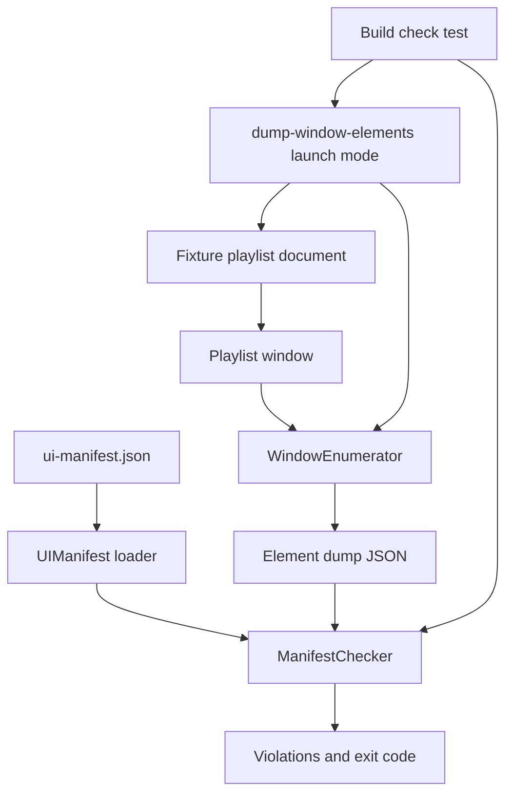
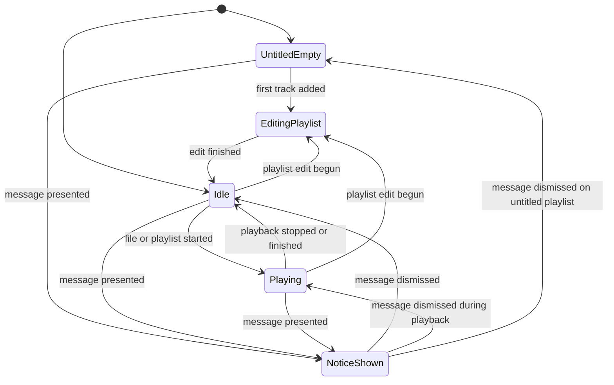
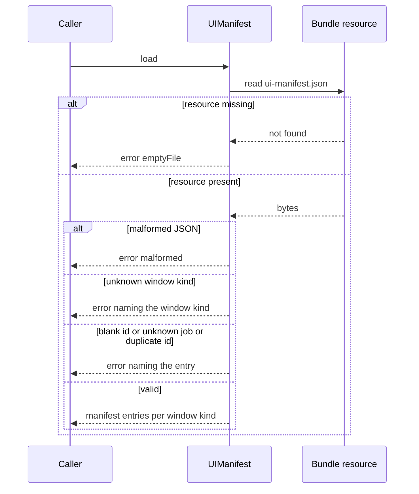
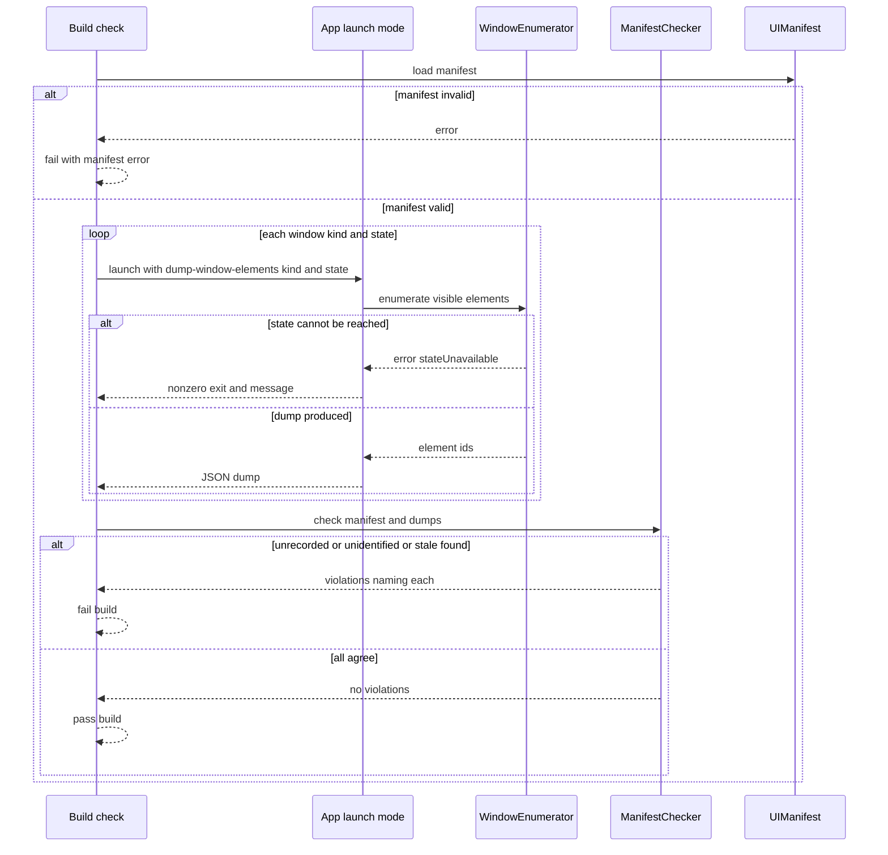

# Technical Design

A bundled element manifest maps every visible main-window element to one of three jobs; a launch-mode check enumerates the window in each state and fails on unrecorded or stale elements.

## Overview

Native Swift app, macOS 26 minimum (see docs/tech-architecture.md). No source tree exists yet; every path below is a PROPOSED location in the SwiftPM package introduced by story 1 (`Sources/LocalPlayer/...`, `Tests/LocalPlayerTests/...`, `Resources/...`). Precedent for a launch-flag check that runs inside the built app: `--test-sparkle-config` and `--test-sparkle-integration` in `/Users/julian/expts/macscreencap/ScreencapMenuBar/Sources/sparkle_config_test.swift`.

The app is document based: each playlist is a document with its own window. There is NO main window and NO list of playlists. This story's rule and check apply to a playlist document window.

The design makes simplicity checkable. A declarative manifest (`Resources/ui-manifest.json`) lists, per window kind, each visible element by its accessibility identifier and the one job it serves (play_file, play_playlist, manage_playlists). Today there is one window kind, `playlist`. A launch mode of the app (`--dump-window-elements <window-kind> <state>`) opens a fixture playlist document, walks that window's accessibility tree in a named window state, prints the visible element identifiers as JSON and exits. A checker compares the dump for every window state against the manifest and reports violations. The comparison itself is pure logic, so it is unit tested; the walk of the real window is integration and e2e tested.

The playlist window has three groups, one per job (PRD Structure). The first group (job play_file) holds the now-playing display, the transport controls, and the volume slider and mute button; those controls are defined by story 11 (control playback) and their identifiers are PROPOSED here as `playback.volume` and `playback.mute`, recorded with job play_file. The job set stays closed at three.

Window states covered: idle (a saved playlist, nothing playing), playing, editingPlaylist, noticeShown, and untitledEmpty (a new untitled playlist with no tracks).

OPEN, not decided here: which window plays a single audio file that is opened on its own (story 1). If it gets its own window, the manifest needs a second window kind (a new `WindowKind` case and its own entries) and the checker needs no change. Menus and dialogs are not covered (PRD open question 4).

Provisional decision pending PRD open question 3 (what counts as an element): an element is any view exposed to the accessibility tree that is visible in the window. A visible view with no accessibility identifier is reported as a violation, so nothing can hide by being unnamed. If the open question is later answered differently only the enumerator changes; the manifest and checker do not.

Stale-record rule used by the checker: a manifest entry is stale when it appears in NONE of the states of its window kind. An entry that exists in only some states (for example a pause control while playing) is valid.

The real playlist window and its element list do not exist yet. Until they do, the check runs against whatever window exists, and the manifest is empty or minimal. This design delivers the enforcement mechanism, not the element list.

## Structure


## State
No persisted state is introduced: the manifest is a read-only resource bundled at build time, the dump is printed and discarded, and nothing is written to disk or settings. The fixture playlist document is a temporary file removed after the run. The only state involved is the playlist window's in-memory UI state, which the enumerator drives through test-only launch seams:


## Flow 1: load the manifest


## Flow 2: run the element check


## ui.manifest.define

> Anchor: `ui.manifest.define`

## Contract
Inputs: the bytes of the bundled manifest `ui-manifest.json`.
Outputs: a `UIManifest` holding, per window kind, entries that each carry exactly one element identifier and exactly one job from the closed set play_file, play_playlist, manage_playlists. Only the window kind `playlist` is valid today. This is how `prd.simple.mapping` is delivered: the manifest is the single record of which elements a playlist window may show and which of the three jobs each serves, and an entry that names no job, or any other job, cannot be loaded, so no element can be recorded as serving something outside the three jobs. The volume slider and mute button are recorded as `playback.volume` and `playback.mute` with job play_file (identifiers PROPOSED, controls defined by story 11). The visible-element rule is then enforced against this record by `ui.manifest.enforce`.
Errors: `emptyFile` (resource missing or zero bytes), `malformed` (not valid JSON of the expected shape), `unknownWindowKind(value)`, `blankElementID(index)`, `duplicateElementID(id)`, `unknownJob(value)`. Loading never falls back to an empty manifest.
Side effects: none; read-only.

## Implementation
Proposed files: `Resources/ui-manifest.json` and `Sources/LocalPlayer/UI/UIManifest.swift`.
```swift
enum Job: String, Codable, CaseIterable { case playFile = "play_file", playPlaylist = "play_playlist", managePlaylists = "manage_playlists" }
enum WindowKind: String, Codable, CaseIterable { case playlist }
struct ManifestEntry: Codable, Equatable { let elementID: String; let job: Job }
enum ManifestError: Error, Equatable { case emptyFile, malformed, unknownWindowKind(String), blankElementID(Int), duplicateElementID(String), unknownJob(String) }
struct UIManifest { init(data: Data) throws; let entries: [WindowKind: [ManifestEntry]] }
```
The set of jobs is defined once in `Job`; adding a fourth job requires a code change and a PRD change. Adding a window kind (for example single-file playback, an OPEN question in story 1) is one new `WindowKind` case plus its entries.

## Tests
TC-20 to TC-27, TC-34, TC-36 and TC-43.

## ui.window.enumerate

> Anchor: `ui.window.enumerate`

## Contract
Inputs: a window kind (`playlist`) and a window state name (idle, playing, editing_playlist, notice_shown, untitled_empty).
Outputs: JSON list of the visible elements of that playlist window in that state, each as `{id, role}` where id is the accessibility identifier, or null when none exists. Output is sorted by id then role so it is stable. This is how `prd.simple.states` is delivered: the same dump is taken in every named window state, and the checker holds each state's dump to the manifest, so the only-recorded-elements rule is evidenced for a new untitled playlist, playing, editing a playlist and showing a message, not only for the first screen.
Errors: `stateUnavailable(name)` when the app cannot reach the requested state; the launch mode exits nonzero and prints the reason. Hidden or zero-size views are excluded.
Side effects: none on playback, saved playlists or the person's files. The launch mode opens a temporary fixture playlist document (or a new untitled one) and the app exits after printing; nothing is written to Documents or any user folder, and the fixture is removed.

## Implementation
Proposed files: `Sources/LocalPlayer/UI/WindowEnumerator.swift` and `Sources/LocalPlayer/App/UICheckMode.swift` (handles `--dump-window-elements <window-kind> <state>`; same launch-flag pattern as the Sparkle checks in macscreencap). States are reached through test-only seams that set in-memory state, never through persisted settings.
```swift
enum WindowState: String, CaseIterable { case idle, playing, editingPlaylist = "editing_playlist", noticeShown = "notice_shown", untitledEmpty = "untitled_empty" }
struct ObservedElement: Codable, Equatable { let id: String?; let role: String }
protocol WindowEnumerating { func visibleElements(kind: WindowKind, in state: WindowState) throws -> [ObservedElement] }
```

## Tests
TC-01 to TC-04, TC-100, TC-31 to TC-33, TC-35, TC-37, TC-42, TC-44 to TC-46 and E2E-1.

## ui.manifest.enforce

> Anchor: `ui.manifest.enforce`

## Contract
Inputs: a `UIManifest` and, for each window kind, one list of `ObservedElement` per window state.
Outputs: a list of violations, empty meaning pass. Violation kinds: `unrecorded(id, state)` (element visible but not in the manifest for that window kind), `unidentified(role, state)` (visible with no identifier), `stale(id)` (in the manifest but visible in no state of its window kind).
How the PRD anchors are delivered: for `prd.simple.mapping`, any visible element in a playlist window that is not in the manifest, and therefore not tied to one of the three jobs, is a violation, so the only elements that pass are those recorded with a job; for `prd.simple.unmapped`, an unrecorded or unidentified element makes the check fail with a message naming it, which fails the build; for `prd.simple.stale`, a manifest entry visible in no state makes the check fail naming the record.
Errors: an invalid manifest fails the check with the manifest error; it never passes by default. All violations are reported together, not just the first.
Side effects: none; exit status of the build check is success only when there are zero violations.

## Implementation
Proposed files: `Sources/LocalPlayer/UI/ManifestChecker.swift` (pure comparison) and `Tests/LocalPlayerTests/UIManifestCheckTests.swift` (the build check, run with the normal test command so it runs on every build).
```swift
enum Violation: Equatable { case unrecorded(String, WindowState), unidentified(String, WindowState), stale(String) }
enum ManifestChecker { static func check(manifest: UIManifest, kind: WindowKind, observed: [WindowState: [ObservedElement]]) -> [Violation] }
```
Stale means absent from every state of that window kind, not from any single state.

## Tests
TC-01 to TC-16, TC-100 to TC-103, TC-28 to TC-30, TC-40, TC-41, TC-43, TC-46 and E2E-1 to E2E-3.

## Test Strategy

## Test Scopes
- **unit**: manifest validation and the checker's comparison logic, using in-memory data only.
- **integration**: the real WindowEnumerator against a real playlist window built from a small fixture playlist document in each window state, and the checker run on the real dump. This exercises the launch-mode boundary shown in the structure diagram.
- **e2e**: the built app is launched with the real flag, a fixture playlist document is opened, its real window is dumped and compared with the real bundled manifest.

## Dimensions crossed
Window state (S1 idle, S2 playing, S3 editing playlist, S4 notice shown, S5 untitled empty) x manifest-versus-window relation (R1 agree, R2 extra visible element not recorded, R3 recorded element visible in no state, R4 visible element with no identifier). Window kind is fixed at `playlist` for every row because it is the only kind decided; a second kind (single-file window) is OPEN and would add a dimension. Equivalence classes are exhaustive and non-overlapping: each state is exactly one of the five, and each run has exactly one relation. R3 is evaluated across all five states at once (stale means absent from every state), so its five rows differ only in which state carries the other, otherwise matching elements; the expected result is the same. Rows TC-01 to TC-16 cover S1 to S4; TC-100 to TC-103 cover S5.

| Ref | State | Relation | Expected | Level |
|---|---|---|---|---|
| TC-01 | S1 | R1 | no violations, pass | integration |
| TC-02 | S2 | R1 | no violations, pass | integration |
| TC-03 | S3 | R1 | no violations, pass | integration |
| TC-04 | S4 | R1 | no violations, pass | integration |
| TC-05 | S1 | R2 | violation unrecorded naming the element and state S1, fail | integration |
| TC-06 | S2 | R2 | violation unrecorded naming the element and state S2, fail | integration |
| TC-07 | S3 | R2 | violation unrecorded naming the element and state S3, fail | integration |
| TC-08 | S4 | R2 | violation unrecorded naming the element and state S4, fail | integration |
| TC-09 | S1 | R3 | violation stale naming the record (absent in all states), fail | integration |
| TC-10 | S2 | R3 | violation stale naming the record, fail | integration |
| TC-11 | S3 | R3 | violation stale naming the record, fail | integration |
| TC-12 | S4 | R3 | violation stale naming the record, fail | integration |
| TC-13 | S1 | R4 | violation unidentified naming role and state S1, fail | integration |
| TC-14 | S2 | R4 | violation unidentified naming role and state S2, fail | integration |
| TC-15 | S3 | R4 | violation unidentified naming role and state S3, fail | integration |
| TC-16 | S4 | R4 | violation unidentified naming role and state S4, fail | integration |
| TC-100 | S5 | R1 | no violations, pass | integration |
| TC-101 | S5 | R2 | violation unrecorded naming the element and state S5, fail | integration |
| TC-102 | S5 | R3 | violation stale naming the record, fail | integration |
| TC-103 | S5 | R4 | violation unidentified naming role and state S5, fail | integration |

## Test Case Design (boundaries and error paths)
| Ref | Capability | Case | Expected | Level |
|---|---|---|---|---|
| TC-20 | ui.manifest.define | resource missing | error emptyFile | unit |
| TC-21 | ui.manifest.define | file contains an empty entry list for the playlist window kind | valid manifest with zero entries | unit |
| TC-22 | ui.manifest.define | exactly one entry | valid manifest with one entry | unit |
| TC-23 | ui.manifest.define | malformed JSON | error malformed | unit |
| TC-24 | ui.manifest.define | blank element id | error blankElementID with the entry index | unit |
| TC-25 | ui.manifest.define | duplicate element id within a window kind | error duplicateElementID naming it | unit |
| TC-26 | ui.manifest.define | job outside play_file, play_playlist, manage_playlists | error unknownJob naming it | unit |
| TC-27 | ui.manifest.define | each of the three valid jobs | accepted | unit |
| TC-28 | ui.manifest.enforce | element present in S2 only and recorded | no stale violation | unit |
| TC-29 | ui.manifest.enforce | two violations at once | both reported, not just the first | unit |
| TC-30 | ui.manifest.enforce | zero visible elements and zero records | pass | unit |
| TC-31 | ui.window.enumerate | requested state cannot be reached | error stateUnavailable and nonzero exit | integration |
| TC-32 | ui.window.enumerate | hidden or zero-size view | not reported as visible | integration |
| TC-33 | ui.window.enumerate | the same fixture dumped twice | identical output, order independent of view creation order | integration |
| TC-34 | ui.manifest.define | entries `playback.volume` and `playback.mute` recorded with job play_file | accepted as valid entries | unit |
| TC-35 | ui.window.enumerate | playing state of a playlist window with volume slider and mute button | dump contains `playback.volume` and `playback.mute` with their roles | integration |
| TC-36 | ui.manifest.define | window kind other than `playlist` | error unknownWindowKind naming it | unit |
| TC-37 | ui.window.enumerate | untitled empty state | a new untitled playlist document is opened, nothing is written to disk, and its elements are dumped | integration |

## Negative Scenarios
| Ref | Case | Must NOT happen | Level |
|---|---|---|---|
| TC-40 | element unrecorded | check must not pass because another element is recorded | unit |
| TC-41 | stale record in the manifest | check must not pass because the record looks plausible | unit |
| TC-42 | enumerator run | must not modify the window, playback or any file | integration |
| TC-43 | invalid manifest | check must not fall back to an empty manifest and pass | unit |
| TC-44 | real app launched in dump mode | must not leave the app running after the dump | e2e |
| TC-45 | dump of any state | must not leave a fixture playlist file or any other file in the person's Documents or any user folder | integration |
| TC-46 | any run | must not check the app against a main window or a list of playlists, because neither exists | integration |

## Mock vs Integration Boundaries
| Component | Real or mocked | Reason |
|---|---|---|
| Manifest resource | real file in unit and e2e; in-memory bytes for validation cases | validation rules are pure; the real file is what ships |
| Playlist window and accessibility tree | real fixture playlist window in integration; real playlist window in e2e | the traversal of the accessibility tree is the behaviour under test, so it must not be mocked |
| Playlist document | temporary fixture file in a temporary directory | the window needs a real document, and nothing may be written to user folders |
| Playback and playlist data | stubbed state seams in integration | only the window state matters here, not audio |
| Checker | real everywhere | pure logic, cheap |

## E2E Workflows
| Ref | Workflow | Asserts |
|---|---|---|
| E2E-1 | launch the built app in dump mode for the playlist window kind in every state (idle, playing, editing, notice shown, untitled empty), then run the checker with the bundled manifest | exit status is success and no violations |
| E2E-2 | same as E2E-1 with one deliberately unrecorded view injected by a test-only build flag | check fails and the report names that view |
| E2E-3 | same as E2E-1 with one entry deleted from a copy of the manifest | check fails and the report names that element |

## Fixtures
A real AppKit playlist window built from a real temporary playlist document, with buttons, a table of rows, sliders (playback position and volume), a mute button and a text label, with real accessibility identifiers, and real manifest files in each of the shapes above, not hand-written stand-ins for the dump format. The e2e manifest is the one that ships in the bundle.

## Deliberately not covered
The actual list of elements and whether each job assignment is sensible; accessibility behaviour such as VoiceOver and keyboard use; visual styling and glass effects; menus and dialogs (PRD open question 4); a window for single-file playback, if one is decided (story 1 open question); multiple playlist windows open at once; and what counts as an element beyond accessibility-visible views (open question 3). A passing run proves the playlist window and the manifest agree, not that the window is simple.

