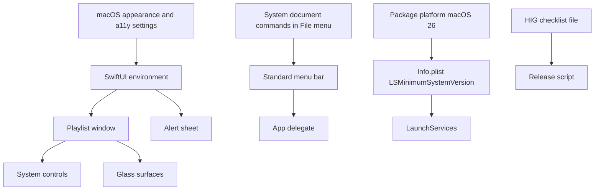
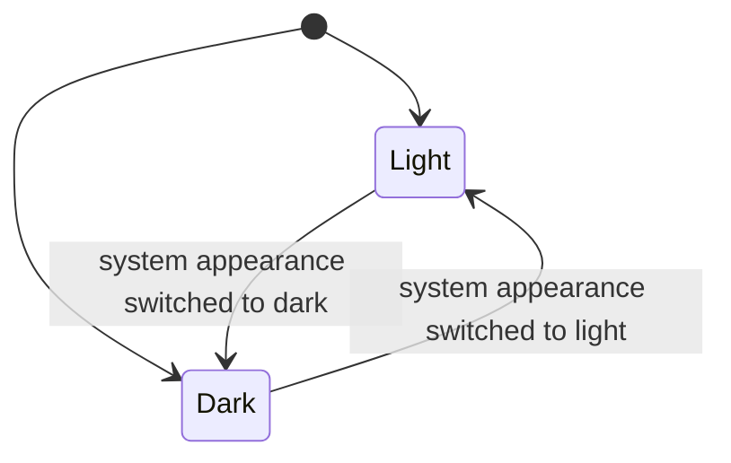
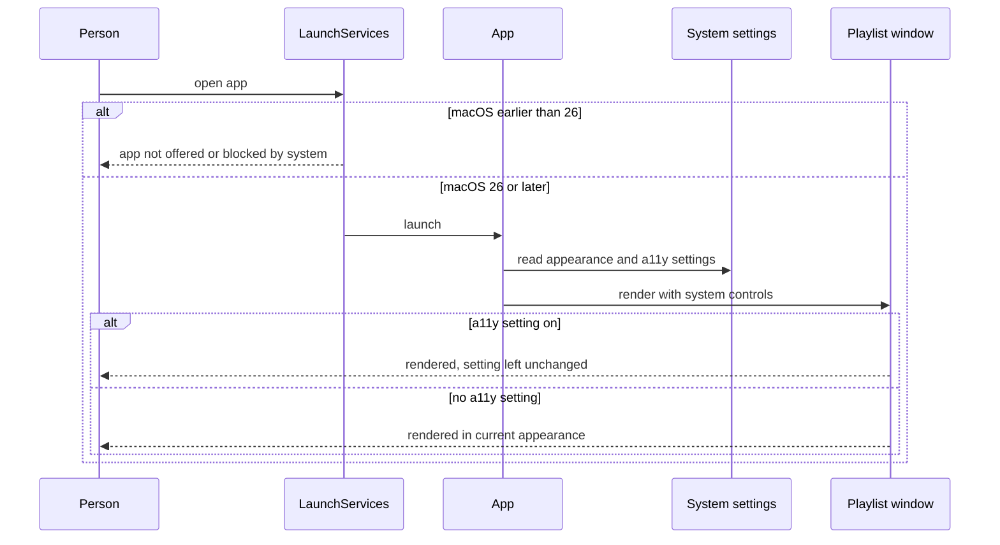
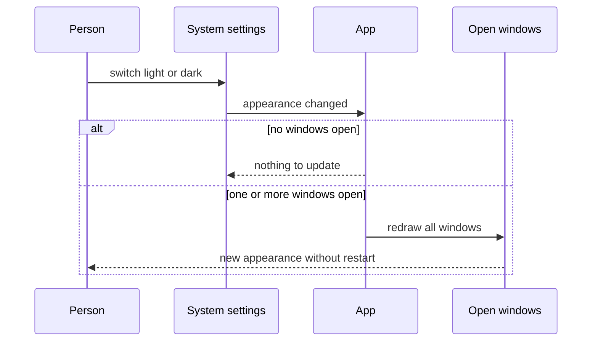
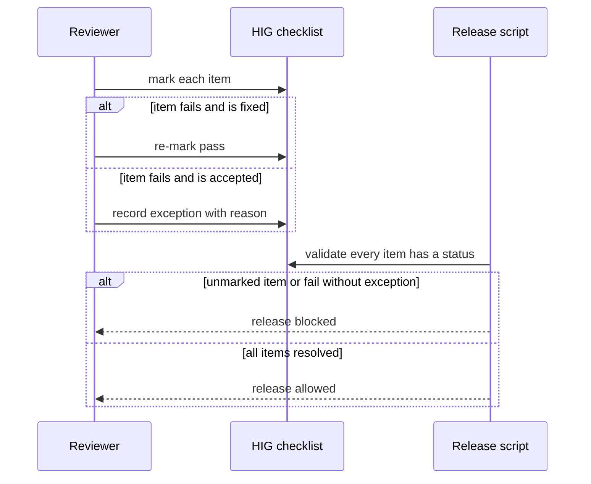

# Technical Design

Native look and feel: standard controls and menu bar, system appearance and accessibility respect, system Liquid Glass, macOS 26 floor, and a per-release HIG review checklist with proposed automated checks.

## Overview

Native Swift app for macOS 26 and later, not sandboxed (see docs/tech-architecture.md). No source tree exists yet; every path below is a PROPOSED location in the SwiftPM package introduced by story 1 (`Package.swift`, `Sources/LocalPlayer/...`, `Tests/LocalPlayerTests/...`). All chrome is built from system-provided controls (SwiftUI and AppKit standard views), so appearance, materials and accessibility behaviour come from the operating system rather than from app code.

The app is document-based: each playlist is a document that opens in its own window. There is NO main window and NO window that lists playlists. Which window plays a single audio file opened on its own is an OPEN question decided elsewhere and not assumed here.

Decided here: system controls, standard menu bar (application menu, File, Window, Help, with the standard document commands in File), follow light/dark, do not override accessibility settings, use the real Liquid Glass material where glass is used, declare macOS 26 as the minimum, and review each release against a written HIG checklist. NOT decided here (see the PRD open questions): which surfaces use glass, Reduce Transparency visuals, VoiceOver and keyboard-only requirements, sign-off, and whether an Edit menu is needed for track add and remove. Where this design proposes automated checks (accessibility audit, light/dark snapshots) they are PROPOSALS to make 'native' verifiable; they do not define the open items. A `.pen` design mock produced before interface code is a suggested option, not a requirement.

Single owner for minimum-version agreement: this story only DECLARES the macOS 26 floor in the package manifest and the Info.plist. Checking that the appcast, the Info.plist and the package manifest agree with each other is done in one place, by story 10's capability `updates.version.consistency` (`scripts/check-min-os.sh`). This design contains no validator for it.

## Structure


## State
The app introduces NO persisted state: it stores no appearance, theme or accessibility preference and writes nothing to disk for this story. Appearance is owned by the system and re-read live, so the only state is the in-memory current appearance, shown here:

The release checklist file is a versioned document, not runtime state; each item has status pass, fail or exception.

## Flow 1: launch and render in the current appearance


## Flow 2: system appearance changes while running


## Flow 3: release review


## Test Strategy

## Test Scopes
- **unit**: checklist parsing and validation, the glass-use helper that refuses custom imitation, and the shortcut-conflict check, without any window.
- **integration**: the real SwiftUI/AppKit view hierarchy of a playlist window and the alert sheet rendered in-process under forced appearance and accessibility environment values, with snapshot and structural assertions; and inspection of the built artefacts (Info.plist, Package.swift) for the declared floor. This exercises the rendering boundary shown in the structure diagram.
- **e2e**: the built, signed .app launched and driven from outside. Needed because the menu bar, system appearance switching and real accessibility settings exist only in the real app on a real system.

## Dimensions crossed
Appearance (L light, D dark) x accessibility setting (A0 none, A1 Increase Contrast, A2 Reduce Transparency, A3 Reduce Motion) x surface (S1 playlist window, S2 unsupported-file alert sheet). Equivalence classes are exhaustive and non-overlapping: appearance is exactly L or D; exactly one accessibility setting is on in a given case, or none; a surface is exactly the playlist window or the alert sheet. Expected for every row: the surface renders with system controls in the stated appearance, the app does not change the accessibility setting, and the app exposes no setting of its own that contradicts it. The exact visual result under A1, A2 and A3 is NOT asserted because it is an open question; snapshots for those rows are recorded as reference images only and compared for stability, not approved as correct.

| Ref | Appearance | A11y | Surface | Expected | Level |
|---|---|---|---|---|---|
| TC-01 | L | A0 | S1 | renders light with system controls | integration |
| TC-02 | L | A0 | S2 | renders light alert sheet | integration |
| TC-03 | L | A1 | S1 | renders, setting unchanged, visual not asserted (open question 3) | integration |
| TC-04 | L | A1 | S2 | renders, setting unchanged, visual not asserted (open question 3) | integration |
| TC-05 | L | A2 | S1 | renders, setting unchanged, visual not asserted (open question 2) | integration |
| TC-06 | L | A2 | S2 | renders, setting unchanged, visual not asserted (open question 2) | integration |
| TC-07 | L | A3 | S1 | renders, setting unchanged, motion not asserted (not specified by PRD) | integration |
| TC-08 | L | A3 | S2 | renders, setting unchanged, motion not asserted (not specified by PRD) | integration |
| TC-09 | D | A0 | S1 | renders dark with system controls | e2e |
| TC-10 | D | A0 | S2 | renders dark alert sheet | integration |
| TC-11 | D | A1 | S1 | renders, setting unchanged, visual not asserted (open question 3) | integration |
| TC-12 | D | A1 | S2 | renders, setting unchanged, visual not asserted (open question 3) | integration |
| TC-13 | D | A2 | S1 | renders, setting unchanged, visual not asserted (open question 2) | e2e |
| TC-14 | D | A2 | S2 | renders, setting unchanged, visual not asserted (open question 2) | integration |
| TC-15 | D | A3 | S1 | renders, setting unchanged, motion not asserted (not specified by PRD) | integration |
| TC-16 | D | A3 | S2 | renders, setting unchanged, motion not asserted (not specified by PRD) | integration |

Appearance change while running, crossed with number of open windows (W0 none, W1 one playlist window, W2 two playlist windows):

| Ref | Change | Windows | Expected | Level |
|---|---|---|---|---|
| TC-20 | L to D | W0 | no crash, next window opens dark | integration |
| TC-21 | L to D | W1 | window becomes dark without restart | e2e |
| TC-22 | L to D | W2 | both windows become dark | integration |
| TC-23 | D to L | W0 | no crash, next window opens light | integration |
| TC-24 | D to L | W1 | window becomes light without restart | e2e |
| TC-25 | D to L | W2 | both windows become light | integration |

## Test Case Design (per capability)
| Ref | Capability | Case | Expected | Level |
|---|---|---|---|---|
| TC-30 | ui.controls.standard | menu bar titles in order | application menu, File, Window, Help present | e2e |
| TC-31 | ui.controls.standard | application menu items | About and Quit present with standard shortcut for Quit | e2e |
| TC-32 | ui.controls.standard | scan view tree of a playlist window | every button, slider and menu is a system class; none is a custom-drawn subclass | integration |
| TC-33 | ui.controls.standard | window chrome | uses the system title bar and window buttons | integration |
| TC-34 | ui.controls.standard | menu item with no keyboard shortcut defined by macOS | item has no invented custom shortcut that conflicts with a system one | unit |
| TC-35 | ui.controls.standard | File menu contents | contains New Playlist, Open, Open Recent, Close, Save and Rename, plus the audio-file open command, each with its standard name and shortcut where macOS defines one | e2e |
| TC-36 | ui.controls.standard | two playlists opened | each is in its own window and no main window or playlist-list window exists | e2e |
| TC-40 | ui.platform.floor | built Info.plist | LSMinimumSystemVersion is 26.0 | integration |
| TC-41 | ui.platform.floor | Package manifest | platform floor declared as macOS 26 | integration |
| TC-50 | ui.glass.material | helper called with a surface request | returns the system glass material | unit |
| TC-51 | ui.glass.material | scan of view tree for custom blur or translucency layers | none found outside the system material | integration |
| TC-52 | ui.glass.material | zero glass surfaces configured | app renders with no glass and no error (list of surfaces is open question 1) | integration |
| TC-60 | ui.review.hig_checklist | checklist with all items pass | validation passes | unit |
| TC-61 | ui.review.hig_checklist | one item fail with recorded exception reason | validation passes and exception is listed | unit |
| TC-62 | ui.review.hig_checklist | one item fail with no exception | validation fails naming the item | unit |
| TC-63 | ui.review.hig_checklist | one item unmarked | validation fails naming the item | unit |
| TC-64 | ui.review.hig_checklist | empty checklist file | validation fails with no items found | unit |
| TC-65 | ui.review.hig_checklist | missing checklist file | validation fails naming the expected path | unit |

Boundary values: zero windows (TC-20, TC-23), one window, two windows; zero, one and all checklist items marked; zero glass surfaces (TC-52). Error paths: every error named in the contracts (unmarked item, fail without exception, missing file, empty file) has a case above. `ui.platform.floor` names no runtime error and contains no validator, so it has no error-path case; disagreement between the declared minimum versions is detected and tested by story 10 (`updates.version.consistency`, its TC-40 to TC-44). State transitions: TC-21, TC-24 assert appearance before and after the switch, not only the final render.

## Negative Scenarios
| Ref | Case | Must NOT happen | Level |
|---|---|---|---|
| TC-70 | app launched with each of A1, A2, A3 on | the app must not change the system setting value afterwards | e2e |
| TC-71 | any launch | the app must not expose its own light/dark or accessibility override setting | integration |
| TC-72 | scan of resources and view tree | no custom window-button images, no fake glass assets | integration |
| TC-74 | review with fail and no exception | release must not be allowed | unit |
| TC-75 | appearance change | the app must not need a restart | e2e |
| TC-76 | any launch | no main window and no window listing playlists is created | e2e |

## Test levels and boundary justification
ui.controls.standard, ui.appearance.system and ui.glass.material are verified at the rendering boundary (real view hierarchy under forced environment values) because the claims are about what is drawn; unit tests alone could not show that a system control is used. e2e is added only for what only the real system can show: the actual menu bar and its File menu, a real appearance switch and real accessibility settings. ui.platform.floor is a declaration in two files, so the sufficient boundary is inspection of the built artefacts (integration); there is no logic to unit test and the agreement check lives in story 10. ui.review.hig_checklist is pure data validation, so unit tests are sufficient.

## Mock vs Integration Boundaries
| Component | Real or mocked | Reason |
|---|---|---|
| SwiftUI and AppKit views | real | the claim under test is which controls are used |
| System appearance | forced through the environment in integration; real switch in e2e | an in-process test cannot flip the whole system, e2e does |
| Accessibility settings | forced through the environment in integration; real settings in e2e for A2 only | changing real settings in CI is intrusive; one real case proves the path |
| LaunchServices minimum-version check | not mocked; the built Info.plist is inspected, and Apple's enforcement is assumed | the app cannot test the OS's own enforcement |
| Checklist file | real files in a temporary directory | parsing the real format is the behaviour under test |
| Menu bar and File menu | real in e2e only | they do not exist outside a running app |
| Standard document commands | real, supplied by the system document machinery | the claim is that the system's own commands are used, so replacing them would prove nothing |

## E2E Workflows
| Ref | Workflow | Asserts |
|---|---|---|
| E2E-1 | launch built app, read menu bar and File menu through UI automation | titles, Quit shortcut and File menu items match TC-30, TC-31 and TC-35 |
| E2E-2 | launch app, switch system appearance light to dark and back with a window open | window follows each switch without restart |
| E2E-3 | enable Reduce Transparency, launch app, quit, read the setting | setting value unchanged, app launches and renders |
| E2E-4 | proposed accessibility audit of a playlist window | audit reports no issues in the categories the audit tool supports, with any known issues listed as recorded exceptions |
| E2E-5 | open two playlist files | each opens in its own window and no other window appears (TC-36, TC-76) |

## Fixtures
A real in-process playlist window populated with a realistic playlist of 12 track rows, a real alert sheet with the real unsupported-file text from story 1, real checklist files covering all item states, and a real built Info.plist and Package.swift. No hand-drawn stubs for the view hierarchy.

## Deliberately not covered
Which surfaces use glass; what the app looks like under Reduce Transparency, Increase Contrast or Reduce Motion beyond rendering and non-override; VoiceOver and keyboard-only operation; whether the result looks 'designed by Apple's best team' (needs a human sign-off that has not been named); whether an Edit menu is needed for track add and remove (open); which window plays a single opened audio file (open); macOS earlier than 26; and agreement between the several declared minimum versions, which is story 10's check. A passing run does not claim any of these.

## ui.platform.floor

> Anchor: `ui.platform.floor`

## Contract
Inputs: none at runtime. The artefacts are the package manifest platform setting and the built Info.plist.
Outputs: the app DECLARES macOS 26.0 as its minimum in both the package manifest and the Info.plist key `LSMinimumSystemVersion`, so macOS 26 or later is required and Macs on an earlier version are not offered the app. This delivers `prd.look.platform`: the requirement and the declaration are the same artefact, because with both values at 26.0 the system itself refuses an earlier macOS, and the integration tests inspect the built artefacts to show both values say 26.0.
Agreement checking: this capability contains NO validator and defines no validation types. Whether the Info.plist, the package manifest and the update feed's minimum version agree with each other is checked in one place only, by story 10's capability `updates.version.consistency` (`scripts/check-min-os.sh`), which the release script runs first. This story declares and inspects its own two values and nothing more.
Errors: none at runtime.
Side effects: none.

## Implementation
Proposed files: `Package.swift` with `platforms: [.macOS(.v26)]` and `Resources/Info.plist` with `LSMinimumSystemVersion` set to `26.0`. There are no Swift types and no scripts in this capability.

## Tests
TC-40 (built Info.plist declares 26.0) and TC-41 (package manifest declares macOS 26), both integration inspection of the built artefacts. Disagreement between declarations is covered by story 10 (TC-40 to TC-44 there), not duplicated here.

## ui.controls.standard

> Anchor: `ui.controls.standard`

## Contract
Inputs: the app's window definitions and menu definitions.
Outputs: playlist windows, buttons, sliders and menus are system-provided classes (delivering `prd.look.controls`), and the menu bar contains the application menu with About and Quit, File, Window and Help with standard names and standard shortcuts, where the File menu contains the standard document commands New Playlist, Open, Open Recent, Close, Save and Rename together with the command that opens an audio file (delivering `prd.look.menubar`).
Errors: none at runtime; a custom-drawn control, a missing or misnamed menu, or a missing File menu command is caught by the tests.
Side effects: none. No custom title bar, window buttons or drawn controls exist. Each playlist document has its own window; there is no main window and no window that lists playlists.

## Implementation
Proposed files: `Sources/LocalPlayer/App/AppMenu.swift` and `Sources/LocalPlayer/UI/PlaylistWindow.swift`. The standard document commands (New, Open, Open Recent, Close, Save, Rename) come from the system's document machinery for a document-based app (proposal: SwiftUI `DocumentGroup` or `NSDocument`), so their names and shortcuts are the system's. The app adds only the command that opens an audio file (story 1's Open item; the exact naming of the two Open commands is provisional). Whether an Edit menu is needed for adding and removing tracks is open (PRD open question 6).
```swift
enum AppMenu { static func makeMenuBar(target: AnyObject) -> NSMenu }
struct PlaylistWindowView: View { var body: some View }
```
The menu is built from standard menu items and selectors; the window is standard SwiftUI views in a standard window. No view subclass draws its own button or slider appearance. Items the app offers use macOS-standard shortcuts (Cmd-Q for Quit, Cmd-N for New Playlist, Cmd-O for Open, Cmd-W for Close, Cmd-S for Save).

## Tests
TC-30 to TC-36, covering menu titles, the File menu contents and one window per playlist at the rendering boundary and in the real app; E2E-1 and E2E-5; TC-72 and TC-76.

## ui.appearance.system

> Anchor: `ui.appearance.system`

## Contract
Inputs: the system appearance (light or dark) and the system accessibility display settings, read from the system.
Outputs: every open window shows the current appearance and updates when it changes, with no restart (delivering `prd.look.appearance`); the app never turns a system accessibility setting off, overrides it, or offers its own setting that contradicts it (delivering `prd.look.a11y_respect`).
Errors: none expected; with zero windows open a change is a no-op and the next window opens in the current appearance.
Side effects: none persisted. The app never writes to system appearance or accessibility preferences and has no preference of its own for either.

## Implementation
Proposed file: `Sources/LocalPlayer/UI/AppearanceModel.swift`, read-only over the system environment.
```swift
@Observable final class AppearanceModel {
  var colorScheme: ColorScheme { get }
  var increaseContrast: Bool { get }
  var reduceTransparency: Bool { get }
  var reduceMotion: Bool { get }
}
```
There are no setters and no appearance or accessibility pane in the app. How the UI should look under each accessibility setting is an open question; this capability only guarantees the app reads and honours the system value and does not contradict it.

## Tests
TC-01 to TC-16, TC-20 to TC-25, TC-70, TC-71, TC-75, E2E-2, E2E-3, proposed E2E-4.

## ui.glass.material

> Anchor: `ui.glass.material`

## Contract
Inputs: a request from a view to render a glass surface.
Outputs: the system-provided Liquid Glass material, never a custom-drawn blur, gradient or image imitating it (delivering `prd.look.glass`). Which surfaces request glass is NOT decided here (PRD open question 1); with no surfaces configured the app renders with no glass.
Errors: none; a view that tries to bypass the helper is caught by the view-tree scan.
Side effects: none.

## Implementation
Proposed file: `Sources/LocalPlayer/UI/GlassSurface.swift`, the only place glass is created, plus a scan helper in `Tests/LocalPlayerTests/UI/GlassScan.swift` that flags custom blur or translucency layers.
```swift
struct GlassSurface<Content: View>: View {
  init(@ViewBuilder content: () -> Content)
  var body: some View
}
```
The system material adapts itself to appearance and accessibility settings.

## Tests
TC-50, TC-51, TC-52, TC-72.

## ui.review.hig_checklist

> Anchor: `ui.review.hig_checklist`

## Contract
Inputs: the checklist document `docs/hig-checklist.md` with one line per item and a status of pass, fail or exception (with a written reason).
Outputs: a validation result that passes only when every item is pass, or fail with a recorded exception reason; the release is accompanied by this recorded review (delivering `prd.look.review`).
Errors: unmarked item, fail without exception, empty file and missing file each fail validation and name the item or path.
Side effects: blocks the release step when validation fails. The checklist content (which HIG sections apply) is a PROPOSAL to be written; who signs off is an open question.

## Implementation
Proposed files: `docs/hig-checklist.md` and `Scripts/HIGChecklist.swift`, called from the release script. Proposed starting items: system controls, menu bar, light/dark, accessibility settings, glass use, window behaviour. The accessibility audit (E2E-4) and the light/dark snapshots are proposed automated checks that feed some items; a `.pen` mock before interface code is a suggested option, not a requirement.
```swift
enum ChecklistStatus: Equatable { case pass, fail, exception(reason: String), unmarked }
struct ChecklistItem: Equatable { let id: String; let status: ChecklistStatus }
enum ChecklistError: Error, Equatable { case fileMissing(String), noItems, unmarked(String), failWithoutException(String) }
func validateChecklist(at path: String) -> [ChecklistError]
```

## Tests
TC-60 to TC-65, TC-74.

