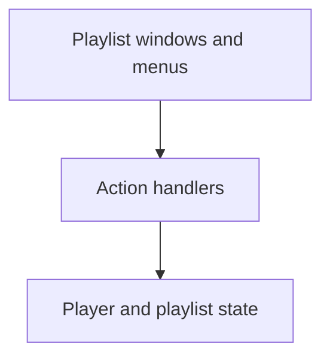
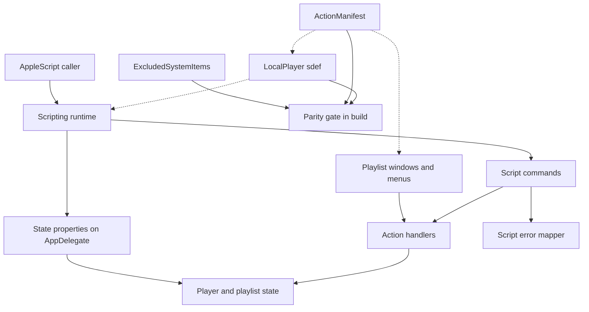
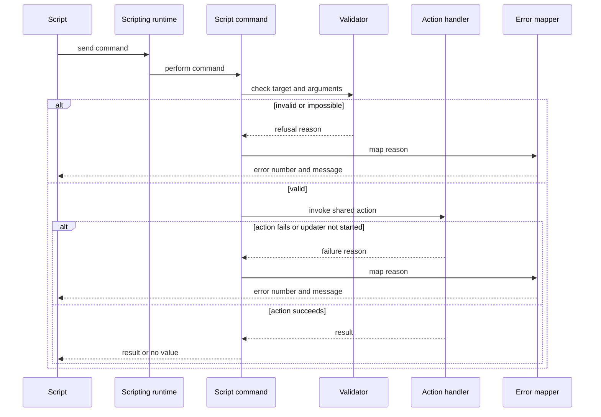
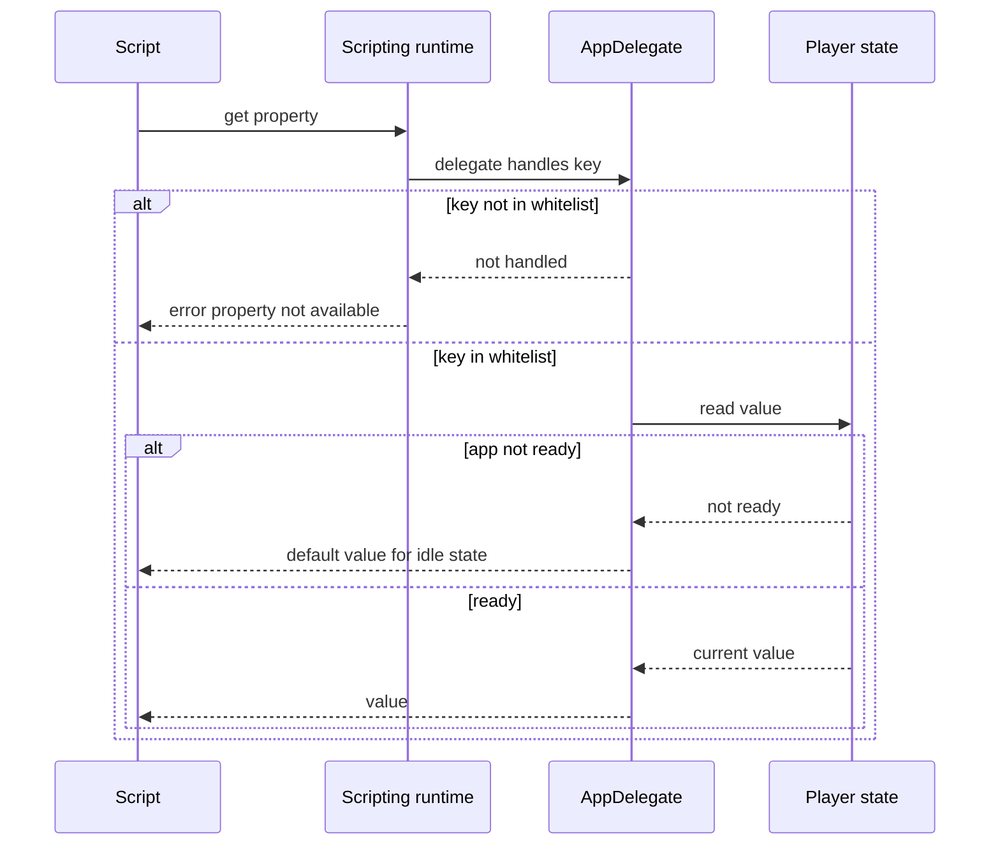
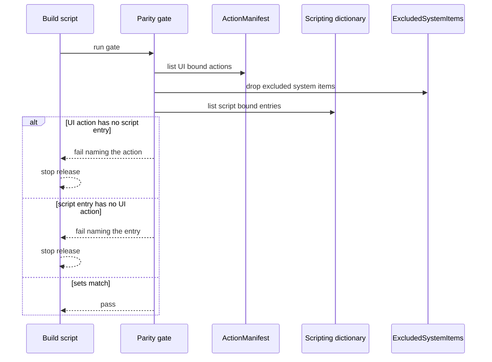
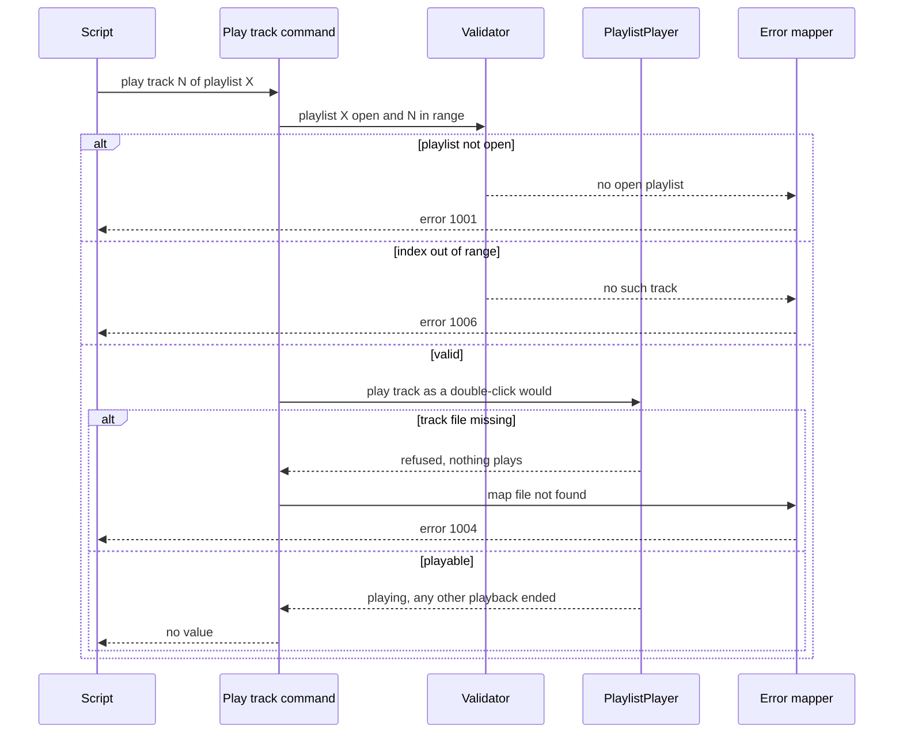

# Technical Design

Parity-driven AppleScript interface for a document-based player: dictionary, commands and properties calling the same actions as the UI, a build-time parity gate with an explicit excluded-system-items list, and dual-route regression tests.

## Overview

Native Swift app, macOS 26 minimum, not sandboxed. No source tree exists yet; all paths are PROPOSED locations in the SwiftPM package introduced by the open-file story (`Sources/LocalPlayer/...`, `Resources/...`, `Tests/LocalPlayerTests/...`). Playlist code lives in `Sources/LocalPlayer/Playlists/`.

App model (owner decisions): the app is document based. Each playlist is a document with its own window; there is no main window and no playlist list. Playlists are ordinary files the person saves wherever they choose (default offered folder is Documents). Deleting a playlist is done in Finder and is NOT an app feature, so there is no delete command. Scripts address a playlist by the name of an OPEN playlist document. Only one thing plays at a time (confirmed by the owner). Which window plays a single audio file opened on its own is an OPEN question owned by other stories; scripts only need the shared open action.

Grounding: the scripting pattern is taken from the existing Cutaway app in `/Users/julian/expts/macscreencap/ScreencapMenuBar`. There, `Info.plist` sets `NSAppleScriptEnabled` to true and `OSAScriptingDefinition` to `Cutaway.sdef`; the sdef (`Sources/Cutaway.sdef`) declares an `application` class whose properties map to KVC keys (for example `scriptIsRecording`); `Sources/ScriptCommands.swift` holds one `NSScriptCommand` subclass per command with an error-number enum and `scriptErrorNumber` / `scriptErrorString`; `Sources/AppDelegate+Scripting.swift` exposes the KVC properties on the app delegate and whitelists them in `application(_:delegateHandlesKey:)` because NSApplication dispatches script KVC to its delegate; `Sources/AppleScriptTest.swift` is a unit-test runner behind a launch flag. This design reuses that mechanism but not its commands or error codes.

The command and property set is PARITY-DRIVEN. An `ActionManifest` lists every user action once (id, description, UI binding, script binding). The windows, the menus and the script commands all invoke the same action handlers, so a scripted action and its click produce the same result by construction. A build-time parity gate fails when an app-specific UI action has no script binding, and the dual-route suite exercises every manifest entry by both routes. System-standard menu items are skipped by an explicit `ExcludedSystemItems` list (About, Quit, Hide, Services, the Window menu and the Help menu); anything not on that list must have a script binding.

Current action set (19): open file, play, play track, pause, stop, seek, next, previous, volume, mute, shuffle, repeat, new playlist, rename playlist, add track, remove track, reorder track, locate missing file, check for updates. "Play track" is the double-click on a track row in a playlist window (owner decision); the playlist-playback story owns `PlaylistPlayer.play(track:)`, and the script command `play track N of playlist X` calls the same handler.

Other stories supply the engine and handlers this story maps to (not defined here): the control-playback story owns the `PlaybackEngine` additions `pause()`, `resume()`, `seek(toSeconds:) -> Bool`, `position`, `duration`, `volume` (0.0 to 1.0), `isMuted` and `setMuted(_:)`, and the saving of volume and mute between launches; the playlist stories own `Playlist`, `Track`, `TrackReference` and `TrackStatus` and `PlaylistPlayer`; the updates story owns `UpdaterController`. Story 9 only maps script commands onto them. Volume is exposed to scripts as an integer 0 to 100 using named constants `scriptVolumeMin = 0` and `scriptVolumeMax = 100`, mapped to the engine range by dividing by `scriptVolumeMax`. Volume and mute are the player's own settings and are SAVED across launches (owner decision); a script sets them through the same settings path as the on-screen controls, so the saved values are identical whichever route set them.

Decided by the owner and no longer provisional: error numbers 1001 to 1008 are accepted for now and may change until the first release. Previous track follows the on-screen control: on the first track it goes to the last track when repeat is on, does nothing when repeat is off, and with shuffle on it goes back through the shuffled order. This reading of the owner's answer is an INTERPRETATION PENDING OWNER CONFIRMATION; the script command must simply give the same result as the control, whatever the control's rule turns out to be.

Assumptions that remain provisional: `make playlist` with only a name saves into Documents, with a full path saves there, with neither stays untitled and unsaved; an unwritable save location returns 1005; playing a track whose file is missing returns 1004 and plays nothing, matching the silent refusal of the double-click.

## Structure: current
Before this story the player (as defined by the other stories) can only be driven from its playlist windows and menus.


## Structure: target
This story adds a second route into the same action handlers, the dictionary that describes it, state reads, an error mapper and the parity gate. The action handlers and player state are unchanged.


## State
Scripting adds no persisted or long-lived state of its own. Every property it reads (playing, current track, position, volume, muted, shuffle, repeat, open playlists) is owned by the playback, playlist and settings stories, and every command mutates only that existing state through the shared action handlers. Playlist changes reach disk only through the playlist document's own saving, owned by the playlist stories. Shuffle, repeat, volume and mute persistence across launches is implemented by the playback stories; this story only reads and writes it through the same handlers. For that reason no state diagram is drawn.

## Flow 1: run a script command


## Flow 2: read a property


## Flow 3: parity gate in the release build


## Flow 4: play a chosen track by script


## Test Strategy

## Test Scopes
- **unit**: the dictionary file (parses, entries), the error mapper, manifest comparison logic including the excluded list, and the property whitelist. No app launch.
- **integration**: script commands and property reads executed in-process through the real scripting runtime against the real action handlers, with the audio output replaced by a recording sink, a recording update-check stub and a real temporary playlist folder. This exercises the request-handling boundary shown in the structure diagram (scripting runtime to command to handler).
- **e2e**: the built, signed app launched and driven both by real UI automation and by real `osascript`. Needed because the UI route (clicks, menus, double-clicks) and cross-process Apple events exist only in the real bundle, and because saved volume and mute need a real quit and relaunch.

## Dimensions crossed
Action (F1 open file, F2 play, F3 pause, F4 stop, F5 seek, F6 next, F7 previous, F8 volume, F9 mute, F10 shuffle, F11 repeat, F12 new playlist, F13 rename playlist, F14 add track, F15 remove track, F16 reorder track, F17 locate missing file, F18 check for updates, F19 play track) x route (UI, AppleScript). The action list is today's parity set from the product requirements (19 actions); when the UI gains an action the manifest and this table gain a row (enforced by the parity gate). Each AppleScript row asserts that the final player and playlist state is identical to the state produced by the matching UI row, which is the equivalence check. Route classes are exhaustive and non-overlapping: an action is invoked either from a playlist window or menu, or from a script, never both in one case. TC numbers follow the rule TC for action Fn on the UI route = 2n-1, on the AppleScript route = 2n, so F19 is TC-37 and TC-38.

| Ref | Action | Route | Case | Expected | Level |
|---|---|---|---|---|---|
| TC-01 | F1 open file | UI | File > Open an mp3 | plays from 0:00 | e2e |
| TC-02 | F1 open file | AppleScript | open the same mp3 | plays from 0:00, state equals TC-01 | integration |
| TC-03 | F2 play | UI | press play on a loaded track | state Playing | e2e |
| TC-04 | F2 play | AppleScript | play | state Playing, equals TC-03 | integration |
| TC-05 | F3 pause | UI | press pause while playing | state Paused, position kept | e2e |
| TC-06 | F3 pause | AppleScript | pause while playing | state Paused, equals TC-05 | integration |
| TC-07 | F4 stop | UI | press stop while playing | state Stopped, position 0 | e2e |
| TC-08 | F4 stop | AppleScript | stop while playing | state Stopped, equals TC-07 | integration |
| TC-09 | F5 seek | UI | drag position to 10 seconds | position 10 seconds | e2e |
| TC-10 | F5 seek | AppleScript | seek to 10 | position 10 seconds, equals TC-09 | integration |
| TC-11 | F6 next | UI | press next in a 3 track playlist | track 2 playing | e2e |
| TC-12 | F6 next | AppleScript | next track | track 2 playing, equals TC-11 | integration |
| TC-13 | F7 previous | UI | press previous on track 2 | track 1 playing | e2e |
| TC-14 | F7 previous | AppleScript | previous track | track 1 playing, equals TC-13 | integration |
| TC-15 | F8 volume | UI | drag the volume control to the middle | engine volume 0.5 | e2e |
| TC-16 | F8 volume | AppleScript | set volume to 50 | engine volume 0.5, equals TC-15 | integration |
| TC-17 | F9 mute | UI | press the mute control | muted, volume value unchanged | e2e |
| TC-18 | F9 mute | AppleScript | set muted to true | muted, volume value unchanged, equals TC-17 | integration |
| TC-19 | F10 shuffle | UI | click shuffle on | shuffle on, persisted | e2e |
| TC-20 | F10 shuffle | AppleScript | set shuffle true | shuffle on, persisted, equals TC-19 | integration |
| TC-21 | F11 repeat | UI | press repeat until all | repeat all, persisted | e2e |
| TC-22 | F11 repeat | AppleScript | set repeat to all | repeat all, persisted, equals TC-21 | integration |
| TC-23 | F12 new playlist | UI | File > New Playlist | an untitled playlist document is open and empty | e2e |
| TC-24 | F12 new playlist | AppleScript | make playlist | an untitled playlist document is open and empty, equals TC-23 | integration |
| TC-25 | F13 rename playlist | UI | rename saved playlist Morning to Evening | the document file is named Evening and Morning is gone | e2e |
| TC-26 | F13 rename playlist | AppleScript | rename playlist Morning to Evening | the document file is named Evening, equals TC-25 | integration |
| TC-27 | F14 add track | UI | add song.mp3 to the open playlist Morning | Morning has 1 track | e2e |
| TC-28 | F14 add track | AppleScript | add song.mp3 to playlist Morning | Morning has 1 track, equals TC-27 | integration |
| TC-29 | F15 remove track | UI | remove track 1 from a 2 track playlist | 1 track left, order kept, audio file untouched | e2e |
| TC-30 | F15 remove track | AppleScript | remove track 1 | 1 track left, equals TC-29 | integration |
| TC-31 | F16 reorder track | UI | drag track 3 to position 1 | order 3,1,2 | e2e |
| TC-32 | F16 reorder track | AppleScript | move track 3 to position 1 | order 3,1,2, equals TC-31 | integration |
| TC-33 | F17 locate missing file | UI | locate moved file for a greyed track | track playable again | e2e |
| TC-34 | F17 locate missing file | AppleScript | locate track with new file | track playable, equals TC-33 | integration |
| TC-35 | F18 check for updates | UI | choose Check for Updates in the app menu | one update check starts | e2e |
| TC-36 | F18 check for updates | AppleScript | check for updates | one update check starts, equals TC-35 | integration |
| TC-37 | F19 play track | UI | double-click track 2 of a 3 track playlist while track 1 plays | track 1 stops, track 2 plays from 0:00, only one thing playing | e2e |
| TC-38 | F19 play track | AppleScript | play track 2 of playlist Morning while track 1 plays | track 1 stops, track 2 plays from 0:00, state equals TC-37 | integration |

## Test Case Design (boundaries and error paths)
Equivalence classes for arguments: playlist open / not open; index within 1..N / below 1 / above N; seek time within 0..duration / negative / beyond duration; volume within 0..100 / below 0 / above 100; file supported and present / unsupported / missing; track playable / track file missing; player state ready / not ready; something playing / nothing playing; update service started / not started; position in playlist first / middle / last. Classes within each pair are exhaustive and non-overlapping.

| Ref | Capability | Case | Expected | Level |
|---|---|---|---|---|
| TC-40 | scripting.errors.report | rename, add or remove on a playlist name that is not open | error 1001 and message No open playlist named X, no state change | integration |
| TC-41 | scripting.errors.report | pause, stop, seek, next or previous with nothing playing | error 1002, no state change | integration |
| TC-42 | scripting.errors.report | open a .flac | error 1003 with the same wording as the on-screen notice, playback unchanged | integration |
| TC-43 | scripting.errors.report | open a path that does not exist | error 1004, playback unchanged | integration |
| TC-44 | scripting.errors.report | seek to -1 and seek beyond duration | error 1005 each, position unchanged | integration |
| TC-45 | scripting.errors.report | volume -1 and volume 101 | error 1005 each, volume unchanged | integration |
| TC-46 | scripting.errors.report | track index 0 and index N+1 | error 1006 each, playlist unchanged | integration |
| TC-47 | scripting.errors.report | locate with a file that is unreadable | error 1007, track stays greyed | integration |
| TC-48 | scripting.errors.report | any command before app setup completes | error 1008, no state change | integration |
| TC-49 | scripting.commands.updates | check for updates while the update service has not started | error 1008, no update check starts | integration |
| TC-50 | scripting.commands.playback | seek to exactly 0 and to exactly the duration | both accepted, position 0 and end | integration |
| TC-51 | scripting.commands.playback | volume exactly 0 and exactly 100 | both accepted, engine volume 0.0 and 1.0 | integration |
| TC-52 | scripting.commands.playback | set muted true twice in a row | second call accepted, still muted, no error | integration |
| TC-53 | scripting.commands.library | playlist with 0 tracks and with 1 track: remove and reorder | remove empties it; reorder 1 to 1 is a no-op, not an error | integration |
| TC-54 | scripting.commands.library | make playlist with a name only | untitled playlist document saved as that name in Documents (provisional) | integration |
| TC-55 | scripting.commands.library | make playlist with a full path in a writable folder | playlist document saved at that path | integration |
| TC-56 | scripting.commands.library | make playlist with a path in an unwritable folder | error 1005, no document file created | integration |
| TC-57 | scripting.state.read | read every property in idle, playing and paused states | idle defaults, then live values for playing, track, position, volume, muted, shuffle and repeat; before and after snapshots identical | unit |
| TC-58 | scripting.state.read | read a key outside the whitelist | not handled, error property not available | unit |
| TC-59 | scripting.dictionary.define | parse the sdef | well formed, every entry has a description and a handler key | unit |
| TC-60 | scripting.dictionary.define | bundle Info.plist | NSAppleScriptEnabled true and OSAScriptingDefinition names the sdef file that exists in Resources | integration |
| TC-61 | scripting.parity.enforce | manifest has an app-specific UI action with no script entry | gate fails and names the action | unit |
| TC-62 | scripting.parity.enforce | sdef has an entry with no UI action | gate fails and names the entry | unit |
| TC-63 | scripting.parity.enforce | matching sets | gate passes | unit |
| TC-64 | scripting.parity.enforce | UI items About, Quit, Hide, Services, Window menu and Help menu have no script entry | gate passes, they are on ExcludedSystemItems | unit |
| TC-65 | scripting.parity.enforce | an app-specific menu item not on the excluded list and with no script entry | gate fails and names it | unit |
| TC-66 | scripting.parity.enforce | run gate inside the real release build script on a fixture with a deliberate gap | build exits non-zero before signing | integration |
| TC-67 | scripting.tests.dual_path | add a manifest entry with no dual-route test | the suite fails naming the entry | integration |
| TC-68 | scripting.tests.dual_path | manifest has 19 entries | the suite reports 19 UI cases and 19 script cases | integration |

Previous track at the edges (UI route and AppleScript route compared; the rule is the on-screen control's, shown here as the owner's answer, an INTERPRETATION PENDING OWNER CONFIRMATION):

| Ref | Capability | Case | Expected | Level |
|---|---|---|---|---|
| TC-80 | scripting.commands.playback | previous track on track 1 of a 3 track playlist, repeat off, shuffle off | nothing changes: track 1 keeps playing from its current position, state equals the UI route | integration |
| TC-81 | scripting.commands.playback | previous track on track 1, repeat all, shuffle off | track 3 plays from 0:00, state equals the UI route | integration |
| TC-82 | scripting.commands.playback | previous track on the third track of a seeded shuffle pass, shuffle on | the second track of the pass plays, state equals the UI route | integration |
| TC-83 | scripting.commands.playback | previous track on the first track of a seeded shuffle pass, repeat all, shuffle on | the last track of the pass plays; with repeat off nothing changes; both equal the UI route | integration |

Play track by script (error and edge cases):

| Ref | Capability | Case | Expected | Level |
|---|---|---|---|---|
| TC-84 | scripting.commands.playback | play track 0 and play track N+1 | error 1006 each, current playback unchanged | integration |
| TC-85 | scripting.commands.playback | play track whose file is missing (greyed) | error 1004, nothing plays, no dialog, equals the silent refusal of the double-click | integration |
| TC-86 | scripting.commands.playback | play track of playlist that is not open | error 1001, no state change | integration |
| TC-87 | scripting.commands.playback | play track 1 and play track N (first and last), nothing else playing | each plays from 0:00 | integration |

Volume and mute are saved across launches (script set then relaunch then read, and the UI equivalent):

| Ref | Capability | Case | Expected | Level |
|---|---|---|---|---|
| TC-88 | scripting.state.read | set volume to 30 by script, quit, relaunch, read volume | 30, and the on-screen control shows 30 | e2e |
| TC-89 | scripting.state.read | set volume to 30 with the on-screen control, quit, relaunch, read volume by script | 30, equal to TC-88 | e2e |
| TC-90 | scripting.state.read | set muted true by script, quit, relaunch, read muted | true, volume value unchanged | e2e |
| TC-91 | scripting.state.read | set muted true with the on-screen control, quit, relaunch, read muted by script | true, equal to TC-90 | e2e |

## State transitions
Every command row in the tables above asserts the player and playlist state BEFORE and AFTER the call, not only the returned value. Error rows (TC-40 to TC-49, TC-56, TC-84 to TC-86) assert before equals after.

## Negative Scenarios
| Ref | Case | Must NOT happen | Level |
|---|---|---|---|
| TC-70 | any refused command | no change to playback, playlists, settings or files | integration |
| TC-71 | any property read | no state change and no side effect such as starting playback | unit |
| TC-72 | the sdef | no command or property without a UI action in the manifest | unit |
| TC-73 | first scripted command | no prompt or setting inside the app must be enabled for scripting | e2e |
| TC-74 | any command, including remove track and rename | no audio file is deleted or moved and no playlist file is deleted | integration |
| TC-75 | scripted open | no import step, library prompt or confirmation appears | e2e |
| TC-76 | the sdef | no command that deletes a playlist exists | unit |
| TC-77 | the sdef and manifest | no script entry for About, Quit, Hide, Services, the Window menu or the Help menu | unit |
| TC-78 | play track by script while another track plays | two things must not play at once | integration |
| TC-79 | volume or mute set by script | the saved volume must not differ from the one the on-screen control would have saved | integration |

## Mock vs Integration Boundaries
| Component | Real or mocked | Reason |
|---|---|---|
| Scripting runtime and NSScriptCommand dispatch | real | it is the boundary under test |
| Action handlers | real | parity means the same handlers as the UI; mocking them would hide drift |
| Audio output and engine volume | recording sink in integration; real in e2e | CI has no output device and the sink lets tests assert what would play and at what volume |
| Saved volume and mute settings | real, in an isolated settings suite per integration test; real quit and relaunch in e2e | persistence is the behaviour under test |
| Update check | recording stub in integration; real updater against a local fixture feed in e2e | the story under test only asks that the same check starts, not that an update is installed |
| Playlist documents and storage | real temporary folder | persistence and file untouched assertions need the real file system |
| Cross-process Apple events | real only in e2e via osascript | cannot be reproduced in the test process |
| UI route | real in e2e through UI automation; not used in integration | clicks and double-clicks exist only in the real window |

## E2E Workflows
| Ref | Workflow | Asserts |
|---|---|---|
| E2E-1 | osascript: open an mp3, set volume 50, mute, unmute, shuffle on, repeat all, play, next track | audio starts, the window shows shuffle and repeat set, volume 50 and unmuted, next track plays |
| E2E-2 | osascript: make playlist saved as Morning in a temporary folder, add three files, move track 3 to 1, play | the playlist window shows the new order and playback follows it |
| E2E-3 | osascript command on a player that is not running | the player launches then runs the command |
| E2E-4 | UI route versus script route on the same fixture, snapshot compare | final player and playlist state is identical |
| E2E-5 | Script Editor dictionary view loads | every command and property is listed with its description and no delete playlist command appears |
| E2E-6 | osascript: check for updates against a local fixture feed | the same update window appears as from the menu item |
| E2E-7 | osascript: set volume 30 and muted true, quit the player, relaunch, read both, then double-click a track and play track 2 by script | saved values read back (TC-88, TC-90), and both play-track routes start the same track |

## Fixtures
Real files: a 30 second mp3, wav and m4a encoded by the system encoder, a real .flac, a three track playlist document created by the app itself, a playlist whose first track file was moved to simulate a missing file, a local fixture update feed, and a deliberately incomplete manifest or sdef pair for the gate tests. No hand-written byte stubs.

## Deliberately not covered
Performance of script round trips, the macOS automation permission prompt (owned by the system), AppleScript use from Shortcuts, scripts that run for a very long time, concurrent scripts from several callers, renaming a playlist that has never been saved, making a playlist at a path that already holds a file, which window plays a single opened audio file, duplicate tracks in one playlist, and behaviours the product requirements leave unspecified (corrupt single files, output-device changes). The previous-track edge rules (TC-80 to TC-83) test that the script matches whatever the on-screen control does; they do not claim the rule itself is confirmed. A passing run does not claim any of these.

## scripting.dictionary.define

> Anchor: `scripting.dictionary.define`

## Contract
Inputs: the ActionManifest (one entry per user action, each with a script binding name).
Outputs: a scripting dictionary file and the Info.plist keys that make the player scriptable. For every app-specific manifest action (the 19 listed in the overview, including play track) there is exactly one command or property in the dictionary with a description, so every action the playlist windows and menus offer, other than the standard items macOS provides, is reachable from AppleScript; this is what delivers `prd.script.parity`, together with the parity gate that stops a release if the two ever diverge. The dictionary has no command that deletes a playlist and no entry for the excluded system items.
Errors: a malformed dictionary prevents the app from being scriptable; this is caught by TC-59 and TC-60 before release.
Side effects: none at runtime; the dictionary is read by the system when a script targets the player and by Script Editor's dictionary view.

## Implementation
Proposed files: `Resources/LocalPlayer.sdef` (suite, `application` class with read properties for state (playing, current track, position, duration, volume, muted) and read/write properties for volume, muted, shuffle and repeat, an `open playlist document` element addressed by name, one `command` element per remaining action with parameters, including `play track` with a 1-based track position and a playlist, and cocoa class or key mappings), `Resources/Info.plist` (`NSAppleScriptEnabled` true, `OSAScriptingDefinition` set to `LocalPlayer.sdef`), and the build script copying the sdef into `Contents/Resources` as Cutaway's `build-app.sh` does. No scripting entitlement is added because the app is not sandboxed.

## Tests
TC-59, TC-60, TC-72, TC-76, TC-77, E2E-5.

## scripting.parity.enforce

> Anchor: `scripting.parity.enforce`

## Contract
Inputs: the ActionManifest, the explicit `ExcludedSystemItems` list and the scripting dictionary.
Outputs: pass, or fail with the name of each app-specific UI-bound action lacking a script entry and each script entry lacking a UI action. Items on `ExcludedSystemItems` (About, Quit, Hide, Services, the Window menu and the Help menu) are ignored by the comparison, so the standard macOS items do not need script commands; any other menu item or control must have a script binding. A fail stops the release build before signing and notarization, so a release without full scripting parity cannot be produced. This delivers `prd.script.parity` (every action other than the standard items is scriptable) and `prd.script.parity_gate` (a release build that lacks one does not pass).
Errors: a missing or unparseable manifest or dictionary is itself a failure.
Side effects: none; read-only comparison.

## Implementation
Proposed files: `Sources/LocalPlayer/Scripting/ActionManifest.swift` (the single list of actions, each with `id`, `uiBinding` and `scriptBinding`, plus the excluded list) and `Sources/LocalPlayer/Scripting/ParityGate.swift` (comparison), invoked by a launch flag in the style of Cutaway's `--test-applescript-unit` and called from the build script (`build-app.sh` in Cutaway runs its own validation step the same way) before signing.
```swift
struct ManifestAction { let id: String; let uiBinding: String?; let scriptBinding: String? }
enum ExcludedSystemItems { static let ids: Set<String> = ["about", "quit", "hide", "services", "windowMenu", "helpMenu"] }
struct ParityResult { let missingScript: [String]; let missingUI: [String] }
func checkParity(manifest: [ManifestAction], dictionaryEntries: Set<String>, excluded: Set<String>) -> ParityResult
```

## Tests
TC-61 to TC-66, TC-72, TC-77, E2E-5.

## scripting.commands.playback

> Anchor: `scripting.commands.playback`

## Contract
Inputs: script commands open (file path), play, play track (position, playlist), pause, stop, seek (seconds), next track, previous track, and read/write properties volume (integer 0 to 100), muted (boolean), shuffle (boolean) and repeat (off, all, one).
Outputs: for open, the same result as opening from Finder: the file plays from 0:00, replacing anything playing, and an unsupported type shows the same notice wording (`prd.script.open`). For play, pause, stop, seek, next, previous, volume and mute, the same player state change as the matching on-screen control (`prd.script.transport`); volume is mapped to the engine range by dividing by `scriptVolumeMax` (100), so 50 becomes 0.5, and muting leaves the volume value unchanged. Volume and mute set by script are saved for the next launch through the same settings path as the on-screen controls, so the saved values are the same whichever route set them (`prd.script.transport`, owner decision: app level, saved). Previous track gives the same result as the on-screen control at every position: on the first track it goes to the last track when repeat is on, does nothing when repeat is off, and with shuffle on it goes back through the shuffled order (an INTERPRETATION PENDING OWNER CONFIRMATION; the command only has to match the control). Play track plays the track at the given position of an open playlist with the same result as double-clicking that row: anything already playing ends (only one thing plays at a time), the track plays from 0:00, and a track whose file is missing is not played (`prd.script.play_track`). For shuffle and repeat, the same setting change as the matching controls, persisted for the next launch through the same settings path as the UI (`prd.script.modes`). The pause, stop, seek, next, previous, position, duration, volume and mute operations and the saving of volume and mute are implemented by the control-playback story, and `PlaylistPlayer.play(track:)` by the playlist-playback story; this capability only maps commands onto them.
Errors: nothing playing for pause, stop, seek, next or previous returns 1002; unsupported file 1003; missing file, including a play track on a missing track, 1004; seek outside 0..duration or volume outside 0..100 returns 1005; track position below 1 or above the track count 1006; playlist not open 1001; app not ready 1008 (see `scripting.errors.report`). Setting muted to the value it already has is accepted without error.
Side effects: only those of the shared action handlers; the playlist window updates immediately.

## Implementation
Proposed file: `Sources/LocalPlayer/Scripting/PlaybackScriptCommands.swift`, one `@objc` `NSScriptCommand` subclass per command as in Cutaway's `ScriptCommands.swift`. Each command validates, then calls the same handler the matching control calls (for open, `OpenCoordinator.open`; for transport, volume and mute, the control-playback handlers over `PlaybackEngine`; for play track, `PlaylistPlayer.play(track:)` on the player of the named open playlist document). Volume, muted, shuffle and repeat are KVC read/write properties on the app delegate, listed in the whitelist.
```swift
let scriptVolumeMin = 0
let scriptVolumeMax = 100
@objc(OpenFileCommand) final class OpenFileCommand: NSScriptCommand {}
@objc(PlayCommand) final class PlayCommand: NSScriptCommand {}
@objc(PlayTrackCommand) final class PlayTrackCommand: NSScriptCommand {}
@objc(SeekCommand) final class SeekCommand: NSScriptCommand {}
```

## Tests
TC-01 to TC-22, TC-37, TC-38, TC-41 to TC-45, TC-50 to TC-52, TC-75, TC-78, TC-79, TC-80 to TC-87, TC-88 to TC-91, E2E-1, E2E-3, E2E-7.

## scripting.commands.library

> Anchor: `scripting.commands.library`

## Contract
Inputs: script commands make playlist (optional name or full path), rename playlist, add track (file, playlist), remove track (index, playlist), move track (from index, to index, playlist), and locate (track, new file). Playlists are addressed by the name of an open playlist document.
Outputs: the same playlist and track changes, and the same refusals, as the matching on-screen actions (`prd.script.playlists`). Make playlist creates a new untitled playlist document, open in its own window; with a name only it is saved into Documents under that name, with a full path it is saved there, with neither it stays untitled (provisional). Rename changes the name of the document's file. Add, remove and move change the open playlist, which saves itself through the playlist document's own saving. Locate re-points the track at the new file. No command deletes a playlist or an audio file; removing a track never touches the audio file. The window updates immediately.
Errors: playlist not open 1001; index out of range 1006; unlocatable file 1007; unsupported or missing file when adding 1003 or 1004; unwritable save location 1005; app not ready 1008.
Side effects: playlist files change exactly as they do for the UI, through the same handlers.

## Implementation
Proposed file: `Sources/LocalPlayer/Scripting/LibraryScriptCommands.swift`, one `NSScriptCommand` subclass per command, calling the playlist handlers owned by the playlist stories (files under `Sources/LocalPlayer/Playlists/`). Open playlist documents are exposed to scripts as an element of the application so scripts can address them by name.
```swift
@objc(MakePlaylistCommand) final class MakePlaylistCommand: NSScriptCommand {}
@objc(MoveTrackCommand) final class MoveTrackCommand: NSScriptCommand {}
```

## Tests
TC-23 to TC-34, TC-40, TC-46, TC-47, TC-53 to TC-56, TC-74, E2E-2.

## scripting.commands.updates

> Anchor: `scripting.commands.updates`

## Contract
Inputs: the script command check for updates.
Outputs: the same update check as the Check for Updates menu item starts, and the same update window or up-to-date message follows (`prd.script.updates`).
Errors: while the update service has not started (it starts after the first window is shown, owned by the updates story) the command returns error 1008 and no check starts.
Side effects: none beyond starting the check; nothing is installed without the person choosing to install.

## Implementation
Proposed file: `Sources/LocalPlayer/Scripting/UpdatesScriptCommands.swift`, one command that calls the same action handler as the menu item, which uses the updates story's `UpdaterController` check.
```swift
@objc(CheckForUpdatesCommand) final class CheckForUpdatesCommand: NSScriptCommand {}
```

## Tests
TC-35, TC-36, TC-49, E2E-6.

## scripting.state.read

> Anchor: `scripting.state.read`

## Contract
Inputs: a script reads the properties playing (boolean), current track (name and path), position (seconds), volume (0 to 100), muted (boolean), shuffle (boolean) and repeat (off, all, one).
Outputs: the current value; in an idle or not-ready app the idle default (false, empty text, 0, the saved volume, mute, shuffle and repeat settings). After the player has been quit and opened again, volume and muted return the values last set by any route, scripted or on-screen (owner decision: saved across launches), and shuffle and repeat return their saved values. Reading never changes any state and never starts playback; this delivers `prd.script.state`.
Errors: a key that is not in the whitelist is not handled and returns the standard property-not-available error.
Side effects: none.

## Implementation
Proposed file: `Sources/LocalPlayer/Scripting/AppDelegate+Scripting.swift`, following Cutaway's `AppDelegate+Scripting.swift`: `@objc` computed properties on the app delegate and a static `scriptKVCKeys` set consulted by `application(_:delegateHandlesKey:)`. Position, volume and muted come from the control-playback story's `PlaybackEngine` properties and its saved settings.
```swift
static let scriptKVCKeys: Set<String> = ["scriptIsPlaying", "scriptCurrentTrack", "scriptPosition", "scriptVolume", "scriptMuted", "scriptShuffle", "scriptRepeat"]
```

## Tests
TC-57, TC-58, TC-71, TC-88, TC-89, TC-90, TC-91, E2E-7.

## scripting.errors.report

> Anchor: `scripting.errors.report`

## Contract
Inputs: a refusal reason from validation or from an action handler.
Outputs: a stable error number and a plain-language message returned to the script. Numbers (accepted by the owner for now; they may change until the first release): 1001 no such open playlist, 1002 nothing playing, 1003 unsupported file, 1004 file not found (including playing a track whose file is missing), 1005 invalid parameter (including a seek or volume out of range and an unwritable save location), 1006 no such track, 1007 missing file could not be located, 1008 app not ready (including the update service not yet started). Wording for 1003 equals the on-screen unsupported notice; wording for 1001 reads No open playlist named X. A refused command leaves playback, playlists, settings and files unchanged. This delivers `prd.script.errors`.
Errors: an unmapped failure returns 1005 with the underlying reason rather than silence.
Side effects: none.

## Implementation
Proposed file: `Sources/LocalPlayer/Scripting/ScriptError.swift`, a private enum of constants in the style of Cutaway's `ScriptError`, and a helper that sets `scriptErrorNumber` and `scriptErrorString` on the command and returns nil.
```swift
enum ScriptError { static let noSuchPlaylist = 1001; static let nothingPlaying = 1002 }
```

## Tests
TC-40 to TC-49, TC-56, TC-70, TC-84 to TC-86.

## scripting.tests.dual_path

> Anchor: `scripting.tests.dual_path`

## Contract
Inputs: the ActionManifest.
Outputs: a regression suite with, for every manifest action (19 today, including play track), one case that triggers it through the on-screen route and one through the AppleScript route, then compares the resulting player and playlist state. The suite fails if a manifest entry has no dual-route case, so every scriptable action stays covered by both routes; this delivers `prd.script.tested`. The persistence cases (TC-88 to TC-91) compare the saved volume and mute after a real relaunch for both routes.
Errors: a failed comparison reports the action and the differing fields.
Side effects: uses temporary playlists and a recording audio sink; touches no real user data.

## Implementation
Proposed files: `Tests/LocalPlayerTests/Scripting/DualPathTests.swift` (integration route using the in-process scripting runtime and action handlers) and `Tests/LocalPlayerE2E/DualPathUITests.swift` (UI automation against the built app plus `osascript`), with a shared state snapshot helper. Cutaway's `AppleScriptTest.swift` is the model for a flag-driven runner.

## Tests
TC-01 to TC-38, TC-67, TC-68, TC-88 to TC-91, E2E-4, E2E-7.

