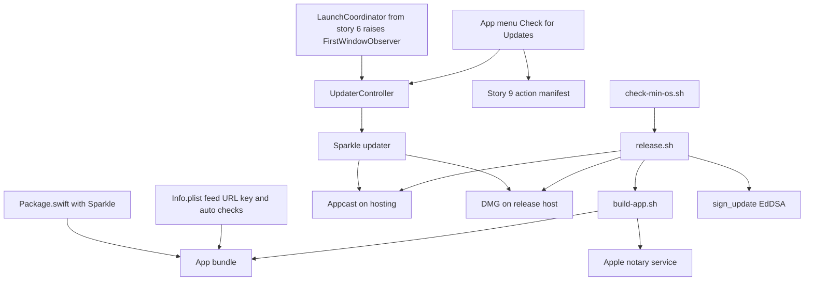
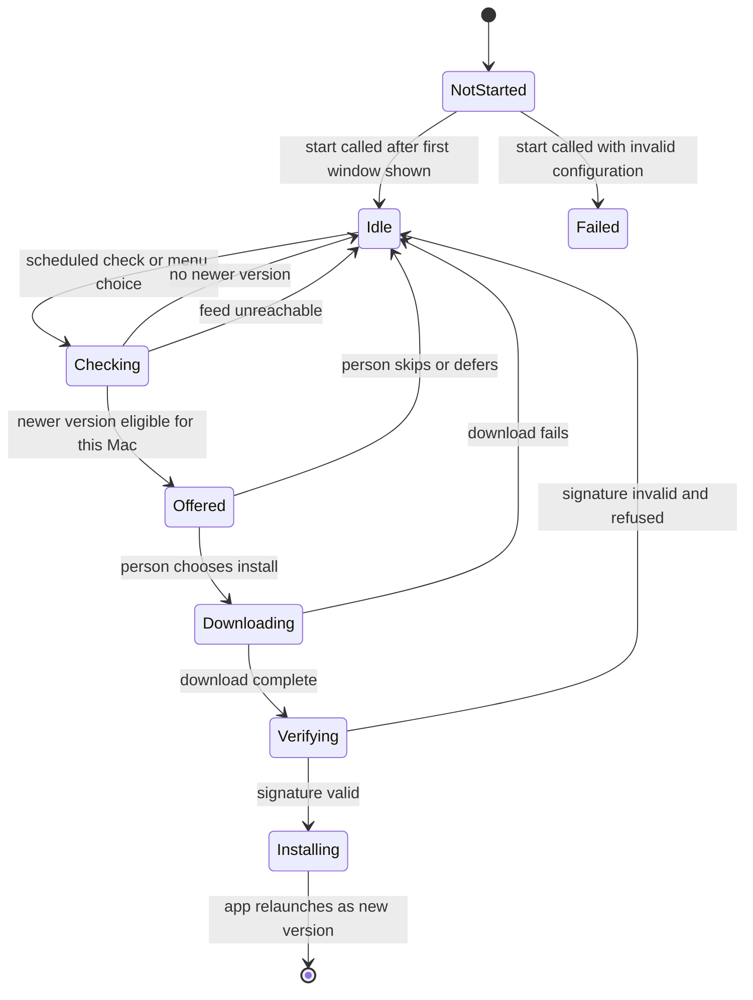
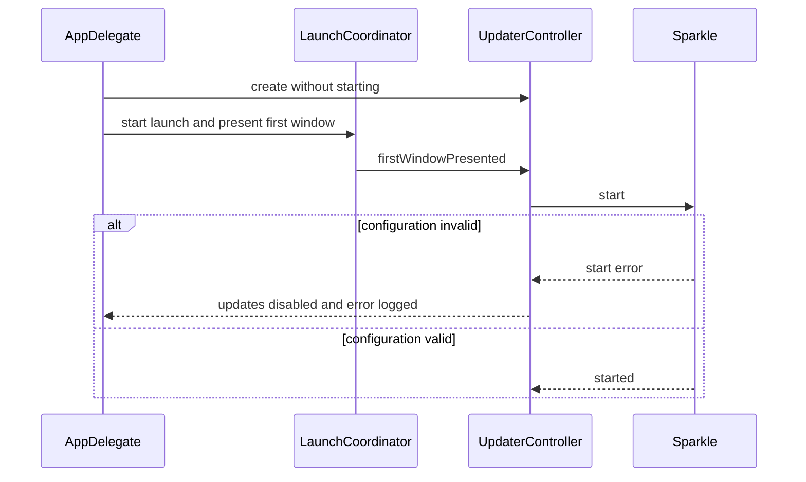
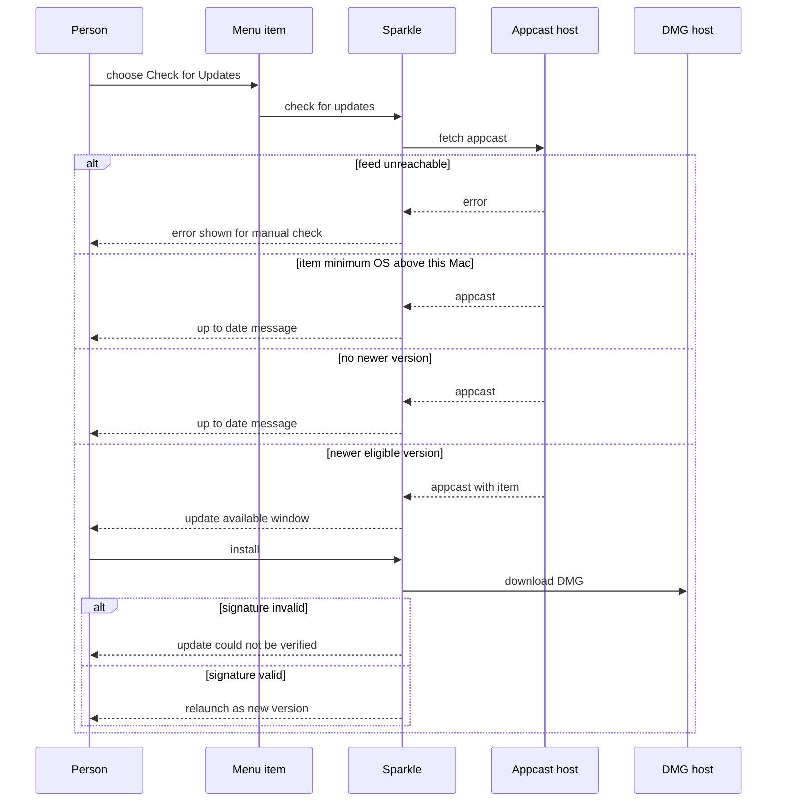
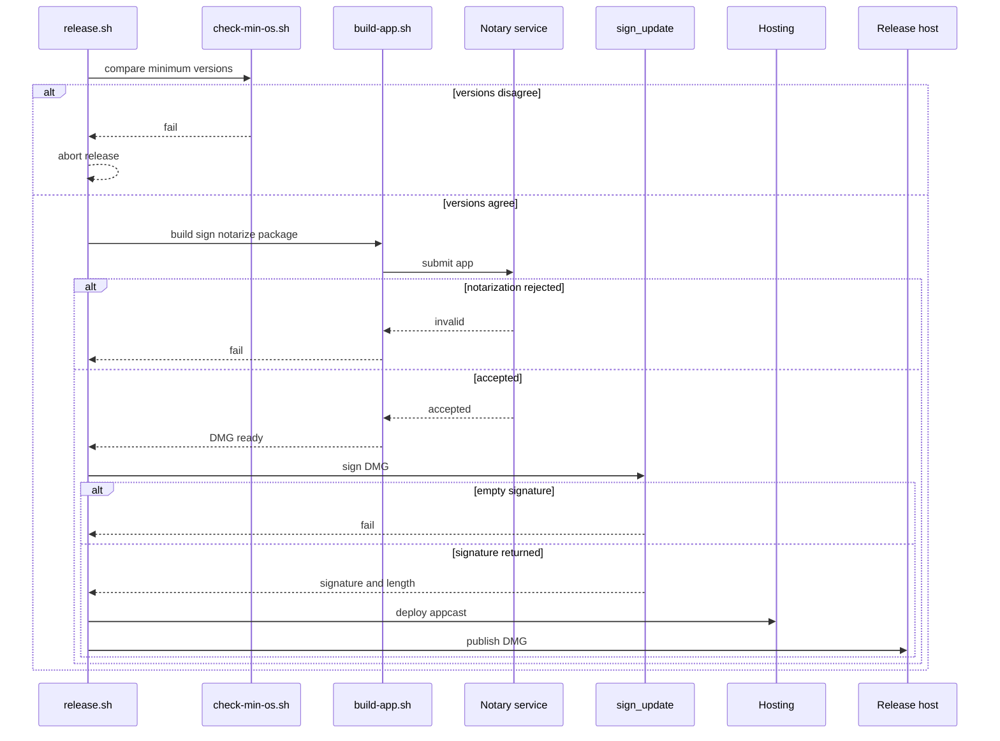

# Technical Design

Sparkle 2 updater wiring plus the build, notarize and release pipeline for a non-sandboxed Developer ID macOS 26 app, ported from the Cutaway reference.

## Overview

Grounded in `docs/tech-architecture.md` and the Cutaway reference at `/Users/julian/expts/macscreencap` (`ScreencapMenuBar/Package.swift`, `ScreencapMenuBar/Info.plist`, `ScreencapMenuBar/build-app.sh`, `scripts/release.sh`, `ScreencapMenuBar/Sources/sparkle_config_test.swift`, `ScreencapMenuBar/Sources/main.swift`). No LocalPlayer source tree exists yet, so every LocalPlayer path below is PROPOSED in the SwiftPM package introduced by story 1 (`Package.swift`, `Resources/Info.plist`, `Sources/LocalPlayer/...`, `scripts/...`). Updater code lives in `Sources/LocalPlayer/Updates/`.

OWNERSHIP (consistency decisions): this story is the SINGLE owner of `UpdaterController` (`Sources/LocalPlayer/Updates/UpdaterController.swift`). The launch-speed story only asserts the ORDER (first window visible, then updater started) against the same signal and does not define its own updater type. This story is also the single owner of the minimum-OS validator (`updates.version.consistency`); the native-look story only declares the macOS 26 floor in `Package.swift` and `Info.plist` and delegates all validation here. 'Check for Updates' is an app action with an AppleScript command owned by the AppleScript story; this story registers the menu item in that story's action manifest.

The app is document based: each playlist is a document with its own window, and there is no single main window. The updater therefore starts on the launch-speed story's `FirstWindowObserver.firstWindowPresented()` signal, which its `LaunchCoordinator` raises once when the first window of any kind is presented (a restored playlist window, or an untitled new-playlist window; which of those appears at launch is an open question owned by the launch-speed story). `UpdaterController` conforms to `FirstWindowObserver`. Which window hosts the update prompt is Sparkle's own standard window and is not specified here.

OPEN ITEMS (recorded, not decided): product name `<PRODUCT_NAME>`, bundle identifier `<BUNDLE_ID>`, feed URL `<FEED_URL>`, hosting project `<HOSTING_PROJECT>`, release repository `<RELEASE_REPO>`, whether the `com.apple.security.cs.disable-library-validation` entitlement is needed (VERIFY: Cutaway sets it; Sparkle normally validates when everything is signed by one team), whether release notes appear in the appcast item, and the signing-key custody location. Placeholders must never be replaced by invented values in code or scripts.

VERIFY (not verified in this project): when the Info.plist does not set `SUEnableAutomaticChecks`, Sparkle is believed to show its own 'check for updates automatically?' permission question on the second launch. Cutaway's Info.plist sets only `SUFeedURL` and `SUPublicEDKey` among the Sparkle keys, so it would have the same behaviour. This design sets `SUEnableAutomaticChecks` to true so the question never appears, and adds a PROPOSED end-to-end test for it (TC-87); the Sparkle behaviour behind that test has not been observed here.

Sparkle is Sparkle 2.x from `https://github.com/sparkle-project/Sparkle`, added as a SwiftPM dependency exactly as Cutaway does (`from: "2.0.0"`). The app is assembled from a SwiftPM executable by a shell script, signed inside-out, notarized, packaged in a DMG, signed again with Sparkle's EdDSA tool, and announced through an appcast file.

Current state versus target: the current state in this repo is nothing (greenfield); the reference state is Cutaway, whose appcast template says 13.0, Info.plist says 15.0 and Package.swift says macOS 15. The target for LocalPlayer is one value, 26.0, enforced everywhere by one validator.

## Structure (target)


## State
The updater has long-lived state because Sparkle keeps its own scheduling and skipped-version preferences in the app's user defaults. This story does not read or write those values directly; the diagram shows the user-visible updater lifecycle only.


## Flow 1: startup and deferred updater start


## Flow 2: check for updates, offer and install


## Flow 3: release pipeline


## Test Strategy

## Test Scopes
- **unit**: configuration validation, version comparison and updater-controller state logic, with no network and no Sparkle runtime.
- **integration**: the real Sparkle updater running inside the built app against a local appcast host serving fixture feeds and fixture DMGs; and the shell scripts run with the Apple notary, hosting and release tools replaced by recording shims on the PATH. This exercises the request-handling boundary shown in the structure diagram (app to feed, app to DMG) and the script boundary (release.sh to build-app.sh, check-min-os.sh and sign_update).
- **e2e**: the real built, signed app bundle driven from outside (menu automation and Apple events) against the local feed; plus real Gatekeeper assessment of a notarized build on a developer machine with a Developer ID certificate. Needed because notarization, stapling and code-signature validity exist only on the real artefact.

The local feed override exists only in debug builds: the updater delegate returns a feed URL from the environment variable `LOCALPLAYER_TEST_FEED_URL` when set, and the variable is ignored in release builds (asserted by TC-45).

## Dimensions crossed
Check trigger (T1 scheduled automatic check, T2 manual menu check) x host eligibility (H1 host meets the item's minimum OS, H2 host below the item's minimum OS, simulated by an item minimum of 99.0 because the app itself cannot launch below macOS 26) x feed content (F1 newer eligible signed version, F2 only the current version, F3 newer version with a bad signature, F4 feed unreachable). Equivalence classes are exhaustive and non-overlapping: a check is exactly one trigger; a host either meets or does not meet the minimum; a feed is exactly one of the four contents.

| Ref | Trigger | Host | Feed | Expected | Level |
|---|---|---|---|---|---|
| TC-01 | T1 | H1 | F1 | update window offers install | integration |
| TC-02 | T1 | H1 | F2 | nothing is shown | integration |
| TC-03 | T1 | H1 | F3 | update offered, install attempt refused, not-verified message shown, app files unchanged | integration |
| TC-04 | T1 | H1 | F4 | no crash, app usable, message text not asserted because unspecified | integration |
| TC-05 | T1 | H2 | F1 | no update offered, nothing shown | integration |
| TC-06 | T1 | H2 | F2 | nothing is shown | integration |
| TC-07 | T1 | H2 | F3 | no update offered, nothing shown, bad item never evaluated for install | integration |
| TC-08 | T1 | H2 | F4 | no crash, app usable, message text not asserted because unspecified | integration |
| TC-09 | T2 | H1 | F1 | update window offers install | e2e |
| TC-10 | T2 | H1 | F2 | up-to-date message shown | integration |
| TC-11 | T2 | H1 | F3 | install attempt refused, not-verified message shown, app files unchanged | e2e |
| TC-12 | T2 | H1 | F4 | error shown, app usable, text not asserted because unspecified | integration |
| TC-13 | T2 | H2 | F1 | up-to-date message shown, update not offered | integration |
| TC-14 | T2 | H2 | F2 | up-to-date message shown | integration |
| TC-15 | T2 | H2 | F3 | up-to-date message shown, update not offered | integration |
| TC-16 | T2 | H2 | F4 | error shown, app usable, text not asserted because unspecified | integration |

## Test Case Design (boundaries and error paths)
| Ref | Capability | Case | Expected | Level |
|---|---|---|---|---|
| TC-20 | updates.sparkle.configure | feed URL missing | config check fails naming SUFeedURL | unit |
| TC-21 | updates.sparkle.configure | feed URL uses http | config check fails, https required | unit |
| TC-22 | updates.sparkle.configure | feed URL is not a valid URL | config check fails | unit |
| TC-23 | updates.sparkle.configure | public key missing, empty, not base64, or 10 characters or fewer | each fails with its own message | unit |
| TC-24 | updates.sparkle.configure | placeholder value such as the literal text PLACEHOLDER in feed URL or key | config check fails so unreleased placeholders cannot ship | unit |
| TC-25 | updates.sparkle.configure | public key equals the Cutaway public key | config check fails, keys must not be shared | unit |
| TC-26 | updates.sparkle.configure | Package.swift lacks the Sparkle dependency | config check fails | integration |
| TC-27 | updates.sparkle.configure | SUEnableAutomaticChecks missing, false, or not a boolean | config check fails naming SUEnableAutomaticChecks | unit |
| TC-28 | updates.sparkle.configure | SUEnableAutomaticChecks is true alongside valid feed URL and key | config check passes | unit |
| TC-30 | updates.controller.lifecycle | controller created | state is NotStarted and Sparkle not started | unit |
| TC-31 | updates.controller.lifecycle | first window reported visible | start called exactly once, state Idle | unit |
| TC-32 | updates.controller.lifecycle | start called twice | second call ignored, state still Idle | unit |
| TC-33 | updates.controller.lifecycle | invalid configuration at start | state Failed, error logged, menu item disabled | unit |
| TC-34 | updates.controller.lifecycle | time from process start to first window visible, with and without updater started | difference does not exceed the launch budget recorded by the launch story | e2e |
| TC-35 | updates.menu.check | menu item present with title Check for Updates and action checkForUpdates | present exactly once in the app menu | unit |
| TC-36 | updates.menu.check | item chosen while a check is running | no second check starts | integration |
| TC-37 | updates.menu.check | updater state Failed | item disabled | unit |
| TC-38 | updates.menu.check | action manifest owned by the AppleScript story (story 9) | contains an entry for Check for Updates whose UI binding is this menu item and which has a script binding | integration |
| TC-39 | updates.controller.lifecycle | first window is a restored playlist window, then separately an untitled new-playlist window; and a launch with no window yet | start is signalled by the first window of either kind; with no window presented yet start is not called | unit |
| TC-40 | updates.version.consistency | appcast, LSMinimumSystemVersion and Package platform all 26.0 | check passes | unit |
| TC-41 | updates.version.consistency | appcast says 13.0 and others say 26.0 | check fails naming appcast | unit |
| TC-42 | updates.version.consistency | LSMinimumSystemVersion says 15.0 and others say 26.0 | check fails naming Info.plist | unit |
| TC-43 | updates.version.consistency | Package platform says macOS 15 and others say 26.0 | check fails naming Package.swift | unit |
| TC-44 | updates.version.consistency | value written as 26 in one place and 26.0 in another | treated as equal | unit |
| TC-45 | updates.sparkle.configure | release build with LOCALPLAYER_TEST_FEED_URL set | override ignored, plist feed URL used | integration |
| TC-46 | updates.version.consistency | the floor declared by the native-look story (Package platform and LSMinimumSystemVersion) is read by this validator, and no other minimum-OS validator exists in the repository | exactly one validator script and one validator test are found | integration |
| TC-50 | updates.build.package | all nested executables, services, apps, framework and app signed with hardened runtime and timestamp | codesign verify deep strict succeeds | integration |
| TC-51 | updates.build.package | no Developer ID Application certificate in keychain | build aborts with a message before building | integration |
| TC-52 | updates.build.package | notary service rejects the submission | build exits non-zero and prints how to fetch the log | integration |
| TC-53 | updates.build.package | stapling fails once then succeeds | retried once, build succeeds | integration |
| TC-54 | updates.build.package | stapling fails twice | build exits non-zero | integration |
| TC-55 | updates.build.package | entitlements file contains the app-sandbox key | build aborts, app must not be sandboxed | integration |
| TC-56 | updates.build.package | notarized build assessed by Gatekeeper | accepted with source Notarized Developer ID | e2e |
| TC-60 | updates.release.publish | sign_update returns an empty signature | release aborts before any publish step | integration |
| TC-61 | updates.release.publish | appcast item generated | contains version, short version, minimumSystemVersion 26.0, enclosure URL, length and edSignature | integration |
| TC-62 | updates.release.publish | hosting deploy fails | release aborts, no tag pushed, no release created | integration |
| TC-63 | updates.release.publish | version not given | patch component is incremented, 1.0 becomes 1.1 | unit |
| TC-64 | updates.release.publish | version given explicitly | that exact version used | unit |
| TC-65 | updates.release.publish | DMG length in appcast | equals the real DMG byte length | integration |
| TC-70 | updates.verify.selftest | app launched with the unit-test flag | prints one line per check and exits non-zero on any failure | integration |
| TC-71 | updates.verify.selftest | app launched with the integration-test flag | exercises updater start and menu action selector | integration |
| TC-72 | updates.verify.selftest | app launched with the unit-test flag and a bundle whose SUEnableAutomaticChecks is absent | prints a failing line naming SUEnableAutomaticChecks and exits non-zero | integration |

## Negative Scenarios
| Ref | Case | Must NOT happen | Level |
|---|---|---|---|
| TC-80 | any feed, any trigger | an update is installed without the person choosing install | integration |
| TC-81 | F3 bad signature | the app bundle on disk changes in any way | e2e |
| TC-82 | H2 host below minimum | the update window appears | integration |
| TC-83 | startup | updater start occurs before the first window is visible | unit |
| TC-84 | any run | the person's audio file names or listening data are sent to the feed or DMG host | integration |
| TC-85 | release | the Cutaway private or public key, feed URL or hosting project appears in any LocalPlayer file | integration |
| TC-86 | release | a release is published while a placeholder value is still present | integration |
| TC-87 | second launch against the fixture feed with no stored updater preferences (PROPOSED: depends on the unverified Sparkle behaviour recorded in the overview) | no permission question about checking for updates automatically is shown | e2e |
| TC-88 | first launch with updater configuration valid | no permission question about checking for updates automatically is shown | integration |

## Mock vs Integration Boundaries
| Component | Real or mocked | Reason |
|---|---|---|
| Sparkle runtime | real in integration and e2e, absent in unit | the update decisions (offer, verify, min OS) are Sparkle behaviour under test, so mocking it would test nothing |
| Appcast and DMG hosts | local HTTP server with fixture files | no network dependency and fixtures can be made tampered or unreachable on demand |
| Apple notary service | shimmed in integration, real in e2e on a developer machine | a real submission takes minutes and needs credentials |
| Hosting deploy tool and GitHub release tool | recording shims in integration | they publish to the outside world |
| sign_update | real in integration | it is local and pure; empty-output cases use a shim |
| Keychain signing identity | real in e2e, stub keychain in integration | needs the developer certificate |
| Host macOS version | simulated through the item minimum OS | the app cannot start on a Mac older than macOS 26 |
| Action manifest of the AppleScript story | real file read from the repository | the registration of the menu item is what is asserted |

## E2E Workflows
| Ref | Workflow | Asserts |
|---|---|---|
| E2E-1 | built app at version A, local feed offers version B, person chooses Check for Updates and installs | app relaunches and reports version B |
| E2E-2 | same with a feed item whose signature is wrong | install refused, not-verified message, app still version A and bundle checksum unchanged |
| E2E-3 | build with the real Developer ID certificate and real notarization, then Gatekeeper assessment | assessment accepts the app and the DMG opens without a warning |
| E2E-4 | release rehearsal against a staging hosting target (name open) | appcast reachable over https and lists the new version with minimumSystemVersion 26.0 |
| E2E-5 | PROPOSED: launch the built app twice against the fixture feed with clean preferences | no permission question appears on either launch (TC-87) |

## Fixtures
A real built app bundle at two versions, real DMGs produced by the build script, a feed signed with a real EdDSA test keypair generated for the test run (never the production key), a second feed whose item signature is altered by one byte, a feed whose item minimum OS is 99.0, and real Info.plist files copied from the reference layout (not minimal stubs), including one with and one without `SUEnableAutomaticChecks`.

## Deliberately not covered
What the person sees when the feed is unreachable (unspecified, so only no-crash is asserted), whether prompts or installs interrupt playback (open), release notes in the appcast (open), key custody and rotation, delta updates, running on an actual macOS version below 26, and whether Sparkle really shows a permission question when `SUEnableAutomaticChecks` is absent (unverified; TC-87 is proposed against it). Real notarization is exercised only by E2E-3 on a developer machine, not on every run. A passing run does not claim any of these.

## updates.sparkle.configure

> Anchor: `updates.sparkle.configure`

## Contract
Inputs: the package manifest, the bundle Info.plist, and for tests an optional feed URL override.
Outputs: an app bundle that tells Sparkle where to find the appcast (`SUFeedURL`, https only), which public key verifies updates (`SUPublicEDKey`, base64 EdDSA public key) and that automatic checking is already on (`SUEnableAutomaticChecks` set to true). The feed URL is how the app finds a newer version, which delivers `prd.update.prompt` together with the lifecycle capability; the public key is how an update that was not signed by the developer's private key is detected and refused, which delivers `prd.update.verified` together with `updates.release.publish` that signs each release. Setting `SUEnableAutomaticChecks` to true means Sparkle starts with automatic checking enabled instead of asking the person for permission, which delivers `prd.update.no_permission_prompt`: the person is never asked whether to check automatically, on the first launch or any later one.
Errors: a missing, non-https or unparsable feed URL, a missing, empty, non-base64 or too-short public key, a missing, false or non-boolean `SUEnableAutomaticChecks`, a placeholder value, or reuse of the Cutaway public key makes the config check fail. A missing Sparkle dependency fails the package check.
Side effects: none at runtime beyond Sparkle reading these values.

VERIFY: that Sparkle shows a permission question when `SUEnableAutomaticChecks` is absent is believed, not observed in this project; the proposed end-to-end test TC-87 is the check.

## Implementation
Proposed files: `Package.swift` (adds `.package(url: "https://github.com/sparkle-project/Sparkle", from: "2.0.0")` and lists `Sparkle` in the app target, as Cutaway's `ScreencapMenuBar/Package.swift` does), `Resources/Info.plist` (keys `SUFeedURL`, `SUPublicEDKey`, `SUEnableAutomaticChecks`), and `Sources/LocalPlayer/Updates/UpdateConfiguration.swift` holding the validation signatures below. `ConfigIssue` has one case per error named in the Errors list above.
```swift
struct UpdateConfiguration {
  let feedURL: String
  let publicEDKey: String
  let automaticChecksEnabled: Bool?
}
enum ConfigIssue: Equatable
func validate(_ configuration: UpdateConfiguration) -> [ConfigIssue]
```
A NEW EdDSA keypair is generated for this product with Sparkle's `generate_keys`; the private key stays in the developer keychain and is never committed. Feed URL and key values are open items, so the repository carries placeholders that the config check rejects until real values are set. A debug-only override of the feed URL for tests is supplied through the updater delegate and is compiled out of release builds.

## Tests
TC-20 to TC-28, TC-45, TC-85, TC-86, TC-87, TC-88, E2E-5.

## updates.controller.lifecycle

> Anchor: `updates.controller.lifecycle`

## Contract
Inputs: the first-window-presented signal. It is the launch-speed story's `FirstWindowObserver.firstWindowPresented()`, which that story's `LaunchCoordinator` calls once, after the first window of any kind is presented (a restored playlist window or an untitled new-playlist window). There is no main window; the signal does not depend on which window it is.
Outputs: an updater that is created at launch but started only after that signal, so that automatic checks begin once the person can already use the app. Starting the updater is what lets scheduled checks find a newer version and offer it, which delivers `prd.update.prompt`; starting it only after the first window delivers `prd.update.nonblocking`. The macOS 26 or later condition of `prd.update.prompt` is met because the update item the updater reads carries a minimum system version of 26.0, written by `updates.release.publish` and kept equal to the app's own floor by `updates.version.consistency`, so Sparkle offers the update only to Macs that meet it.
Ownership: this capability is the single owner of `UpdaterController`. It is registered with the launch-speed story's `LaunchCoordinator` as a `FirstWindowObserver`. The launch-speed story does not define an updater type; its ordering tests assert, against this same signal and this same type, that the first window is presented before the updater starts.
Errors: invalid configuration at start moves the controller to Failed, logs the error and disables the menu item; the app keeps working. A second start call is ignored. With no window presented yet, start is not called.
Side effects: Sparkle begins its own scheduled checking and persists its own preferences in user defaults.

## Implementation
Proposed file: `Sources/LocalPlayer/Updates/UpdaterController.swift`, wrapping `SPUStandardUpdaterController`. Cutaway creates it with `startingUpdater: false` in `main.swift` and starts it after onboarding; this app has no onboarding, so the start trigger is `FirstWindowObserver.firstWindowPresented()` from story 6. Whether the start is further deferred to the next idle turn of the run loop is a proposal owned by the launch-speed measurements and is not decided here. Measuring whether starting Sparkle affects the one-second launch target is VERIFY work, covered by TC-34.
```swift
// from story 6: protocol FirstWindowObserver: AnyObject { func firstWindowPresented() }
final class UpdaterController: FirstWindowObserver {
  enum State { case notStarted, idle, failed }
  private(set) var state: State
  init(configuration: UpdateConfiguration)
  func firstWindowPresented()      // calls startAfterFirstWindow()
  func startAfterFirstWindow()
}
```

## Tests
TC-30 to TC-34, TC-39, TC-83, TC-01 to TC-08.

## updates.menu.check

> Anchor: `updates.menu.check`

## Contract
Inputs: the person choosing Check for Updates in the app menu.
Outputs: Sparkle checks for a newer version and then shows either the update-available window or an up-to-date message, which is exactly `prd.update.manual`. The item is disabled when the updater is in the Failed state, and choosing it while a check is running does not start a second check.
Cross-reference: Check for Updates is an app action with an AppleScript command. That command and the action manifest are owned by the AppleScript story (story 9); this capability registers the menu item in that manifest, with this menu item as the UI binding and the script command as the script binding, so the parity gate of story 9 passes without an exclusion for it. Story 9 only excludes system-standard menu items (About, Quit, Hide, Services, Window, Help).
Errors: if the feed is unreachable Sparkle shows its own error for a manual check; the exact text is not asserted because it is unspecified.
Side effects: none beyond the check.

## Implementation
Proposed file: `Sources/LocalPlayer/Updates/UpdateMenu.swift`. As in Cutaway's `main.swift`, the item's action is `#selector(SPUStandardUpdaterController.checkForUpdates(_:))` and its target is the controller. The item is added to the app menu in code, and its action id is added to story 9's `ActionManifest` file (`Sources/LocalPlayer/Scripting/ActionManifest.swift`).

## Tests
TC-35 to TC-38, TC-09 to TC-16, E2E-1.

## updates.build.package

> Anchor: `updates.build.package`

## Contract
Inputs: the SwiftPM package, a Developer ID Application identity in the keychain, a stored notary credential profile, an entitlements file, and flags such as skip-notarize and no-launch.
Outputs: a universal (arm64 and x86_64) `.app` that embeds `Sparkle.framework`, is signed with hardened runtime and secure timestamp, notarized and stapled, and packaged as `<PRODUCT_NAME>-<version>.dmg`. A release is therefore a signed and Apple-notarized download that macOS opens without a security warning, which is `prd.update.notarized`.
Errors: missing signing identity aborts early; a rejected notarization exits non-zero and prints how to fetch the log; stapling is retried once then fails; an entitlements file that contains the sandbox key aborts the build.
Side effects: creates build artefacts and submits the app to Apple's notary service.

## Implementation
Proposed file: `scripts/build-app.sh`, ported from Cutaway's `ScreencapMenuBar/build-app.sh`: universal `swift build -c release`; hand-assembled bundle (binary, Info.plist, Sparkle.framework in `Contents/Frameworks`); signing inside-out with `codesign --force --options runtime --timestamp` on Sparkle's nested executables, XPC services and helper apps, then the framework, then dylibs, then the app with entitlements; `codesign --verify --deep --strict`; zip, `xcrun notarytool submit --keychain-profile ... --wait`, `xcrun stapler staple` with one retry; `hdiutil create` for the DMG. Entitlements file `Resources/LocalPlayer.entitlements` omits camera and audio-input (not needed) and has no `app-sandbox` key; whether `disable-library-validation` is needed is an open VERIFY item and starts absent.

## Tests
TC-50 to TC-56, E2E-3.

## updates.release.publish

> Anchor: `updates.release.publish`

## Contract
Inputs: an optional version (default is the next patch version), the built DMG, the Sparkle signing tool and private key, and the hosting and release tool credentials.
Outputs: an appcast with one item containing the version, short version, `sparkle:minimumSystemVersion` of 26.0, and an enclosure with the download URL, byte length and `sparkle:edSignature`; the appcast deployed to hosting; the DMG attached to a tagged release. Publishing the item is what makes existing installs discover the new version (`prd.update.prompt`); the EdDSA signature over the DMG is what lets the app verify the update came from the developer (`prd.update.verified`); the minimum-OS value in the item is what stops Sparkle offering the update to Macs below macOS 26 (`prd.update.min_os`).
Errors: an empty signature, a failed deploy, a failed version consistency check or a failed build aborts the release before later publish steps; no tag is pushed and no release is created after a failure. Any remaining placeholder value aborts the release.
Side effects: commits a version bump, deploys the appcast, pushes a tag and creates a release. This is hard to reverse, so the failure ordering above matters.

## Implementation
Proposed file: `scripts/release.sh`, ported from Cutaway's `scripts/release.sh`: version bump through `PlistBuddy` on `CFBundleShortVersionString`; build; `sign_update` from `.build/artifacts/sparkle/Sparkle/bin`; extract signature and length; write `appcast.xml`; deploy with `wrangler pages deploy` (hosting project name is an open item); tag and push; `gh release create` (repository is an open item). Cutaway's template hardcodes `minimumSystemVersion` 13.0; this script reads 26.0 from the single source checked by `updates.version.consistency`. Release notes in the appcast item are an open item and are not included.

## Tests
TC-60 to TC-65, TC-62, TC-85, TC-86, E2E-4.

## updates.version.consistency

> Anchor: `updates.version.consistency`

## Contract
Inputs: the appcast minimum system version, `LSMinimumSystemVersion` in Info.plist, and the platform in `Package.swift`. The last two are the floor declared by the native-look story; that story only declares the value and delegates ALL validation of it to this capability, so this is the single minimum-OS validator in the repository.
Outputs: pass when all three equal 26.0 (the forms 26 and 26.0 compare equal); otherwise fail with the name of each disagreeing file. Because the release script refuses to publish when they disagree, an appcast can never offer an update to a Mac that cannot run it, which is `prd.update.min_os` in practice. Cutaway shows why this is needed: its appcast says 13.0, its Info.plist 15.0 and its Package.swift macOS 15.
Errors: unreadable or missing value in any of the three sources fails the check naming the source.
Side effects: none.

## Implementation
Proposed files: `scripts/check-min-os.sh` (reads the three values) and `Tests/LocalPlayerTests/MinOSConsistencyTests.swift`. `release.sh` runs the check as its first step. No second validator is added elsewhere (for example in the native-look story); a test asserts exactly one exists.

## Tests
TC-40 to TC-44, TC-46, TC-13 to TC-15, TC-82.

## updates.verify.selftest

> Anchor: `updates.verify.selftest`

## Contract
Inputs: launch flags `--test-sparkle-config` and `--test-sparkle-integration`, plus for the integration flag the local fixture feed address.
Outputs: one printed line per check (pass or fail with file and line) and a non-zero exit when any check fails. The app shows no window in this mode.
- With `--test-sparkle-config` the shipped app proves, from its own bundle, that the https feed, the base64 public key that make update verification possible, and `SUEnableAutomaticChecks` set to true (so no permission question is shown, `prd.update.no_permission_prompt`) are present and valid; an app whose key or feed is wrong cannot refuse a tampered update, so this check is a release gate for `prd.update.verified`.
- With `--test-sparkle-integration` the shipped app runs its real updater against a local fixture feed and asserts the two user-visible outcomes end to end. First, a manual check (the same code path the Check for Updates menu item triggers, `prd.update.manual`) completes and reports either an available update or up to date. Second, a fixture update with an altered signature is refused and the app bundle is left unchanged, which is `prd.update.verified` at runtime. It also asserts that the menu item's action is Sparkle's check-for-updates selector.
Errors: any failed check exits non-zero; if the fixture feed address is missing the integration mode fails with a message instead of silently passing.
Side effects: none on the installed app; the fixture update is never installed.

## Implementation
Proposed file: `Sources/LocalPlayer/Updates/SparkleConfigTest.swift`, ported from Cutaway's `ScreencapMenuBar/Sources/sparkle_config_test.swift`, which checks that `SUFeedURL` is present, uses https and parses; `SUPublicEDKey` is present, non-empty and base64-like; the Sparkle dependency is in `Package.swift`; the updater can be started when created deferred; and the menu item action is `checkForUpdates:`. Added to the port: the `SUEnableAutomaticChecks` check, the minimum-OS consistency check, the placeholder check, the not-Cutaway-key check, and the runtime fixture-feed assertions above (the fixture feed override is debug-build only, as described in the overview).

## Tests
TC-70 to TC-72, TC-20 to TC-28, TC-03, TC-11.

