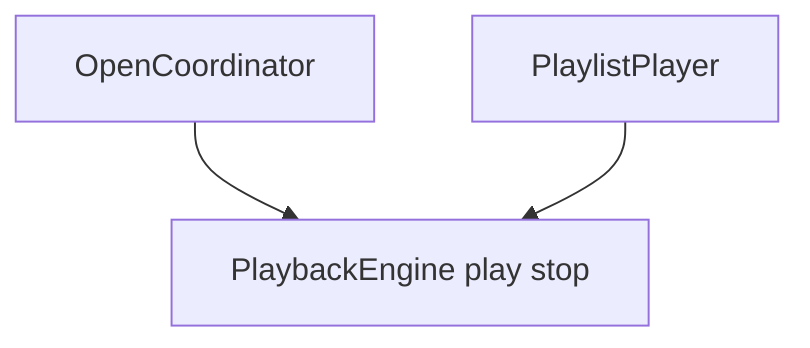
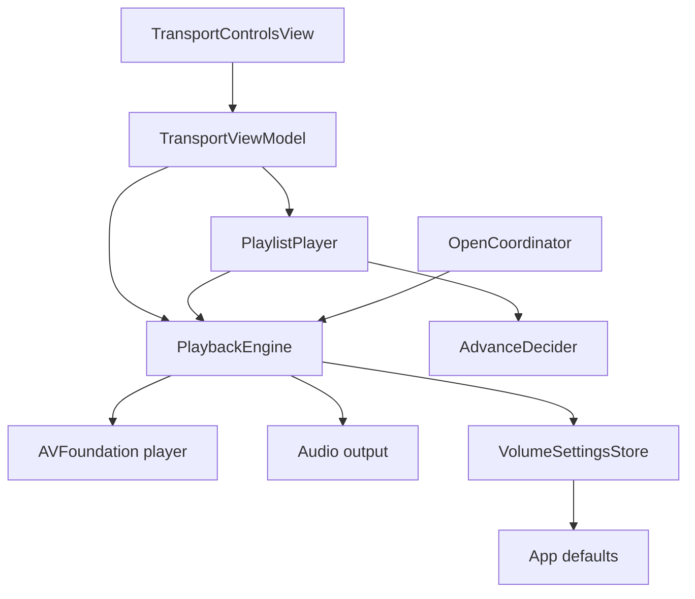
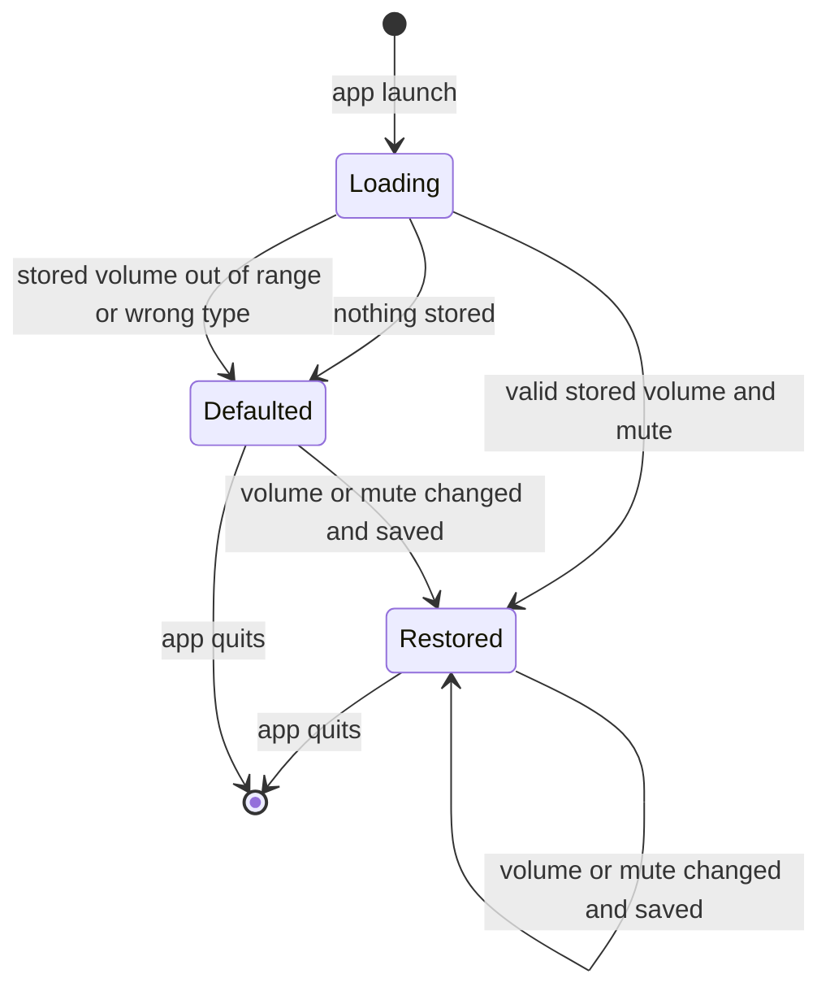
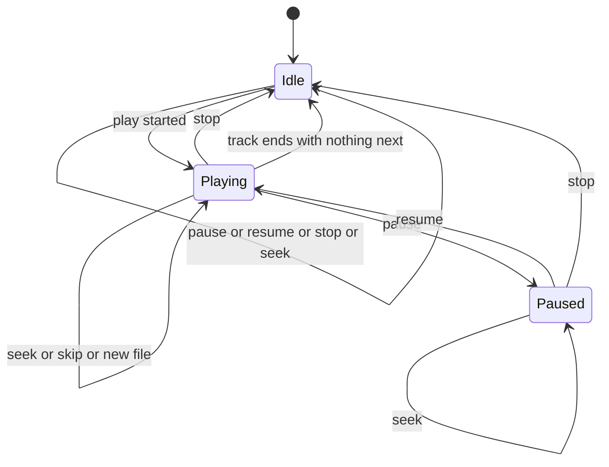
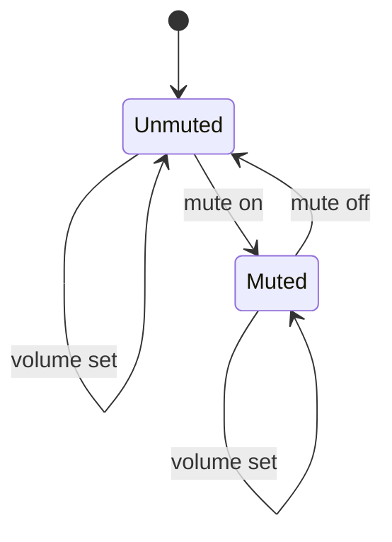
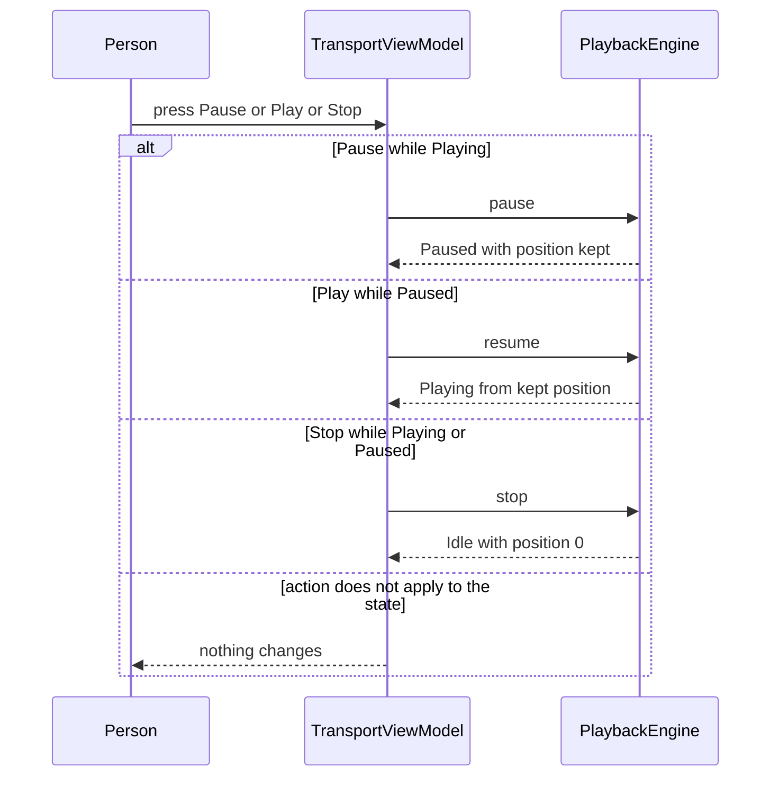
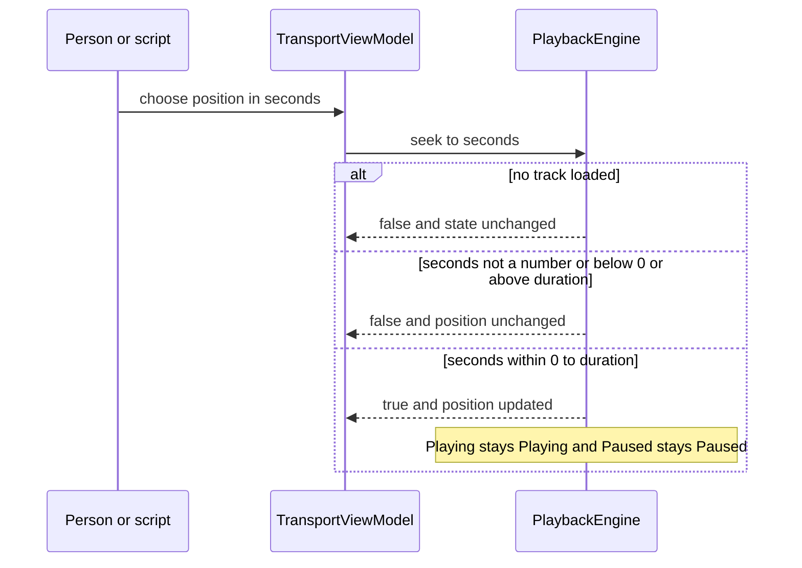
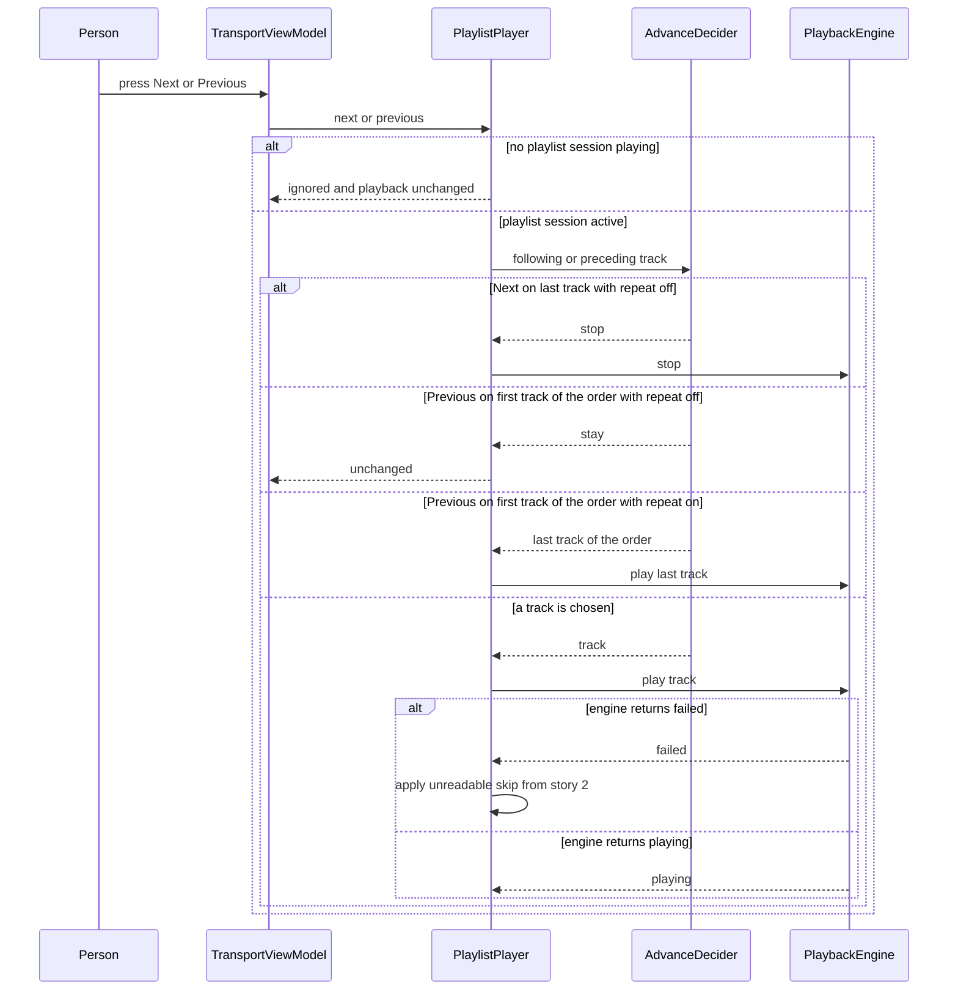
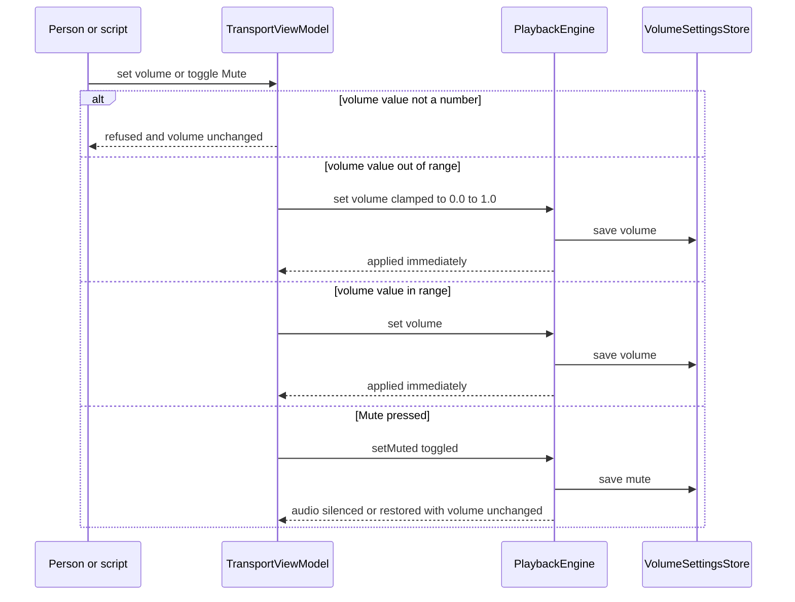
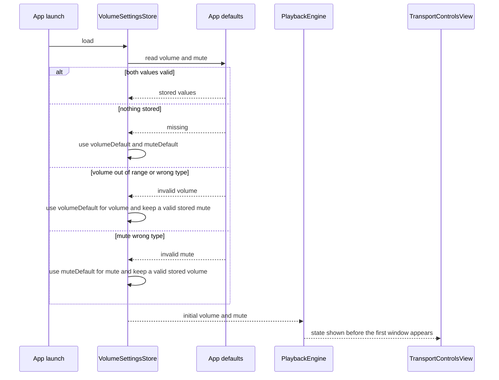

# Technical Design

Transport, seek, skip, volume and mute added to the shared playback engine, plus controls that show live state.

## Overview

Native Swift app, macOS 26 minimum, not sandboxed (docs/tech-architecture.md). No source tree exists yet; every path is a PROPOSED location in the SwiftPM package introduced by story 1. Paths follow the shared layout: engine in `Sources/LocalPlayer/Playback/`, playlist session extensions in `Sources/LocalPlayer/Playlists/`, controls in `Sources/LocalPlayer/UI/`.

This story extends the shared `PlaybackEngine` from story 1 (which has `play(_:)`, `stop()`, `isPlaying` and `PlayResult`) with pause, resume, seek, position, duration, volume and mute, adds `next()` and `previous()` to the playlist session `PlaylistPlayer` from story 2, and persists volume and mute in the app's own settings. The window model is document-based (one window per playlist, no main window); which window hosts the controls when a single audio file is playing is OPEN and not decided here, so the controls are a self-contained view that any host window can embed.

DECIDED by the owner (not provisional): (1) volume is the player's own level in 0.0 to 1.0 and never touches the Mac system volume; (2) volume and mute are saved in the app's own settings and restored before the first window is shown, with a damaged or out-of-range stored value falling back to the named default; (3) Next with repeat one moves to the following track; (4) Previous moves to the preceding track of the current order, which is the listed order or, with shuffle on, the shuffle pass being played; on the first track of that order it goes to the last track when repeat is on (all or one) and does nothing when repeat is off. Rule (4) is the current reading of the owner's words "last track if it's on repeat, nothing if not, previous random if random" and is marked INTERPRETATION PENDING OWNER CONFIRMATION wherever it appears.

PROVISIONAL assumptions (not owner decisions, flagged so they are not mistaken for decisions): (a) changing volume while muted does not unmute; (b) Next on the last track with repeat all wraps to the first and with repeat off stops; (c) Next and Previous do nothing when no playlist is playing; (d) controls that need a track are shown unavailable when nothing is loaded; (e) Previous never restarts the current track (the first-moments rule is open question 3).

Named constants: `volumeMinimum = 0.0`, `volumeMaximum = 1.0`, `volumeDefault = 1.0`, `muteDefault = false`, and the settings keys `volumeSettingKey` and `muteSettingKey` (names PROPOSED). The settings are read from the app's own defaults domain only.

## Structure (current and target)
Current (stories 1 and 2): the engine only plays and stops.

Target:


## State
Persisted state is introduced: the volume level and the mute flag are written to the app's own defaults and read at launch. Everything else below is in memory only. Persisted audio settings lifecycle:

Transport state:

Output state, independent of transport state:


## Flow 1: pause, resume and stop


## Flow 2: seek


## Flow 3: next and previous


## Flow 4: volume and mute


## Flow 5: app launch restores volume and mute


## Test Strategy

## Test Scopes
- **unit**: engine state logic against a fake audio backend (transport state machine, seek range, volume clamping, mute), the volume settings store against an in-memory defaults fake, and PlaylistPlayer skip decisions with an in-memory playlist and a seeded random generator. No audio hardware.
- **integration**: the real AVFoundation-backed engine with the audio output replaced by a recording sink, driven through TransportViewModel, with a real PlaylistPlayer, real fixture files and a real defaults suite created per test. This exercises the request-handling boundary in the structure diagram (view model to engine and playlist session, engine to settings store).
- **e2e**: the built app driven from outside (UI automation) because live control state, the real slider, real audible output and quit-and-relaunch persistence exist only in the real app.

## Dimensions crossed
Transport state (T-Idle, T-Playing, T-Paused) x action (Pause, Play, Stop, Seek valid). Classes are exhaustive and non-overlapping: the engine is in exactly one transport state; an action is exactly one of the four. Position is asserted before and after.

| Ref | State | Action | Expected | Level |
|---|---|---|---|---|
| TC-01 | T-Idle | Pause | no change, stays Idle | unit |
| TC-02 | T-Idle | Play (resume) | no change, stays Idle (starting a file is story 1) | unit |
| TC-03 | T-Idle | Stop | no change, stays Idle, position 0 | unit |
| TC-04 | T-Idle | Seek valid | returns false, stays Idle (no track loaded) | unit |
| TC-05 | T-Playing | Pause | state Paused, audio silent, position equal before and after | unit |
| TC-06 | T-Playing | Play (resume) | no change, stays Playing | unit |
| TC-07 | T-Playing | Stop | state Idle, position 0 | unit |
| TC-08 | T-Playing | Seek valid | returns true, stays Playing, position at the target | unit |
| TC-09 | T-Paused | Pause | no change, stays Paused, position unchanged | unit |
| TC-10 | T-Paused | Play (resume) | state Playing, continues from the paused position, not from 0 | unit |
| TC-11 | T-Paused | Stop | state Idle, position 0 | unit |
| TC-12 | T-Paused | Seek valid | returns true, stays Paused, position at the target | unit |
| TC-13 | T-Playing | Pause then Play with the real engine and recording sink | sink shows silence then audio resuming from the paused frame | integration |
| TC-14 | T-Playing | Stop then Play a new file | position starts at 0:00 | integration |

Skip crossed over playlist context x direction x repeat x shuffle. Contexts are exhaustive and non-overlapping: a single file with no playlist, the middle of a playlist, the first track, the last track, a one-track playlist. Playlist under test has 5 tracks; shuffle rows use a seeded pass. Rows marked interpretation depend on the reading of the owner's words that is pending owner confirmation.

| Ref | Context | Direction | Repeat | Shuffle | Expected | Level |
|---|---|---|---|---|---|---|
| TC-20 | single file | Next | any (not a playlist, setting not consulted) | off | playback unchanged | unit |
| TC-21 | single file | Previous | any (not a playlist, setting not consulted) | off | playback unchanged | unit |
| TC-22 | middle track 3 | Next | off | off | track 4 plays | unit |
| TC-23 | middle track 3 | Previous | off | off | track 2 plays | unit |
| TC-24 | middle track 3 | Next | all | off | track 4 plays | unit |
| TC-25 | middle track 3 | Next | one | off | track 4 plays (decided: Next with repeat one moves on) | unit |
| TC-26 | first track | Next | off | off | track 2 plays | unit |
| TC-27 | first track | Previous | off | off | stays on track 1, playback unchanged (interpretation pending owner confirmation) | unit |
| TC-28 | first track | Previous | all | off | track 5 (the last track) plays (interpretation pending owner confirmation) | unit |
| TC-29 | last track | Next | off | off | playback ends, state Idle | unit |
| TC-30 | last track | Next | all | off | track 1 plays | unit |
| TC-31 | last track | Previous | off | off | track 4 plays | unit |
| TC-32 | middle track 3 | Next | off | on | the next track of the seeded pass plays | unit |
| TC-33 | middle track 3 | Previous | off | on | the previous track of the seeded pass plays | unit |
| TC-34 | one-track playlist | Next | off | off | playback ends, state Idle | unit |
| TC-35 | one-track playlist | Next | all | off | the same track plays again from 0:00 | unit |
| TC-36 | one-track playlist | Previous | off | off | stays on the track, playback unchanged | unit |
| TC-37 | middle track 3, real engine | Next | off | off | sink shows track 3 stopped and track 4 started at 0:00 | integration |
| TC-38 | middle track 3 whose next file is unreadable | Next | off | off | track 4 marked unreadable, track 5 plays, no dialog (story 2 rule) | integration |
| TC-90 | first track | Previous | one | off | track 5 (the last track) plays (interpretation pending owner confirmation) | unit |
| TC-91 | middle track 3 | Previous | one | off | track 2 plays | unit |
| TC-92 | first track of the seeded pass | Previous | off | on | stays on that track, playback unchanged (interpretation pending owner confirmation) | unit |
| TC-93 | first track of the seeded pass | Previous | all | on | the last track of the seeded pass plays, no new pass is built (interpretation pending owner confirmation) | unit |
| TC-94 | first track of the seeded pass | Previous | one | on | the last track of the seeded pass plays (interpretation pending owner confirmation) | unit |
| TC-95 | last track of the seeded pass | Next | one | on | the first track of the next pass per story 2 order rules, not the same track again | unit |
| TC-96 | one-track playlist | Previous | all | off | the same track plays again from 0:00 (interpretation pending owner confirmation) | unit |
| TC-97 | first track, real engine | Previous | all | off | sink shows track 1 stopped and the last track started at 0:00 (interpretation pending owner confirmation) | integration |

Persisted volume and mute crossed over launch state. Volume classes (exhaustive and non-overlapping): V1 nothing stored, V2 valid in range (0.4), V3 out of range (1.5 stored), V4 wrong type (text stored). Mute classes: M1 nothing stored, M2 true, M3 false, M4 wrong type (text stored). A fresh defaults suite is created for each row and the engine is constructed as at launch; expected results are asserted on the engine before any window exists. Defaults are volumeDefault (1.0) and muteDefault (false).

| Ref | Stored volume | Stored mute | Expected on launch | Level |
|---|---|---|---|---|
| TC-100 | V1 | M1 | volume 1.0, mute off | integration |
| TC-101 | V1 | M2 | volume 1.0, mute on | integration |
| TC-102 | V1 | M3 | volume 1.0, mute off | integration |
| TC-103 | V1 | M4 | volume 1.0, mute off | integration |
| TC-104 | V2 | M1 | volume 0.4, mute off | integration |
| TC-105 | V2 | M2 | volume 0.4, mute on | integration |
| TC-106 | V2 | M3 | volume 0.4, mute off | integration |
| TC-107 | V2 | M4 | volume 0.4, mute off (bad mute falls back alone) | integration |
| TC-108 | V3 | M1 | volume 1.0, mute off | integration |
| TC-109 | V3 | M2 | volume 1.0, mute on (bad volume falls back alone) | integration |
| TC-110 | V3 | M3 | volume 1.0, mute off | integration |
| TC-111 | V3 | M4 | volume 1.0, mute off | integration |
| TC-112 | V4 | M1 | volume 1.0, mute off | integration |
| TC-113 | V4 | M2 | volume 1.0, mute on | integration |
| TC-114 | V4 | M3 | volume 1.0, mute off | integration |
| TC-115 | V4 | M4 | volume 1.0, mute off | integration |

## Test Case Design (boundaries and error paths)
Equivalence classes: seek seconds are exactly one of valid (0 to duration inclusive), below 0, above duration, or not a number; volume is exactly one of in range (0.0 to 1.0 inclusive), below 0.0, above 1.0, or not a number; mute is exactly on or off. Every error in the contracts has a case.

| Ref | Capability | Case | Expected | Level |
|---|---|---|---|---|
| TC-40 | playback.transport.seek | seek 0 | true, position 0 | unit |
| TC-41 | playback.transport.seek | seek exactly duration | true, position at end, state per rule | unit |
| TC-42 | playback.transport.seek | seek duration plus 0.001 | false, position unchanged | unit |
| TC-43 | playback.transport.seek | seek -1 | false, position unchanged | unit |
| TC-44 | playback.transport.seek | seek not a number | false, position unchanged | unit |
| TC-45 | playback.transport.seek | seek with no track loaded | false, state unchanged | unit |
| TC-46 | playback.transport.seek | seek while Paused to 10 | true, still Paused, position 10, no audio | integration |
| TC-50 | playback.volume.level | volume 0.0 | applied, level 0.0 | unit |
| TC-51 | playback.volume.level | volume 1.0 | applied, level 1.0 | unit |
| TC-52 | playback.volume.level | volume 0.5 | applied immediately, sink gain 0.5 | integration |
| TC-53 | playback.volume.level | volume -0.1 | clamped to 0.0 | unit |
| TC-54 | playback.volume.level | volume 1.1 | clamped to 1.0 | unit |
| TC-55 | playback.volume.level | volume not a number | refused, level unchanged | unit |
| TC-56 | playback.volume.level | volume changed during playback | track not interrupted, position continues | integration |
| TC-60 | playback.volume.mute | mute on at volume 0.7 | sink silent, volume value still 0.7, isMuted true | unit |
| TC-61 | playback.volume.mute | mute off | sink gain 0.7, isMuted false | unit |
| TC-62 | playback.volume.mute | volume set to 0.3 while muted | volume value 0.3, still muted, still silent (provisional) | unit |
| TC-63 | playback.volume.mute | mute on while Idle | isMuted true, no error (mute is allowed before playing) | unit |
| TC-64 | playback.volume.mute | muted then a new file starts | new file is silent (mute persists across tracks in the session) | integration |
| TC-70 | ui.controls.transport | state Playing | control shows Pause, elapsed time advances | integration |
| TC-71 | ui.controls.transport | state Paused | control shows Play, elapsed time frozen | integration |
| TC-72 | ui.controls.transport | state Idle | track-dependent controls unavailable, volume and Mute available (provisional) | integration |
| TC-73 | ui.controls.transport | volume 0.5 and Mute on | volume control shows 0.5, Mute shows on | integration |
| TC-74 | ui.controls.transport | pause triggered from outside the view (script) | control switches to Play | integration |
| TC-75 | ui.controls.transport | app launched with saved volume 0.4 and mute on | the first state the view model publishes already shows 0.4 and Mute on, never the default | integration |
| TC-116 | playback.volume.persist | stored volume exactly 0.0 | restored as 0.0 (boundary, valid) | integration |
| TC-117 | playback.volume.persist | stored volume exactly 1.0 | restored as 1.0 (boundary, valid) | integration |
| TC-118 | playback.volume.persist | stored volume not a number (NaN) | volume 1.0 (default), no crash | integration |
| TC-119 | playback.volume.persist | stored volume exactly -0.001 | volume 1.0 (default) | integration |
| TC-120 | playback.volume.persist | volume set to 0.6, engine reconstructed | new engine starts at 0.6 | integration |
| TC-121 | playback.volume.persist | Mute on, then volume set to 0.3, engine reconstructed | mute on and volume 0.3 (stored independently) | integration |
| TC-122 | playback.volume.persist | engine constructed | initial volume and mute are applied before any view is created | unit |
| TC-123 | playback.volume.persist | volume set to 2.0 (clamped to 1.0) | the saved value is 1.0, not 2.0 | unit |

State transitions are asserted before and after in every row of TC-01 to TC-14, TC-60 to TC-64 and TC-120 to TC-121 (state and position, or level and mute flag), not only the returned value.

## Negative Scenarios
| Ref | Case | Must NOT happen | Level |
|---|---|---|---|
| TC-80 | Pause | position must not move | unit |
| TC-81 | resume | track must not restart from 0:00 | unit |
| TC-82 | invalid seek | position and transport state must not change | unit |
| TC-83 | Mute | volume value must not change | unit |
| TC-84 | volume change or Mute | the Mac system volume must not be read for the level or written (decided requirement) | integration |
| TC-85 | Next or Previous on a single file | playback must not change and no error is shown | unit |
| TC-86 | any control | no confirmation dialog appears | e2e |
| TC-87 | Next at the end of a repeat-off playlist | must not restart the playlist | unit |
| TC-88 | damaged or out-of-range saved volume or mute | no crash, no message and no dialog on launch | integration |
| TC-89 | volume change | no other app setting is written, only the volume and mute keys | integration |

## Test levels and boundary justification
Engine logic is pure state, so unit tests with a fake backend exercise every cell of the tables. The real AVFoundation engine is exercised in integration because pause position, seek and gain are properties of the real player that a fake cannot prove. Persistence is exercised against a real defaults suite in integration because the stored types (wrong type, out of range) only exist in the real store. Skip decisions are logic over a playlist, so unit tests suffice for the decision, with TC-37, TC-38 and TC-97 at the integration boundary for the real call into the engine. The visible state of controls needs a real view, so the control rows run at integration and e2e.

## Mock vs Integration Boundaries
| Component | Real or mocked | Reason |
|---|---|---|
| AVFoundation player | fake backend in unit; real in integration and e2e | state logic needs determinism; real pause, seek and gain behaviour is under test |
| Audio output hardware | recording sink in unit and integration; real in e2e | CI has no output device and the sink lets tests assert silence, gain and position |
| App defaults (volume and mute keys) | in-memory fake in unit; a real defaults suite, unique per test, in integration; the real defaults in e2e | the wrong-type and out-of-range cases only exist in the real store |
| PlaylistPlayer and AdvanceDecider | real, with a seeded random generator | skip behaviour is under test and shuffle assertions must be exact |
| Playlist data | in-memory playlist in unit; real fixture files in integration | storage format is another story |
| TransportControlsView | real in integration and e2e | live state display is under test |
| macOS system volume | real, only read to assert it is unchanged | TC-84 asserts non-interference |

## E2E Workflows
| Ref | Workflow | Asserts |
|---|---|---|
| E2E-1 | play a 3 minute mp3, Pause, wait 10 seconds, Play | resumes within a second of the paused time, not from 0:00 |
| E2E-2 | drag the position control to the middle, then Pause and drag again | audio continues from the new time, then stays paused at the new time |
| E2E-3 | start a 3-track playlist, Next, Previous | track 2 plays, then track 1 plays |
| E2E-4 | set volume to the left end, then half, Mute, Mute | silent, half, silent with the control still at half, audible at half |
| E2E-5 | open a single mp3, press Next and Previous | nothing changes |
| E2E-6 | set volume to about a quarter, Mute, quit, relaunch | volume control shows about a quarter and Mute shows on; unmuting restores sound at about a quarter |

## Fixtures
Real files: a 3 minute mp3 and a 30 second wav and m4a encoded by the system encoder with real tags, a 5-track and a 1-track playlist built from them, and a real unreadable mp3 (header bytes zeroed). Real defaults suites holding valid, out-of-range and wrong-type stored values written by the same store. No hand-written byte stubs.

## Deliberately not covered
Keyboard shortcuts, the first-moments rule for Previous, seek step size, which window hosts the controls for a single file, behaviour on output device loss, visual styling, a failure of the system to write the defaults file (the store treats it as best effort), and owner confirmation of the Previous reading (rows marked interpretation will change if the reading changes). A passing run does not claim any of these.

## playback.transport.pause_resume

> Anchor: `playback.transport.pause_resume`

## Contract
Inputs: `pause()` and `resume()` calls on the engine.
Outputs: the transport state. `pause()` while Playing silences the audio immediately and the position is unchanged (delivers `prd.ctrl.pause`). `resume()` while Paused continues from that position, not from 0:00 (delivers `prd.ctrl.resume`).
Errors: none thrown; `pause()` when not Playing and `resume()` when not Paused are no-ops that leave state and position exactly as they were.
Side effects: the state changes Playing to Paused and back; no change to volume, mute or the playlist.

## Implementation
Proposed files: `Sources/LocalPlayer/Playback/PlaybackEngine.swift` (protocol extension) and `Sources/LocalPlayer/Playback/AVPlaybackEngine.swift`.
```swift
protocol PlaybackEngine: AnyObject {
  var isPlaying: Bool { get }
  var isPaused: Bool { get }
  var position: Double { get }
  func pause()
  func resume()
}
```
The AVFoundation player is paused rather than stopped so its position is kept. Existing members from story 1 (`play(_:)`, `stop()`, `PlayResult`) are unchanged.

## Tests
TC-01 to TC-03, TC-05, TC-06, TC-09, TC-10, TC-13, TC-80, TC-81, E2E-1.

## playback.transport.stop

> Anchor: `playback.transport.stop`

## Contract
Inputs: `stop()` on the engine, from the Stop control.
Outputs: while Playing or Paused, playback ends, the state becomes Idle and the position is set to 0:00 (delivers `prd.ctrl.stop`).
Errors: none; `stop()` while Idle is a no-op.
Side effects: Idle state; volume and mute are unchanged; the playlist session is not ended by this story's controls alone (ending a session follows story 2 and story 3 rules).

## Implementation
Proposed files: the same engine files as `playback.transport.pause_resume`. `stop()` already exists from story 1; this story only adds the guarantee that position returns to 0:00 and that it works from Paused.
```swift
func stop()
```

## Tests
TC-03, TC-07, TC-11, TC-14.

## playback.transport.seek

> Anchor: `playback.transport.seek`

## Contract
Inputs: `seek(toSeconds:)` with a number of seconds, from the position control or a script.
Outputs: `true` and the position set to that time when the time is within 0 to `duration` inclusive; playback continues if it was Playing and stays paused if it was Paused (delivers `prd.ctrl.seek`). `false` with position and state unchanged when the time is below 0, above `duration`, not a number, or no track is loaded (delivers `prd.ctrl.seek_range`).
Errors: none thrown; every refusal is the `false` result.
Side effects: position only.

## Implementation
Proposed files: engine files as above.
```swift
var duration: Double { get }
func seek(toSeconds seconds: Double) -> Bool
```
Seek granularity (step size) is open question 4 and is not constrained here.

## Tests
TC-04, TC-08, TC-12, TC-40 to TC-46, TC-82, E2E-2.

## playback.transport.skip

> Anchor: `playback.transport.skip`

## Contract
Inputs: `next()` and `previous()` on `PlaylistPlayer`.
Outputs: with a playlist session playing, `next()` starts the track that the playlist order or shuffle pass selects as the following track, and `previous()` starts the track that the current order selects as the preceding one (delivers `prd.ctrl.next` and `prd.ctrl.previous`). With no playlist session (a single audio file), both are ignored and playback is unchanged (delivers `prd.ctrl.skip_single`).
Decided rules: `next()` with repeat one moves to the following track (it does not replay the current one). `previous()` uses the current order, which is the listed order, or the shuffle pass being played when shuffle is on, stepping backward through it. On the first track of that order, `previous()` starts the last track of the order when repeat is on (all or one) and leaves playback unchanged when repeat is off. This last rule is an INTERPRETATION of the owner's words ("last track if it's on repeat, nothing if not, previous random if random") PENDING OWNER CONFIRMATION; with shuffle on it is applied to the pass, and no new random pass is built.
Provisional rules: `next()` on the last track with repeat off ends playback; with repeat all it wraps to the first track; a one-track playlist is both first and last track at once, so `previous()` replays that track with repeat on and does nothing with repeat off; `previous()` never restarts the current track in other cases. An unreadable chosen track is skipped with the story 2 rule, and a missing one with story 2's skip-missing rule.
Errors: none thrown; an engine `failed` result triggers the story 2 skip-unreadable path; `noOutputDevice` stops the session without marking a track.
Side effects: the current track changes; the shuffle pass is stepped, not rebuilt; settings are not changed.

## Implementation
Proposed file: `Sources/LocalPlayer/Playlists/PlaylistPlayer+Skip.swift`, using story 2's `AdvanceDecider`, `ShuffleOrdering` and `ReadabilityMarkStoring` (the readability mark type is story 2's; story 5's `TrackStatus` is a different type).
```swift
extension PlaylistPlayer {
  func next()
  func previous()
}
```
Story 2 owns the decider events: `PlaybackEvent.skipForward` and `.skipBackward`, and `Next.stay`. `next()` asks the decider for `skipForward`, and `previous()` for `skipBackward` together with the repeat mode and the current order. Story 2's `skipBackward` implementation must apply the first-track rule above: repeat on returns the last track of the order, repeat off returns `.stay`. A `.stay` result changes nothing.

## Tests
TC-20 to TC-38, TC-85, TC-87, E2E-3, E2E-5.

## playback.volume.level

> Anchor: `playback.volume.level`

## Contract
Inputs: a volume value set on the engine.
Outputs: the player's own level in `volumeMinimum` (0.0) to `volumeMaximum` (1.0). A value in range is applied immediately and a track that is playing is not interrupted; a value below 0.0 or above 1.0 is clamped to the nearest end; a value that is not a number is refused and the level is unchanged (delivers `prd.ctrl.volume`). Each applied level is handed to `playback.volume.persist` so it is remembered between launches.
Scope: the level is applied only to the player's own output gain. The Mac system volume is never read to set it and never written (delivers `prd.ctrl.volume_scope`, a decided requirement, not a proposal).
Errors: none thrown; a non-number is ignored.
Side effects: the output gain of the player; a save of the level to the app's own settings.

## Implementation
Proposed files: engine files as above, with constants in `Sources/LocalPlayer/Playback/VolumeLimits.swift`.
```swift
let volumeMinimum = 0.0
let volumeMaximum = 1.0
let volumeDefault = 1.0
var volume: Double { get set }
```
The gain is set on the AVFoundation player only; no system audio device property is touched. The default level at launch when nothing valid is saved is `volumeDefault`.

## Tests
TC-50 to TC-56, TC-84.

## playback.volume.mute

> Anchor: `playback.volume.mute`

## Contract
Inputs: `setMuted(_:)` with true or false, from the Mute control.
Outputs: muting silences the audio while the volume value is unchanged; unmuting restores the audio at that volume value (delivers `prd.ctrl.mute`). `isMuted` reports the current flag.
Errors: none; muting while Idle is allowed and takes effect when playback starts. Changing the volume while muted updates the stored level but stays silent until unmuted (PROVISIONAL).
Side effects: the output flag; a save of the flag to the app's own settings through `playback.volume.persist`, stored separately from the volume value so neither can overwrite the other. The volume value is never altered by muting. The flag applies to every track played in the session.

## Implementation
Proposed files: engine files as above.
```swift
var isMuted: Bool { get }
func setMuted(_ muted: Bool)
```

## Tests
TC-60 to TC-64, TC-83, E2E-4.

## playback.volume.persist

> Anchor: `playback.volume.persist`

## Contract
Inputs: a volume level or a mute flag handed over by the engine whenever either changes; app launch.
Outputs: on launch, the volume level and the mute state the person last chose, applied to the engine before the first window is shown, so the controls never display a wrong level (delivers `prd.ctrl.volume_persist`). The volume and the mute flag are stored separately, each under its own key, so a damaged value in one never discards a valid value in the other. When nothing is stored, or the stored volume is outside 0.0 to 1.0, not a number or of the wrong type, the volume falls back to `volumeDefault` (1.0); when the stored mute flag is missing or not a boolean, it falls back to `muteDefault` (false).
Errors: none thrown and no message shown for any stored value; a damaged value is silently replaced by its default and overwritten on the next change. A failure to write is ignored: the new value stays in effect for this launch.
Side effects: two keys, `volumeSettingKey` (Double) and `muteSettingKey` (Bool), in the app's own defaults domain. Nothing else is read or written and the Mac system volume is not involved. A clamped value is saved as its clamped value, never the raw one.

## Implementation
Proposed file: `Sources/LocalPlayer/Playback/VolumeSettingsStore.swift`, backed by `UserDefaults` that is injected so tests use a private suite and unit tests use an in-memory fake.
```swift
protocol VolumeSettingsStoring {
  func load() -> (volume: Double, isMuted: Bool)
  func saveVolume(_ volume: Double)
  func saveMuted(_ muted: Bool)
}
```
`AVPlaybackEngine` is constructed with the loaded values and calls the save methods from its volume and mute setters. The load runs before any window is created, so the first published view state already holds the restored values. Constants: `volumeDefault`, `muteDefault`, `volumeSettingKey`, `muteSettingKey` (names PROPOSED).

## Tests
TC-100 to TC-123 (persistence rows in the launch-state matrix and its boundary cases), TC-75, TC-88, TC-89, E2E-6.

## ui.controls.transport

> Anchor: `ui.controls.transport`

## Contract
Inputs: the engine's published state (playing or paused, position, duration, volume, mute) and the playlist session's presence.
Outputs: a controls view with Play/Pause, Stop, Previous, Next, a position control with elapsed time, a volume control and a Mute control. The view always shows the real state: the Play/Pause control shows Pause while Playing and Play otherwise, the elapsed time follows the position, the volume control shows the level, and Mute shows on or off (delivers `prd.ctrl.state`). The first state the view shows already holds the volume and mute restored by `playback.volume.persist`, never a default that is replaced a moment later. The state shown also follows changes made from outside the view, such as a script. Pressing a control calls the matching capability: pause_resume, stop, seek, skip, volume.level and volume.mute.
Accessibility identifiers (the names the on-screen-simplicity story's manifest records; `playback.volume` and `playback.mute` are the ones it already lists, the others are PROPOSED here): `playback.playpause`, `playback.stop`, `playback.previous`, `playback.next`, `playback.position`, `playback.volume`, `playback.mute`.
Errors: none visible; a refused action leaves the display unchanged. With no track loaded the track-dependent controls are unavailable and volume and Mute stay available (PROVISIONAL).
Side effects: none beyond the calls to the engine and playlist session.

## Implementation
Proposed files: `Sources/LocalPlayer/UI/TransportControlsView.swift` and `Sources/LocalPlayer/UI/TransportViewModel.swift`. The view uses standard system controls only (the native look story governs appearance and which window embeds it; that window is open) and sets the accessibility identifiers above on its controls. The view model is created after the settings store has loaded, so its initial `volume` and `isMuted` are the restored values.
```swift
@MainActor final class TransportViewModel: ObservableObject {
  @Published private(set) var isPlaying: Bool
  @Published private(set) var position: Double
  @Published private(set) var volume: Double
  @Published private(set) var isMuted: Bool
}
```
Every user action is also exposed as a view model method so the AppleScript story calls the same code path with the action ids play, pause, stop, seek, next, previous, volume and mute.

## Tests
TC-70 to TC-75, TC-86, E2E-1 to E2E-6.

